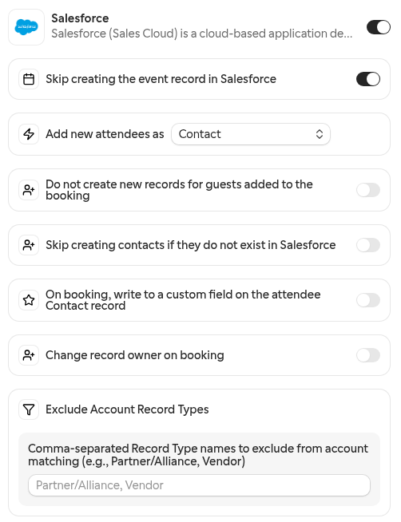
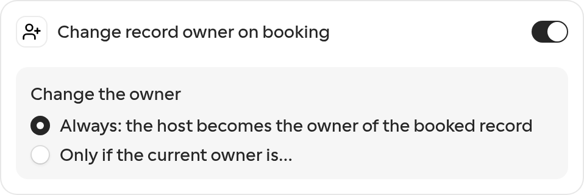
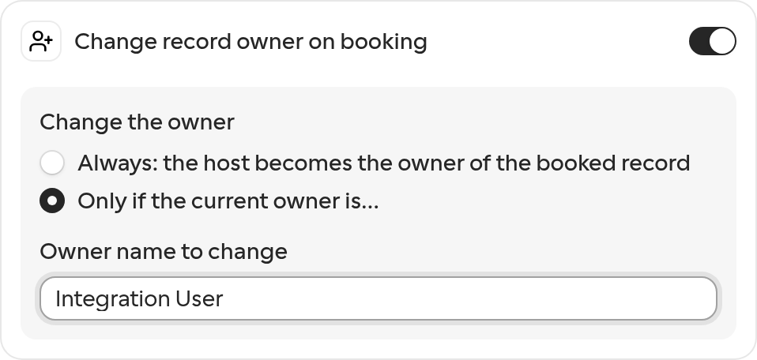
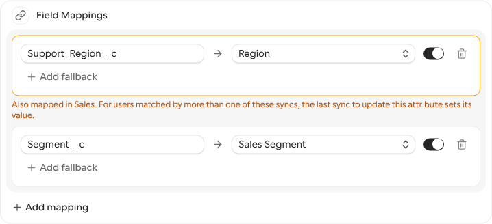
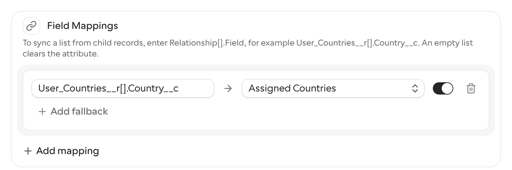
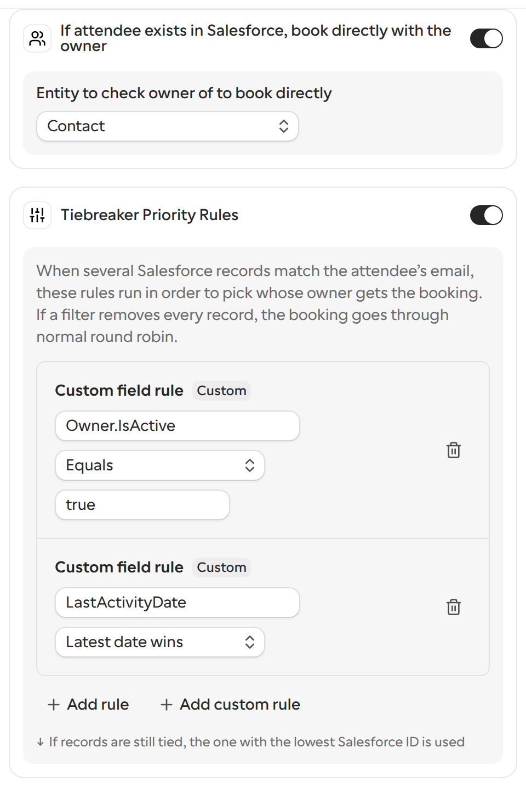

With our Salesforce integration you can sync data between Cal.com and your instance of Salesforce. 

## Basic functionality
- On booking, we create an event record under a lead/contact record
- On reschedule, we adjust the event record's dates
- On cancellation, we delete the event record


## Booking Link Options

Open the booking link's **Apps** tab and find **Salesforce** to manage these settings.

#### Skip creating the event record in Salesforce

Enable **Skip creating the event record in Salesforce** to stop Cal.com from creating a Salesforce Event for each booking of this event type, while still keeping your Contacts and Leads up to date. With this option on, Cal.com still looks up or creates the attendee's Contact or Lead, writes your configured fields to the attendee record, changes the record owner, and creates [fallback records](#create-records-on-lead-or-contact-owner-fallback).

<Frame>
  
</Frame>

The option is off by default. While it is on, the settings that act on the Salesforce Event are hidden, because there is no Event to write to:

- **On booking, write to the event object**
- **On cancelled booking, write to event record instead of deleting event**
- **On cancelled booking, write to a custom field on the attendee record**
- **Send no-show attendee data**

<Note>
  Turning the option off again doesn't create Events for existing bookings. Bookings made while it was on still have no Salesforce Event, even if they are rescheduled later.
</Note>

#### On booking, add events on and new attendees as
Choose which record to create Salesforce events under or if the attendee does not exist in Salesforce as the selected record create a new record of the chosen type. We search for records based on the attendee email.

**Options**
- Contact
- Lead
- Contact under an account

#### Do not create new records for guests added to the booking
If this option is enabled, we will only handle creating events under the main attendee of the event and not additional guests

#### Skip creating contacts if they do not exist in Salesforce
This option is available when [adding events on contacts](#on-booking,-add-events-on-and-new-attendees-as). If the option is enabled, skip creating new contacts if they do not exist in Salesforce already.

#### Create event on contact, if it exists. Else fallback to lead
This option is available when [adding events on leads](#on-booking,-add-events-on-and-new-attendees-as). If this option is enabled, we check if a contact already exists with the attendee's email. If it does, create the event on the contact record. If it does not exist, then we create the event on an existing lead record or create a new lead

#### Create a new contact under an account based on email domain of attendee and existing contacts
This option is available when [adding events on leads or a contact under an account](#on-booking,-add-events-on-and-new-attendees-as). If this option is enabled, we create a new contact under an account if it does not already exist then create an event under that new contact. 

[Determining which account an attendee belongs to](#determining-if-an-attendee-belongs-under-an-account)

#### If the contact does not exist under an account, create new lead from attendee
This option is available when [adding events on contacts under an account](#on-booking,-add-events-on-and-new-attendees-as). If a contact under an account does not exist, then create a new lead record.

#### On booking, write to event object
When a booking is created, you can write to specific fields on the event record. To write to a field you need the following:
- The API field name ex. `Custom_Field__c`
- The value that you want to pass to the field ([Mapping data from Cal.com to Salesforce](#mapping-data-from-cal-com-to-salesforce))

#### On booking, write to a custom field on the attendee record
This option writes to fields on the type of record that is set [to create events on](#on-booking,-add-events-on-and-new-attendees-as). To write to a field you need the following:
- The API field name ex. `Custom_Field__c`
- The field type in Salesforce. We current support the following types:
    - Text (`text`, `textarea` )
    - Date (`date`, `datetime`)
    - Phone
    - Checkbox
    - Picklist
    - Custom (ignores field validations)
- The value that you want to pass to the field ([Mapping data from Cal.com to Salesforce](#mapping-data-from-cal-com-to-salesforce))
    - For checkbox fields, you can choose whether to pass true or false
    - For picklist fields, the value passed needs to match the value of a picklist option
- When to write to the field
    - When the field is empty
    - On every booking, overwriting the previous values

#### Context tokens in field values

Text-based field values in write-to-record and fallback-record configurations can embed context tokens that Cal.com replaces at booking time. Tokens use curly braces and can appear anywhere in the string, including alongside literal text.

| Token | Replaced with |
|---|---|
| `{account_id}` | Salesforce id of the Account resolved for the attendee |
| `{organizer_user_id}` | Cal.com user id of the booking's organizer (host) |
| `{booking_uid}` | Cal.com booking uid |

```text Value examples
Booked via Cal.com — organizer {organizer_user_id}
https://app.cal.com/booking/{booking_uid}
Account: {account_id} / Rep: {organizer_user_id}
```

<Note>
  Values that contain only a brace-only literal (for example, `{}`) are treated as static text. Any other token — including hyphenated identifiers from routing form questions such as `{my-question}` — is resolved at booking time.
</Note>

#### Change record owner on booking
Turn on **Change record owner on booking** to make the assigned host the owner of the attendee's Salesforce Contact or Lead. Under **Change the owner**, choose **Always** or **Only if the current owner is…**. For conditional changes, enter the matching names in **Owner name to change**. If you leave it blank, ownership doesn't change.

Existing links that used name-based owner changes keep that behavior. To assign ownership, the host's Cal.com email must match a Salesforce user's email.

With **Always**, an already-owned record is left untouched. With **Only if the current owner is…**, enter several owner names to match more than one owner. Round-robin bookings assign the record to the host chosen for that booking.

<Frame>
  
</Frame>

<Frame>
  
</Frame>

#### Change account owner on booking

On round-robin event types with **Book directly with attendee owner** on, you can also make the host the owner of the attendee's Account. Which bookings change the Account depends on whose owner Cal.com checks:

- **Contact** — enable **Change the contact’s account owner to host on booking**. A new booking whose Contact already existed in Salesforce and belongs to an Account hands that Account to the host, whether the Contact owner took the meeting or round-robin assigned someone else. Contacts Cal.com creates for the booking, for example under a matched Account with **Create contact under account**, never change their Account's owner.
- **Account** — enable **Change account owner to host on round-robin fallback**. The matched Account changes owner only when its owner couldn't take the booking and round-robin assigned another host.

The Account always goes to the host. This setting doesn't follow **Change record owner on booking** or its owner names. Only a new booking moves the Account: reassigning or rescheduling a booking leaves the Account's owner as it is. Cal.com also leaves the Account untouched when the host already owns it, when the host has no Salesforce user whose email matches their Cal.com email, or when the Account's record type is listed under **Exclude Account Record Types**.

#### If attendee exists in Salesforce, book directly with the owner
This option is available for round robin events. When this option is enabled, you can pass `?email` as a URL param in the round robin booking link, Cal.com searches Salesforce for the record owner. If the record owner is a host of the round robin event, then only that owner's availability is presented and the attendee books directly with the owner.

Options to search ownership against
- Lead
- Contact
- Account — Cal.com uses the full [account resolution waterfall](#determining-if-an-attendee-belongs-under-an-account) to find the matching account. If the initial lookup returns no results, Cal.com automatically falls back to normalized website matching and, when enabled, [fuzzy cross-TLD matching](#cross-tld-fuzzy-domain-matching). This means attendees with regional email domains (for example, `user@acme.co.uk`) can still be matched to the correct account owner even if the account's website is listed as `acme.com`.

When this option is enabled, you can also turn on **Show banner with CRM contact owner** to display a banner at the top of the booking page confirming who the attendee is booking with (for example, "Booking directly with jane@acme.com"). The banner only appears when a matching CRM contact owner is resolved for the attendee; otherwise the booking page renders as usual.

You can also opt into the banner from a routed URL by appending `cal.showCrmOwnerBanner=true` to the booking link, for example when an external system already knows the attendee’s CRM owner.

#### Create records on lead or contact owner fallback

When a round-robin event type is configured to **Book directly with attendee owner**, Cal.com looks up the matched Contact, Lead, or Account owner and routes the booking to that host. If no owner is found, the fallback path runs and standard round-robin assignment takes over. You can also configure Cal.com to **create Salesforce records on this fallback**, so a new Lead, Contact, or custom object is created for the attendee whenever the owner lookup misses.

Use this when you want every booking to leave a paper trail in Salesforce — even when the attendee has no existing owner mapping — without needing your reps to create records manually after the fact.

<Steps>
  <Step title="Open Salesforce settings">
    Navigate to the event type's **Apps** tab and expand the Salesforce section.
  </Step>
  <Step title="Enable the fallback record toggle">
    Turn on **On lead or contact owner fallback, create records in Salesforce**.
  </Step>
  <Step title="Add one or more fallback records">
    For each record you want created, select the Salesforce object (for example, Lead, Contact, or a custom object) and configure the field mappings that populate it. You can add multiple records — for example, create a Lead and a related custom object in a single fallback.
  </Step>
  <Step title="Configure field mappings">
    For each field on the fallback record, specify:

    - **Field name** — The Salesforce API name of the field
    - **Field type** — The data type. In addition to the standard types (text, date, datetime, phone, checkbox, picklist, textarea, custom), fallback records support **Account lookup** for fields that reference the resolved Salesforce Account
    - **Value** — A literal value, a dynamic booking value, or a string with [context tokens](#context-tokens-in-field-values). For **Account lookup** fields, Cal.com writes the id of the Account resolved from the attendee's email domain
  </Step>
  <Step title="Optionally skip when the booking is already with the account owner">
    Enable **Skip if booking with account owner** on any record to suppress creation when the resolved host is already the account owner. This avoids duplicate records for bookings that were routed to the "right" rep to begin with.
  </Step>
  <Step title="Save">
    Save your event type. On future bookings that fall through owner lookup, Cal.com creates each configured record and links Account lookup fields to the matched Account.
  </Step>
</Steps>

<Note>
  If Salesforce returns an error while resolving the Account or its ownership, Cal.com treats the booking as "not owned by the host" and continues creating the fallback records. Salesforce failures never block booking creation.
</Note>

#### If attendee has a free email domain, skip the ownership check and round robin as normal
If this option is enabled, attendees with free email domains (for example, gmail.com, yahoo.com, or outlook.com) skip the Salesforce ownership check entirely and go through normal round robin assignment. This applies to all ownership lookup types, including Account-based lookups.

## Viewing routing traces for Salesforce-routed bookings

When a booking is routed through Salesforce ownership — even without a routing form — Cal.com records a routing trace that shows how the host was selected. You can view the trace from the bookings list (via the actions menu) or from the booking detail page.

This is useful for verifying that Salesforce-based routing resolved to the correct owner and for troubleshooting assignment issues.

### What the routing trace shows

The routing trace includes information about how and why a booking was assigned to a specific host. For CRM-routed bookings, this typically reflects the Salesforce record owner assignment or account resolution logic that determined the host.

### Where to find it

- **Booking list** — Open the actions dropdown on any booking row. If the booking has a routing trace, you see an option to view it.
- **Booking detail page** — A routing trace badge appears on the detail page for bookings that were routed through CRM, even if no routing form was used.

<Note>
  Routing trace is only available for bookings that have trace data recorded by Cal.com. Bookings created without CRM routing or a routing form do not show a trace.
</Note>

For more details on routing traces, see [Routing overview](/routing/routing-overview#5-routing-trace).

#### On cancelled booking, write to event record instead of deleting event
When this option is enabled, instead of deleting the event record we write to specific fields. To write to a field you need the following:
- The API field name ex. `Custom_Field__c`
- The field type in Salesforce. We current support the following types:
    - Text (`text`, `textarea` )
    - Date (`date`, `datetime`)
    - Phone
    - Checkbox
    - Picklist
    - Custom (ignores field validations)
- The value that you want to pass to the field ([Mapping data from Cal.com to Salesforce](#mapping-data-from-cal-com-to-salesforce))
    - For checkbox fields, you can choose whether to pass true or false
    - For picklist fields, the value passed needs to match the value of a picklist option
- When to write to the field
    - When the field is empty
    - On every booking, overwriting the previous values

#### On cancelled booking, write to a custom field on the attendee record
Cal.com identifies the Contact or Lead through the Salesforce event's `WhoId` field. This feature works independently of booking-time field writes.

When this option is enabled, cancelling a booking updates fields on the attendee's contact or lead record in Salesforce. This is useful when you want to track cancellation status directly on the person's record rather than (or in addition to) the event record.

To configure, provide:
- The API field name ex. `Custom_Field__c`
- The field type in Salesforce. We current support the following types:
    - Text (`text`, `textarea` )
    - Date (`date`, `datetime`)
    - Phone
    - Checkbox
    - Picklist
    - Custom (ignores field validations)
- The value that you want to pass to the field ([Mapping data from Cal.com to Salesforce](#mapping-data-from-cal-com-to-salesforce))
    - For checkbox fields, you can choose whether to pass true or false
    - For picklist fields, the value passed needs to match the value of a picklist option
- When to write to the field
    - When the field is empty
    - On every cancellation, overwriting the previous values

<Tip>
  You can use both the "write to event record" and "write to attendee record" options together. For example, you might mark the event as cancelled while also updating a status field on the contact or lead.
</Tip>

#### Enable write-to-record on cancellation

<Steps>
  <Step title="Open event type settings">
    Go to **Event Types**, select the event type you want to configure, and open the **Apps** tab.
  </Step>
  <Step title="Open Salesforce settings">
    Find the Salesforce app card and expand its settings.
  </Step>
  <Step title="Enable the cancellation toggle">
    Turn on **On cancelled booking, write to a custom field on the attendee contact/lead record**.
  </Step>
  <Step title="Configure fields">
    Add one or more field mappings. For each field, specify:

    - **Field name** — The Salesforce API name of the field on the contact or lead object (for example, `Last_Booking_Status__c`)
    - **Field type** — The data type (text, date, datetime, phone, checkbox, picklist, textarea, or custom)
    - **Value** — The value to write when a booking is cancelled. For date fields, you can use dynamic values like `booking_cancel_date` to automatically populate the cancellation date
    - **When to write** — Choose between writing on every cancellation or only when the field is empty
  </Step>
  <Step title="Save">
    Save your event type. The configured fields update on the attendee's Salesforce record whenever a booking of this type is cancelled.
  </Step>
</Steps>

#### Example: tracking cancellation status and date

A sales team wants to track when prospects cancel discovery calls:

1. In Salesforce, add custom fields to the Contact object (e.g., `Last_Booking_Status__c` and `Last_Cancel_Date__c`)
2. In Cal.com, open the "Discovery Call" event type's Salesforce settings
3. Enable **On cancelled booking, write to a custom field on the attendee contact/lead record**
4. Add a first field mapping:
   - Field name: `Last_Booking_Status__c`
   - Field type: Text
   - Value: `Cancelled`
   - When to write: Every cancellation
5. Add a second field mapping:
   - Field name: `Last_Cancel_Date__c`
   - Field type: Date
   - Value: `booking_cancel_date`
   - When to write: Every cancellation

When a prospect cancels, their Salesforce contact record automatically updates with the cancellation status and date.

#### Match accounts by base domain across TLDs (fuzzy matching)
This option is available when adding events on **Account** or **Lead** records. When enabled, Cal.com uses fuzzy domain matching to find the right Salesforce account even when the attendee's email domain uses a different top-level domain (TLD) than the account's website.

For example, if an attendee's email is `user@acme.co.uk` and the Salesforce account has `acme.com` as its website, Cal.com strips the TLD from both and matches them by the base domain (`acme`). This is useful for companies that use country-specific email domains.

Fuzzy matching runs only after exact and normalized website matching have been attempted. Free email domains (e.g. `gmail.com`) are excluded automatically.

To configure the event type setting, open the booking link’s **Apps** tab, expand Salesforce, and enable **Match accounts by base domain across TLDs (e.g. acme.co.uk → acme.com) using Fuzzy Matching**. The toggle appears for **Contact under Account** and **Lead** attendee record types.

#### Send no show attendee data to event object
When this option is enabled, we set the specific checkbox field to true when an attendee is marked as no-show in Cal.com

## Organization attribute sync

Organization admins can sync Salesforce user fields to Cal.com organization attributes from the **Attribute Sync** settings page. Each sync maps one or more Salesforce field names to an attribute.

An attribute can be mapped in more than one sync — for example, a "Sales" sync and a "Support" sync can both write the Region attribute. When you add a mapping to an attribute that another sync already maps with an enabled mapping, the editor shows a warning naming those syncs. The warning doesn't block saving.

<Frame>
  
</Frame>

For a user matched by several syncs that map the same attribute, the last sync to update the attribute sets its value. If a sync skips the mapping for that user — for example, because every Salesforce field in the mapping is blank — the value stays as it was.

<Note>
  Within a single sync, each attribute can only be mapped once. If two mappings in the same sync point to the same attribute, both show an error and the sync can't be saved, even if one of the mappings is disabled.
</Note>

### Map a list from child records

A mapping can read a list from a Salesforce User child relationship instead of a single field. Enter the integration field as `Relationship[].Field` — the child relationship name, `[].`, then the field to read from every child record. For example, `User_Countries__r[].Country__c` reads `Country__c` from each of the user's `User_Countries__r` records. The help text under **Field Mappings** shows the same syntax.

<Frame>
  
</Frame>

Cal.com turns the list into attribute values:

- Each entry is trimmed, and blank and duplicate entries are dropped. The remaining entries are matched to the attribute's options like any multi-select value, so each matching option is assigned once and an entry that matches no option is skipped.
- An empty list — for example, after the user's last child record is deleted — clears the attribute.
- If the list isn't sent or can't be read at all, the mapping is skipped and the attribute keeps its value.

Only one relationship followed by one field is supported. Names that put `[]` anywhere else, such as `Manager.User_Countries__r[].Country__c` or `User_Countries__r[].Country__r.Name`, are ignored. Enter the relationship and field names exactly as their Salesforce API names, including case — a name in a different case finds no list, so the mapping is skipped rather than cleared.

Current versions of the Cal.com Salesforce package send these lists to Cal.com whenever a user is saved in Salesforce and when you click **Push to Cal.com** on the user's record page. The package reads every child record of the user, including records on a private child object that the person saving or pushing can't see. Empty child values are left out, dates are sent as `2026-01-02`, date-times as `2026-01-02T03:04:05.000Z` (UTC), and checkboxes as `true` or `false`. A user with no child records gets an empty list, so **Push to Cal.com** also works for a user whose only mappings are child lists. A relationship or field name that Salesforce doesn't recognize, including one in the wrong case, is skipped, and the user's other mapped fields still sync.

<Note>
  Adding, editing, or deleting child records doesn't start a sync on its own. The [hourly check](#hourly-check-for-changed-values) sends the updated list within about an hour, or sooner if the user is saved in Salesforce or pushed with **Push to Cal.com**.
</Note>

<Note>
  Map lists to multi-select attributes. A single-select attribute only uses the first entry, in the order Salesforce returns the records. Entries are split on commas, so a value such as `Korea, Republic of` becomes two entries — store ISO codes or values without commas in the child field.
</Note>

<Note>
  If the user update from Salesforce doesn't include the mapped field values, Cal.com queries Salesforce for them. In that case, it reads at most five pages of child records per relationship. If a user has more child records than that, or a page fails to load, every mapping on that relationship is skipped for that user rather than syncing a partial list.
</Note>

### Hourly check for changed values

Saving a user in Salesforce only catches changes to the User record itself. Current versions of the Cal.com Salesforce package also run an hourly check that catches the rest. Every hour, the package reads the mapped values of every active Standard Salesforce user and sends only the users whose values changed since the last sync Cal.com applied. This picks up changes that happen without a User save, such as:

- Child records that are added, edited, or deleted
- Formula fields, and fields on related records such as `Manager.Department`
- Fields that are cleared to empty
- Earlier syncs that failed to reach Cal.com

Every mapped User field is sent, including empty ones, so a field cleared in Salesforce clears the Cal.com attribute it maps to. This also means **Push to Cal.com** works for a user whose mapped fields are all empty.

The hourly check is off until a Salesforce admin turns it on:

1. In Salesforce Setup, open **Custom Settings**, then **Manage** next to **Cal.com Settings**.
2. Under **Default Organization Level Value**, click **New** (or **Edit**), tick **Turn on hourly check**, and save.

The check starts the next time a user is saved or pushed in Salesforce, or when you next save the attribute sync in Cal.com. It stops when no Salesforce fields are mapped any more — for example, after you remove the sync. To turn it off, untick the box; the check stops at its next hourly run.

<Note>
  Each run sends at most 500 users. Users left over are sent by later runs. The first run after the check starts sends every active Standard user once, so in a large org it can take several hours before the check only sends changes.
</Note>

<Note>
  The hourly check only covers Standard users. Other user types, such as Chatter, Experience Cloud, and portal users, still sync when they are saved in Salesforce or pushed with **Push to Cal.com**.
</Note>

## Record type filtering

Salesforce objects can have multiple record types — for example, your contacts may include both "Business Contact" and "Person Account" types. You can exclude specific record types so that Cal.com only looks up or creates records of the types you want.

<Steps>
  <Step title="Open Salesforce settings">
    Navigate to the booking link's **Apps** tab and expand the Salesforce section.
  </Step>
  <Step title="Find the record type exclusion setting">
    Below the attendee record type selector, look for the **Exclude Record Types** setting.
  </Step>
  <Step title="Select record types to exclude">
    Cal.com fetches the available record types from your Salesforce org. Select any record types you want to skip during contact or lead lookups. Records matching excluded types are filtered out of results.
  </Step>
  <Step title="Save">
    Save your booking link. Future bookings only match records whose record type is not in the exclusion list.
  </Step>
</Steps>

<Note>
  Record type matching is case-insensitive. This setting applies to both lookups and record creation — Cal.com does not create records with an excluded record type.
</Note>

## Field mapping validation

Cal.com validates your Salesforce field mappings when you save booking link settings. Checkbox values must be booleans, date fields must use supported dynamic values, and text fields cannot be empty. If a field mapping has a type mismatch — for example, a non-boolean value mapped to a checkbox field, or an empty value for a required text field — Cal.com displays an inline error and prevents the save.

| Field type | Validation rule |
|---|---|
| Checkbox | Value must be a boolean (`true` or `false`) |
| Date | Must reference a valid dynamic date value (e.g., `booking_start_date`, `booking_created_date`, or `booking_cancel_date`) |
| Text, phone, picklist, textarea | Value must be a non-empty string |
| Custom | No automatic validation — values are passed through as-is |

## Sync error notifications

When a Salesforce sync fails at booking time — for example, due to a permission error or an invalid field — Cal.com stores the error and displays a diagnostic notification on the Salesforce settings tab. The notification includes:

- The error code and message
- Which fields were dropped from the sync
- A timestamp of when the error occurred

This helps you identify and fix integration issues without needing to check Salesforce logs directly.

## Cross-TLD fuzzy domain matching

When using the **Contact under Account** attendee record type, Cal.com resolves the attendee's Salesforce account by matching their email domain against account `Website` fields. By default, this lookup requires an exact domain match — `acme.com` only matches accounts whose website is on `acme.com`.

With **cross-TLD fuzzy domain matching** enabled, Cal.com also matches across different top-level domains. An attendee with an `@acme.co.uk` email can be matched to a Salesforce account whose website is `acme.com`, `acme.de`, or any other TLD variant sharing the same base domain.

Fuzzy domain matching is a per-credential toggle — enable it in your Salesforce connection settings, and it applies to all booking links using that credential.

### How account resolution works

Cal.com resolves the attendee's Salesforce account using a multi-step waterfall:

1. **Exact match** — Look for an account whose `Website` exactly matches the attendee's email domain (for example, `acme.com`)
2. **Normalized match** — Strip URL prefixes like `www.`, `http://`, and trailing paths, then retry the exact match
3. **Contact email match** — Search for existing contacts whose email domain matches, and use their linked account
4. **Fuzzy cross-TLD match** — Extract the base domain (for example, `acme` from `acme.co.uk`) and match it against all account websites regardless of TLD

Cal.com uses the first match found. If multiple accounts match at any step, the [tiebreaker waterfall](#tiebreaker-waterfall) runs to select the best candidate. If no account is resolved at any step, the integration falls back to the behavior configured in your booking link settings.

This same resolution waterfall also runs for [Account-based round robin ownership lookups](#if-attendee-exists-in-salesforce,-book-directly-with-the-owner). If the initial Account lookup returns no results, Cal.com falls back through normalized and fuzzy matching to find the correct account owner.

<Note>
  Fuzzy matching applies to the **Contact under Account** attendee record type and to **Account-based round robin ownership lookups**. It does not affect contact-only or lead-only lookups.
</Note>

### When to use fuzzy matching

Fuzzy domain matching is useful when:

- Your Salesforce accounts have websites on a single TLD (for example, `acme.com`) but attendees book from regional email domains (for example, `@acme.co.uk`, `@acme.de`)
- You want to automatically link international attendees to the correct parent account without creating duplicate records
- Your organization operates across multiple country domains under the same brand

### Tiebreaker waterfall

When multiple Salesforce accounts match a domain during account resolution, Cal.com runs a tiebreaker waterfall to select the best candidate. This is especially relevant for round robin booking links where the resolved account owner determines which host receives the booking.

You can customize which tiebreaker rules are active and the order in which they run. By default, all nine rules are enabled in the order shown below. The first criterion that produces a single winner ends the waterfall:

| Default priority | Rule | Category | Description |
|---|---|---|---|
| 1 | Sub-region match | Geo | Account whose custom sub-region field matches the booker's sub-region (geo tiebreaker only) |
| 2 | Country + state + zip match | Geo | Account whose billing address matches the booker's country, state, and postal code (geo tiebreaker only) |
| 3 | Country + state match | Geo | Account whose billing country and state match the booker's (geo tiebreaker only) |
| 4 | Country match | Geo | Account whose billing country matches the booker's (geo tiebreaker only) |
| 5 | Most child accounts | Size | Account with the highest number of child accounts in its hierarchy |
| 6 | Most opportunities | Size | Account with the highest number of related opportunities |
| 7 | Most contacts | Size | Account with the most related contact records |
| 8 | Most recent activity | Recency | Account with the most recent `LastActivityDate` |
| 9 | Oldest account | Age | Account with the oldest `CreatedDate` (longest-standing relationship) |

Geo rules (1–4) only apply when a booking comes through a routing form that collects the booker's location. They are skipped for direct bookings. If geo tiebreaker is not configured, those rules are skipped. If all active criteria result in a tie, Cal.com falls back to round robin assignment.

#### Configuring tiebreaker rules

You can enable, disable, reorder, add, and remove tiebreaker rules from your booking link's Salesforce settings. **Tiebreaker Priority Rules** appears only while **If attendee exists in Salesforce, book directly with the owner** is enabled. Account owner checks use the rules below; Contact and Lead owner checks have their own [custom rules](#contact-and-lead-tiebreaker-rules).

<Steps>
  <Step title="Open Salesforce settings">
    Navigate to the booking link's **Apps** tab and expand the Salesforce section.
  </Step>
  <Step title="Find the tiebreaker priority rules section">
    Scroll to **Tiebreaker Priority Rules**. Use the toggle to enable or disable the entire tiebreaker waterfall.
  </Step>
  <Step title="Reorder rules">
    Hover over a rule and use the arrow buttons to move it up or down. Rules at the top are evaluated first.
  </Step>
  <Step title="Remove a rule">
    Click the trash icon on any rule you do not need. Removing a rule means it is skipped during account resolution.
  </Step>
  <Step title="Add a rule">
    Click **Add rule** below the list to add a rule that was previously removed. Select the rule from the dropdown — each rule shows a description and category to help you decide.
  </Step>
  <Step title="Save">
    Save your booking link. The updated rule order and selection apply to new bookings immediately.
  </Step>
</Steps>

<Tip>
  If no tiebreaker rules resolve the tie, Cal.com falls back to standard round robin assignment. You can see which rule decided a booking in the [routing trace](/routing/routing-overview#5-routing-trace).
</Tip>

#### Host filtering

For round robin booking links, candidates are filtered before the tiebreaker runs. Only account owners who are hosts on the booking link are eligible. Host filtering also applies when a GraphQL lookup falls back to SOQL. If this filter removes all candidates, Cal.com falls back to standard round robin assignment.

#### Contact and Lead tiebreaker rules

When a round-robin event type checks the owner of a **Contact** or **Lead**, several records can share the attendee's email. By default, Cal.com uses the first record Salesforce returns. Turn on **Tiebreaker Priority Rules** to choose the record, and so the owner who gets the booking, with your own rules instead.

Contact and Lead owner checks have their own rule list, separate from the Account rules above. When you turn the setting on, the list starts with two built-in rules: **Most recent activity** (latest `LastActivityDate`) and **Oldest account** (earliest `CreatedDate`). Click **Add custom rule** to add a rule on any Salesforce field.

<Frame>
  
</Frame>

For each custom rule, set:

- **Salesforce field** — The API name of a field on the Contact or Lead, for example `LastActivityDate`, or one relationship and a field, for example `Owner.IsActive`. Deeper paths aren't supported.
- **Condition** — How the rule treats the records still in the running:

| Condition | Type | What it does |
|---|---|---|
| **Has a value** | Filter | Keeps records where the field isn't empty |
| **Equals** | Filter | Keeps records where the field matches **Value** (case-insensitive) |
| **Doesn’t equal** | Filter | Keeps records where the field doesn't match **Value**, including records where it's empty |
| **Latest date wins** | Ranking | Keeps the records with the latest date |
| **Earliest date wins** | Ranking | Keeps the records with the earliest date |
| **Highest number wins** | Ranking | Keeps the records with the highest number |
| **Lowest number wins** | Ranking | Keeps the records with the lowest number |

**Value** is only needed for **Equals** and **Doesn’t equal**. A ranking rule ignores records with no value in the field, unless no record has one, in which case the rule keeps them all.

Rules run from top to bottom; reorder them with the arrow buttons. Each rule narrows the records left by the rules above it. Every filter rule always runs, even if only one record is left, so that record must still pass it. If records are still tied after the last rule, Cal.com picks the one with the lowest Salesforce ID.

For example, to send bookings to the active owner with the most recent activity, add `Owner.IsActive` **Equals** `true`, then `LastActivityDate` **Latest date wins**, and remove the built-in rules.

<Note>
  If a filter rule removes every record, Cal.com doesn't book directly with an owner and the booking goes through normal round robin. A custom rule that names a field your Salesforce org doesn't have is skipped and noted in the [routing trace](#viewing-routing-traces-for-salesforce-routed-bookings). Custom rules aren't available for the Account owner check.
</Note>

### Geo tiebreaker

The geo tiebreaker lets Cal.com prefer the Salesforce account that is geographically closest to the booker when multiple accounts match. It compares the booker's location against each candidate account's billing address fields (`BillingCountry`, `BillingState`, `BillingPostalCode`) and an optional custom sub-region field. The closest geographic match wins before any size or recency-based tiebreakers run.

Geo tiebreakers only apply when a booking comes through a routing form — they are skipped for direct bookings.

#### Convention-based field identifiers

The simplest way to enable geo tiebreakers is to add fields to your routing form using the standard identifiers below. Cal.com detects these automatically with no per-route configuration required.

| Field identifier | Description | Matches against | IP fallback |
|---|---|---|---|
| `country` | The booker's country (ISO code or name) | Account `BillingCountry` | Yes |
| `state` | The booker's state or region | Account `BillingState` | Yes |
| `zip` | The booker's ZIP or postal code | Account `BillingPostalCode` | No |
| `sub_region` | A custom sub-region value | A custom field on the Account object | No |

Use the exact identifier shown (lowercase, snake_case). The field label displayed to the booker can be anything you want.

When a `country` or `state` form field is missing or left blank, Cal.com automatically falls back to the booker's IP geolocation to determine their country and state. ZIP and sub-region do not have an IP fallback.

<Tip>
  When any geo tiebreaker rule is active, a **"How do geo tiebreakers read booker location?"** link appears in the tiebreaker rules section. Click it to see the field identifiers and which rules use each field.
</Tip>

### Route to custom lookup field

When routing form routes are set to **Route to custom lookup field**, Cal.com resolves the host by reading a **user lookup field** on the attendee's Salesforce account, instead of using the account's owner. This is useful when you assign bookings to a rep tracked outside of `Account.OwnerId` — for example a `Region_Manager__c` field, or a manager on a related record like a parent account or region.

Enter the field's API name in **Lookup field name**. Two syntaxes are supported:

- **Flat field on the Account** — the API name of a user lookup field defined directly on the Account object, for example `Region_Manager__c`.
- **Dot-notation to a connected object** — a path that hops through a relationship on the Account and ends at a user lookup field on the connected object, for example `Region__r.Owner__c` or `Parent.Owner__c`.

In a dot-notation path, each intermediate segment is a **relationship name** (custom relationships end in `__r`; standard relationships such as `Parent` or `Owner` are also allowed), and the final segment is the API name of the user lookup field to read on that related object. Only letters, numbers, and underscores are allowed in each segment. Cal.com validates the syntax as you type and shows an inline error if the name is malformed.

<Note>
  Cal.com follows the first target of a polymorphic lookup. If the resolved value is not a valid user ID — for example the field is empty or the traversal hits a missing record — routing falls back to standard round robin assignment for the event.
</Note>

#### Lookup field example

Use this option when the correct host is stored as a user reference on the booker's Salesforce Account (or on a related object), rather than as the Account owner. Cal.com resolves the Account for the booker, reads the configured user lookup field, and routes to the matching Cal.com user.

Enter the Salesforce API name of the user lookup field in **Lookup field name**. Two formats are supported:

- A field directly on the Account, for example `Owner_Lookup__c`
- A dot-notation path that traverses a relationship on the Account to reach a user lookup field on a connected object, for example `Region__r.Owner__c`

Dot-notation lets you point at a user field that lives on another object linked to the Account — for example a regional territory record with its own owner — without duplicating that field onto the Account itself. Salesforce resolves the relationship server-side, so any depth supported by SOQL relationship queries works.

```text Lookup field name examples
Owner_Lookup__c
Region__r.Owner__c
Territory__r.Regional_Manager__c
```

<Note>
  The lookup field name must contain only letters, numbers, and underscores, with dots separating segments for connected objects. Invalid names are flagged inline in the routing form builder. At routing time, an unrecognized field or relationship causes Cal.com to fall through to the form's fallback route.
</Note>

#### Configuring geo tiebreaker per route

You can also configure the geo tiebreaker on individual routes within a routing form. This is available when the Salesforce routing option is set to **Route to custom lookup field** and gives you control over the field mapping on a per-route basis.

<Steps>
  <Step title="Open the routing form">
    Navigate to **Routing Forms** and select the form you want to configure.
  </Step>
  <Step title="Select a route">
    Choose the route where you want to enable geographic tiebreaking. The route must use the **Route to custom lookup field** Salesforce option.
  </Step>
  <Step title="Enable geo tiebreaker">
    Toggle **Geo tiebreaker** on. A configuration panel appears with the following fields.
  </Step>
  <Step title="Map booker location fields">
    Enter the routing form field identifiers that capture the booker's location. These are the identifiers of fields on your routing form, not Salesforce field names.

    | Setting | Description | Example value |
    |---|---|---|
    | Booker country field identifier | The form field that captures the booker's country | `country` |
    | Booker state field identifier | The form field that captures the booker's state or region | `state` |
    | Booker zip/postal code field identifier | The form field that captures the booker's postal code | `zip` |
    | Booker sub-region field identifier | (Optional) A form field for a custom sub-region value | `sub_region` |
  </Step>
  <Step title="Map the Salesforce sub-region field (optional)">
    If you use a custom sub-region field on the Account object in Salesforce, enter its API name in the **Salesforce sub-region field API name** setting (for example, `Sub_Region_DV__c`). This enables priority 1 matching in the tiebreaker waterfall.
  </Step>
  <Step title="Enable IP geolocation fallback (optional)">
    Toggle **Use IP geolocation as fallback** if you want Cal.com to use the booker's IP address to determine their country and state when the routing form fields are empty. This uses standard geolocation headers from the hosting provider.
  </Step>
  <Step title="Save the routing form">
    Save your changes. The geo tiebreaker takes effect for new bookings routed through this form.
  </Step>
</Steps>

#### How geo matching works

When the geo tiebreaker is enabled, Cal.com compares the booker's location against each candidate account's Salesforce billing address in this order:

1. **Sub-region** — If configured, check whether the account's custom sub-region field matches the booker's sub-region value. This is useful for organizations that segment territories by custom regions.
2. **Country + state + zip** — Match the account's `BillingCountry`, `BillingState`, and `BillingPostalCode` against the booker's location.
3. **Country + state** — Match on country and state only, ignoring postal code.
4. **Country** — Match on country only.

The first level that narrows candidates to a single account wins. If multiple accounts still tie after all geographic checks, the waterfall continues with size and recency-based criteria (child accounts, opportunities, contacts, recent activity, and creation date).

<Note>
  The geo tiebreaker only applies when bookings come through a routing form. It does not apply to direct bookings or booking link-level Salesforce settings. Per-route configuration is only available when the route uses the **Route to custom lookup field** Salesforce option.
</Note>

## Field mapping validation

Cal.com validates your Salesforce field mappings at two points to help you catch configuration issues early.

### Inline validation

When you add or edit a field mapping entry, Cal.com checks that the value you provide is compatible with the selected field type:

- **Checkbox** fields require a boolean value (True or False). Entering text triggers an error.
- **Date** fields require a valid date reference (such as Booking Start Date or Booking Created Date).
- **Text**, **Phone**, **Picklist**, and **Custom** fields require a non-empty text value.

If a value is invalid, an error message appears directly below the field mapping row so you can correct it before saving.

### Save-time validation

When you save your booking link settings, Cal.com connects to your Salesforce org and validates each field mapping against the actual Salesforce schema. The following checks run automatically:

- **Field existence** — the API field name must exist on the Salesforce object.
- **Writability** — the field must not be read-only.
- **Type compatibility** — if you configured a field as Checkbox, the Salesforce field must be a boolean (and vice versa).
- **Picklist values** — for Picklist fields, the value you entered must match one of the active picklist options in Salesforce.
- **Field name casing** — the field name must match the exact casing used in Salesforce (for example, `Custom_Field__c` instead of `custom_field__c`).

If any check fails, the save is blocked and you see an error message describing which field has the problem and what needs to be fixed.

<Tip>
  If your Salesforce connection is inactive or unreachable, save-time validation is skipped so that you can still save other booking link settings. Reconnect Salesforce to re-enable validation.
</Tip>

### Sync error notifications

If a booking triggers a write to Salesforce and it fails at runtime, Cal.com stores the error details and displays a diagnostic notification banner at the top of the Salesforce settings tab for that booking link. The banner includes:

- **Error code** — the Salesforce error code (for example, `FIELD_CUSTOM_VALIDATION_EXCEPTION`).
- **Error message** — a description of what went wrong.
- **Dropped fields** — if custom fields caused the failure, the fields that were removed from the write so the booking could still be created.
- **Timestamp** — when the error occurred.

You can dismiss the banner after reviewing the error. To prevent the error from recurring, update your field mappings using the guidance in the error message.

## Appendix

#### Determining if an attendee belongs under an account

Cal.com resolves the attendee's Salesforce Account using a multi-step waterfall:

1. **Exact website match** — Check Account `Website` fields for an exact domain match against the attendee's email domain
2. **Normalized website match** — Strip protocols, paths, ports, and trailing slashes from Account `Website` values before comparing. This means accounts with website values like `https://www.acme.com/about/` or `HTTP://ACME.COM:443/en/` still match an attendee with an `@acme.com` email.
3. **Contact email match** — Search for existing contacts whose email domain matches, and use their linked Account
4. **Fuzzy cross-TLD match** — Extract the base domain (for example, `acme` from `acme.co.uk`) and match it against all Account websites regardless of TLD

Cal.com uses the first match found. If multiple Accounts match at any step, the [tiebreaker waterfall](#tiebreaker-waterfall) runs to select the best candidate. If no Account is resolved at any step, the integration falls back to the behavior configured in your booking link settings.

#### Tiebreaker waterfall

When multiple Salesforce Accounts match a domain during account resolution, Cal.com runs a configurable tiebreaker waterfall to select the best candidate. This is especially relevant for round-robin booking links where the resolved Account owner determines which host receives the booking.

You can customize which rules are active and their priority order in your booking link's Salesforce settings under **Tiebreaker Priority Rules**. See [Configuring tiebreaker rules](#configuring-tiebreaker-rules) for step-by-step instructions.

By default, all nine rules are enabled. The first criterion that produces a single winner ends the waterfall:

| Default priority | Rule | Category | Description |
|---|---|---|---|
| 1 | Sub-region match | Geo | Account whose custom sub-region field matches the booker's sub-region (geo tiebreaker only) |
| 2 | Country + state + zip match | Geo | Account whose billing address matches the booker's country, state, and postal code (geo tiebreaker only) |
| 3 | Country + state match | Geo | Account whose billing country and state match the booker's (geo tiebreaker only) |
| 4 | Country match | Geo | Account whose billing country matches the booker's (geo tiebreaker only) |
| 5 | Most child accounts | Size | Account with the highest number of child Accounts in its hierarchy |
| 6 | Most opportunities | Size | Account with the highest number of related Opportunities |
| 7 | Most contacts | Size | Account with the most related Contact records |
| 8 | Most recent activity | Recency | Account with the most recent `LastActivityDate` |
| 9 | Oldest account | Age | Account with the oldest `CreatedDate` (longest-standing relationship) |

Geo rules (1–4) only apply when a booking comes through a routing form that collects the booker's location. They are skipped for direct bookings. If geo tiebreaker is not configured, those rules are skipped. If all active criteria result in a tie, Cal.com falls back to round-robin assignment.

For round-robin booking links, candidates are filtered before the tiebreaker runs. Only Account owners who are hosts on the booking link are eligible. If this filter removes all candidates, Cal.com falls back to standard round-robin assignment.

#### Record type filtering

You can exclude specific Salesforce record types from account resolution. When record type filtering is enabled, Accounts with excluded record types are skipped during the resolution waterfall. This prevents Cal.com from matching against Accounts that are not relevant to booking routing, such as partner or vendor accounts.

Configure record type filtering in the Salesforce section of your booking link's **Apps** tab.

#### When to use fuzzy matching

Fuzzy domain matching is useful when:

- Your Salesforce org has accounts with different TLDs (for example, `acme.com` and `acme.co.uk`)
- Attendees book from regional email domains that differ from the main account website
- You want Cal.com to match attendees to the correct account without manually maintaining every domain variant

<Note>
  Fuzzy matching applies to the **Contact under Account** attendee record type and to **Account-based round robin ownership lookups**. It does not affect Contact-only or Lead-only lookups.
</Note>

#### Field mapping validation

Cal.com validates your Salesforce field mappings when you save booking link settings. If a field mapping has a type mismatch — for example, a non-boolean value mapped to a checkbox field, or an empty value for a required text field — Cal.com displays an inline error and prevents the save.

If a sync error occurs at runtime (for example, a field was deleted in Salesforce after configuration), Cal.com stores the error and displays a diagnostic notification on the Salesforce settings tab. The notification includes the error code, message, any dropped fields, and a timestamp to help you troubleshoot.

| Field type | Validation rule |
|---|---|
| Checkbox | Value must be a boolean (`true` or `false`) |
| Date | Must reference a valid dynamic date value (e.g., `booking_start_date`) |
| Text, phone, picklist, textarea | Value must be a non-empty string |
| Custom | No automatic validation — values are passed through as-is |

#### Mapping data from Cal.com to Salesforce
When writing to fields in Salesforce, you can pass data from different sources in Cal.com
- To pass a static value, input the value in the `Value` field
- To pass a value from a booking question, wrap the identifier of the booking question in `{}` brackets. For example, if you have a booking question with the identifier `productInterest` you would input `{productInterest}` in the `Value` field
- To pass a value from a routing form, wrap the identifier of the field of you want to pass in `{}` and add the `form:` prefix. For example, if the field identifier is `productInterest` you would input `{form:productInterest}` in the `Value` field
- To pass a `utm_parameter`, pass the parameter name as `{utm:parameter}` in the value field. We currently support the following:
    - `utm_source` as `{utm:source}`
    - `utm_medium` as `{utm:medium}`
    - `utm_campaign` as `{utm:campaign}`
    - `utm_term` as `{utm:term}`
    - `utm_content` as `{utm:content}`
