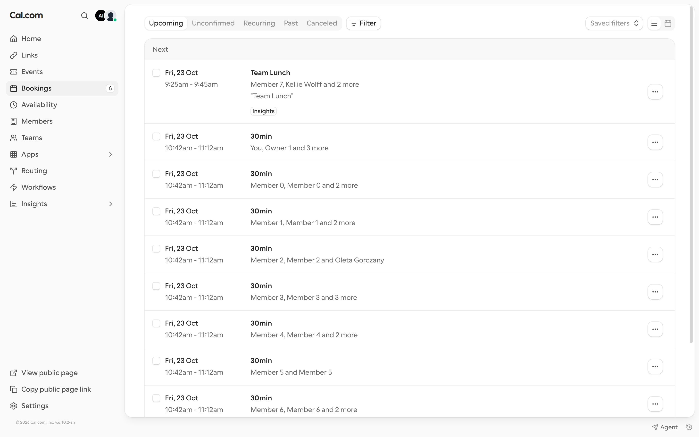
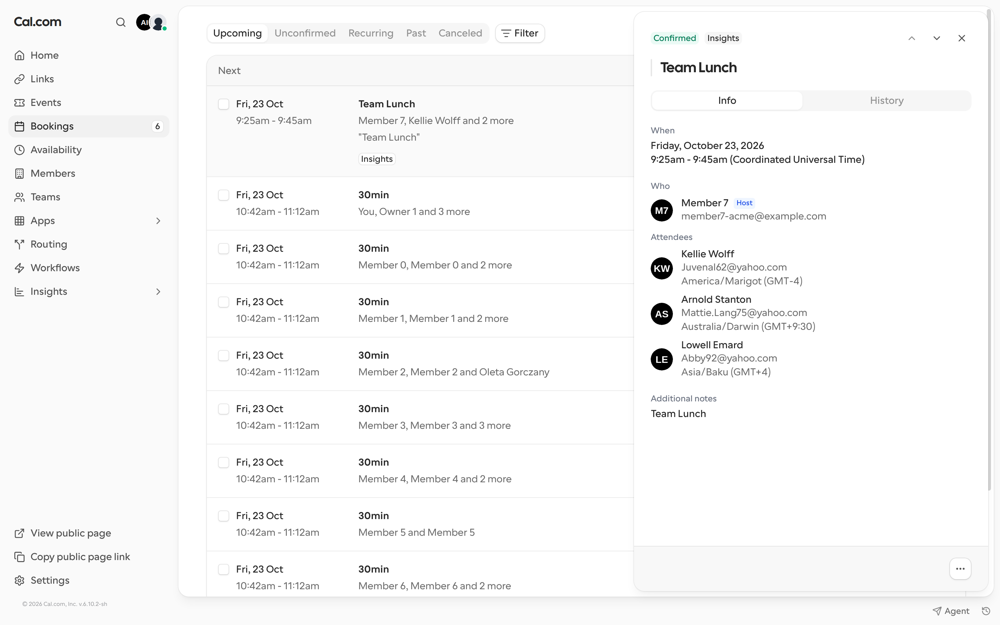
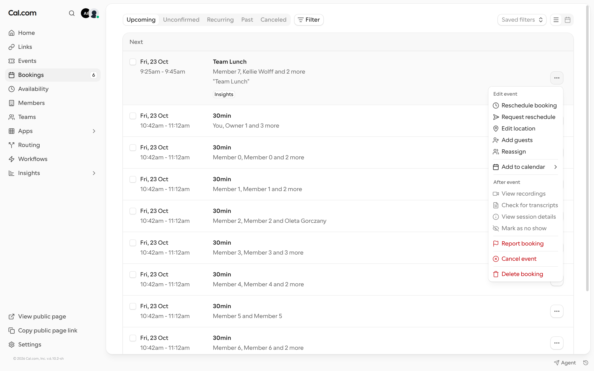

Every booking you host or are invited to is listed on **Bookings**. Use the tabs at the top to switch between **Upcoming**, **Unconfirmed**, **Recurring**, **Past** and **Canceled** bookings.

<Frame>
  
</Frame>

## See a booking's details

Click a booking to open its details panel. **Info** shows the time, host, attendees, and any notes the booker added. An attendee's time zone appears next to their name when available. Hover over it to see their current local time. **History** shows what's happened to the booking so far.

<Frame>
  
</Frame>

## Booking options

Click the **...** button on a booking or at the bottom of its details panel to see what you can do with it. On desktop, you can also right-click a row in the bookings list. Options that don't apply to that booking are greyed out.

<Frame>
  
</Frame>

### Edit event

- **Reschedule booking**: pick a new time for the booking yourself.
- **Request reschedule**: cancels the booking and emails the booker to pick a new time. You can add a reason. It isn't available for seated events.
- **Edit location**: change where the meeting happens, for example to a different video app or address.
- **Add guests** and **Remove guests**: add people to the booking, or take guests off it. Removed guests are notified and taken off the calendar invite.
- **Remove seats**: on seated events, remove attendees from their seats.
- **Reassign**: on round robin and managed events, move the booking to another host. See [Round robin](/event-types/round-robin).
- **Reroute**: for bookings that came through a routing form, change the form responses to route the booking to different team members. You can preview the result before you reroute.
- **Add to calendar**: add the booking to Google, Outlook or another calendar.

You can't edit past, canceled or rejected bookings. A booking can't be rescheduled when the event doesn't allow it, for example when [rescheduling is turned off](/event-types/disable-canceling-rescheduling). The event's minimum reschedule notice applies to everyone except the organizer.

### After event

These options become available after the meeting has taken place.

- **View recordings**, **Check for transcripts** and **View session details**: for confirmed Cal Video meetings.
- **Mark as no show**: record that an attendee or host didn't attend. See [No-show](/bookings/no-show).
- **Collect no-show fee**: charge the card saved at booking, for paid events that hold a no-show fee. See [Paid bookings](/bookings/paid-bookings).

### Report, cancel or delete

- **Report booking**: flag a booking as spam or unwanted.
- **Cancel event**: cancel the booking and notify everyone on it. You can add a reason. On the **Recurring** tab, this becomes **Cancel all remaining**.
- **Delete booking**: permanently removes the booking **without notifying attendees**. This can't be undone. To let guests know, cancel the booking or request a reschedule first. Only people allowed to edit the booking can delete it.

## Reschedule from the calendar

In **Bookings**, switch to calendar view and choose **Day** or **Week**. Drag an eligible booking to its new time, review the old and new times, optionally add a reason, then select **Reschedule**. Guests are notified when the change is saved. Select **Cancel** to leave the booking at its original time.

You can't drag bookings in **Month** view, bookings waiting for confirmation, seated bookings, or occurrences in a recurring series. If you can't drag a booking, check whether **Reschedule booking** is available in its options menu.

## Confirm or reject a booking

Bookings for events that need your approval wait on the **Unconfirmed** tab, and also appear on [Home](/quick-start/home-cal-agent). Click **Confirm** to accept the booking, or **Reject** to decline it. When you reject a booking, you can add a reason, and the booker is told. For recurring bookings, use **Confirm all** or **Reject all**.

To change whether an event needs approval, see [Requires confirmation](/event-types/how-to-requires).

## Manage many bookings at once

Select bookings with the checkboxes to act on several at once. See [Bulk actions](/bookings/bulk-actions).
