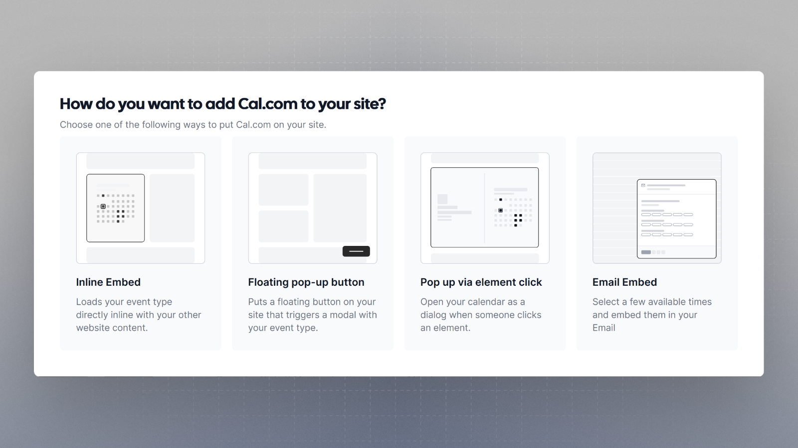
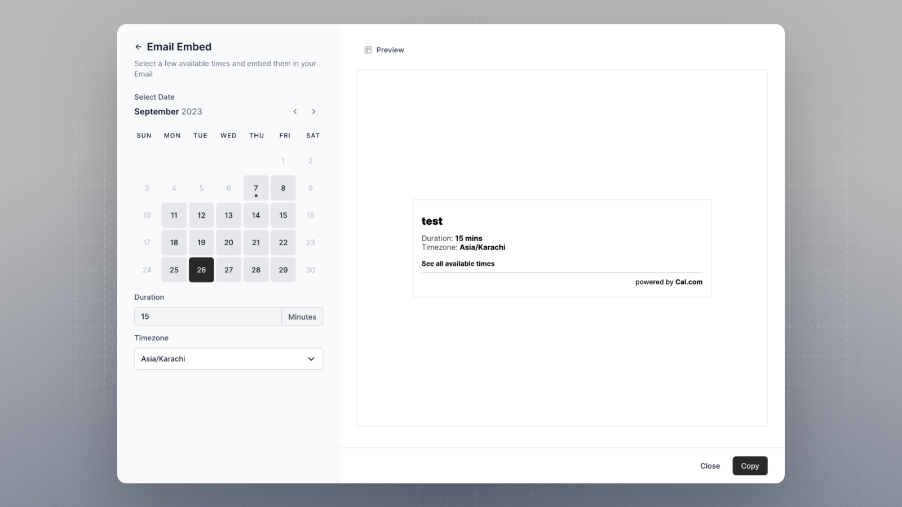

You can add the slots to your email as well using `Email Embed`. When composing an email, this method of embedding streamlines the process, allowing you to effortlessly share available time slots with recipients.

This ensures seamless scheduling and improved communication efficiency.

