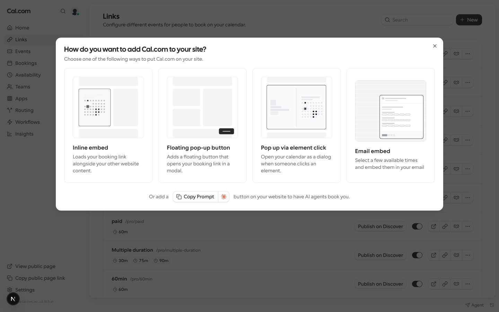
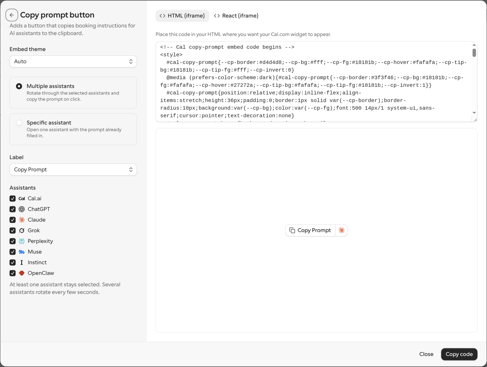
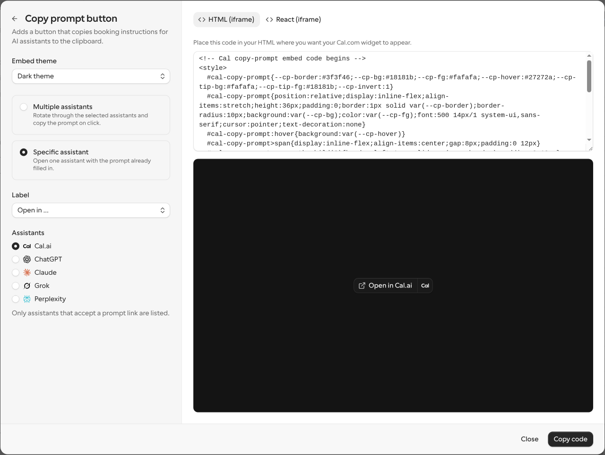
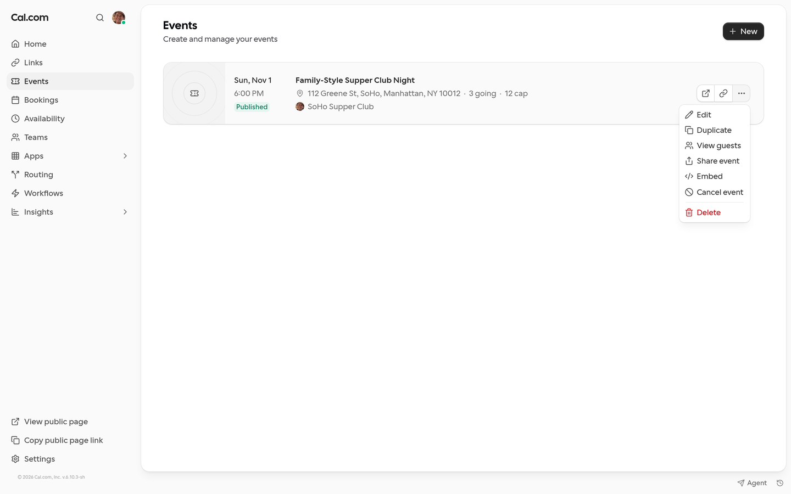
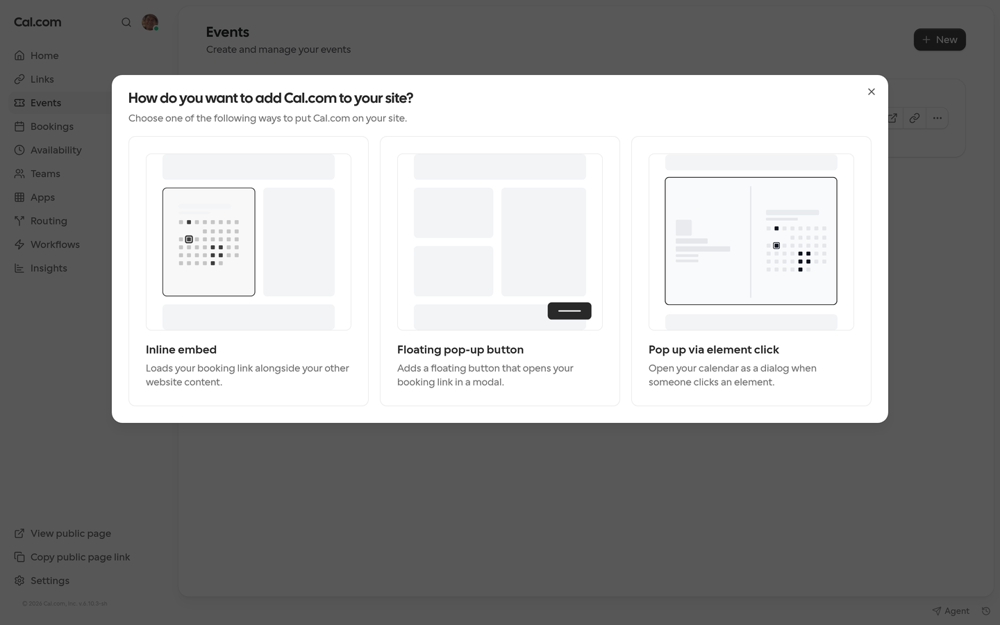

## Listening to Events

You can listen to an event that occurs in embedded cal link as follows. You can think of them as DOM events.

```js
<script>
  Cal("on", {
    action: "ANY_EVENT_NAME",
    callback: (e)=>{
      // `data` is properties for the event.
      // `type` is the name of the event(You can also call it type of the event.) This would be same as "ANY_EVENT_NAME" except when ANY_EVENT_NAME="*" which listens to all the events.
      // `namespace` tells you the Cal namespace for which the event is fired/
      const {data, type, namespace} = e.detail;
    }
  })
</script>
```

## Usage

<table>
  <thead>
    <tr>
      <th>Wrong ❌</th>
      <th>Correct ✅</th>
      <th>Comments</th>
    </tr>
  </thead>
  <tbody>
    <tr>
      <td>`Cal.ns.yournamespace.on(...)`</td>
      <td>`Cal.ns.yournamespace('on', ...)`</td>
      <td>To be used when a namespace is used which you can identify by seeing if "init" call has namespace in it.<br/><br/>`Cal("init", "yournamespace", { origin: "https://cal.com" })`.<br/><br/>The Embed snippet you get from the Cal.com app uses a namespace derived from the event type slug.</td>
    </tr>
    <tr>
      <td>`Cal.on(...)`</td>
      <td>`Cal('on', ...)`</td>
      <td>To be used when namespace is not used which you can identify by seeing if the "init" call has no namespace in it.<br/><br/>`Cal("init", { origin: "https://cal.com" })`</td>
    </tr>
  </tbody>
</table>

## Event Reference

### `eventTypeSelected`

**Description:** When user chooses an event-type from the listing.

**Properties:**

- `eventType`: `object` - Event Type that has been selected

### `bookingSuccessfulV2`

_`It deprecates bookingSuccessful event.`_

**Description:** When a fresh booking is successfully done. It might not be confirmed.

**Properties:**

- `uid`: `string` | `undefined` - Unique identifier for the booking
- `title`: `string` | `undefined` - Title of the booking
- `startTime`: `string` | `undefined` - Start time of the booking
- `endTime`: `string` | `undefined` - End time of the booking
- `eventTypeId`: `number` | `null` | `undefined` - Event type id of the booking
- `status`: `string` | `undefined` - Status of the booking
- `paymentRequired`: `boolean` - Whether payment is required for the booking
- `isRecurring`: `boolean` - Whether the booking is recurring
- `allBookings`: `object` - Array of objects with `startTime` and `endTime`. Applicable only if `isRecurring` is `true`
- `videoCallUrl`: `string` - URL of the video call

### `rescheduleBookingSuccessfulV2`

_`It deprecates rescheduleBookingSuccessful event.`_

**Description:** When a booking is rescheduled.

**Properties:**

- `uid`: `string` | `undefined` - Unique identifier for the booking
- `title`: `string` | `undefined` - Title of the booking
- `startTime`: `string` | `undefined` - Start time of the booking
- `endTime`: `string` | `undefined` - End time of the booking
- `eventTypeId`: `number` | `null` | `undefined` - Event type id of the booking
- `status`: `string` | `undefined` - Status of the booking
- `paymentRequired`: `boolean` - Whether payment is required for the booking
- `isRecurring`: `boolean` - Whether the booking is recurring
- `allBookings`: `object` - Array of objects with `startTime` and `endTime`. Applicable only if `isRecurring` is `true`

### `linkReady`

**Description:** Tells that the link is ready to be shown now.

**Properties:** None

### `linkFailed`

**Description:** Fired if link fails to load.

**Properties:**

- `code`: `string` - Error Code
- `msg`: `string` - Human Readable msg
- `data`: `object` - More details to debug the error (includes url)

### `dryRunBookingSuccessfulV2`

**Description:** When a dry run booking is successfully created (test mode).

**Properties:**

Same properties as `bookingSuccessfulV2` (without `uid`)

### `dryRunRescheduleBookingSuccessfulV2`

**Description:** When a dry run reschedule is successful (test mode).

**Properties:**

Same properties as `bookingSuccessfulV2` (without `uid`)

### `bookingCancelled`

**Description:** When a booking is cancelled.

**Properties:**

- `booking`: `object` - Booking details including cancellationReason
- `organizer`: `object` - Organizer details (name, email, timeZone)
- `eventType`: `object` - Event type details

### `routed`

**Description:** When a routing form routes to an action (event type, external URL, or custom page).

**Properties:**

- `actionType`: `string` - Type of action: "customPageMessage", "externalRedirectUrl", or "eventTypeRedirectUrl"
- `actionValue`: `string` - The value/URL of the action

### `navigatedToBooker`

**Description:** When user navigates to the booker interface.

**Properties:** None

### `bookerViewed`

**Description:** Fires once when the booker becomes visible to the user for the first time. Not fired during prerendering.

**Properties:**

- `eventId`: `number` | `null` - Event type ID (null if slots not loaded)
- `eventSlug`: `string` | `null` - Event type slug (null if slots not loaded)
- `slotsLoaded`: `boolean` - Whether slots are loaded

### `bookerReopened`

**Description:** Fires when the booker is reopened after the modal was closed. Distinguishes between first view and subsequent reopens.

**Properties:**

- `eventId`: `number` | `null` - Event type ID (null if slots not loaded)
- `eventSlug`: `string` | `null` - Event type slug (null if slots not loaded)
- `slotsLoaded`: `boolean` - Whether slots are loaded

### `bookerReloaded`

**Description:** Fires when the booker undergoes a full page reload within the modal.

**Properties:**

- `eventId`: `number` | `null` - Event type ID (null if slots not loaded)
- `eventSlug`: `string` | `null` - Event type slug (null if slots not loaded)
- `slotsLoaded`: `boolean` - Whether slots are loaded

### `bookerReady`

**Description:** Fires when the booker view is loaded and slots are ready for user interaction. Only fires for booker pages (not booking success or other views).

**Properties:**

- `eventId`: `number` - Event type ID
- `eventSlug`: `string` - Event type slug

<Note>
With GTM App enabled for an Event type, these events are automatically sent to GTM and GTM could be setup to send these events to your desired destination like Google Analytics, etc.
</Note>

## Internal Events

These events are used internally by the embed system for communication between the iframe and parent window. They are prefixed with `__` and are not intended for external use.

| Action               | Description                                                                                           | Properties                                                                                                                       |
|----------------------|-------------------------------------------------------------------------------------------------------|-----------------------------------------------------------------------------------------------------------------------------------|
| __iframeReady        | Fired when the embedded iframe is ready to communicate with parent snippet.                           | `isPrerendering: boolean` // Whether the iframe is in prerender mode                                                             |
| __windowLoadComplete | Tells that window load for iframe is complete.                                                        | None                                                                                                                             |
| __dimensionChanged   | Tells that dimensions of the content inside the iframe changed.                                       | `iframeWidth: number` <br /> `iframeHeight: number` <br /> `isFirstTime: boolean` // Whether this is the first dimension change |
| __routeChanged       | Fired when the route changes within the iframe.                                                       | None                                                                                                                             |
| __closeIframe        | Fired when the iframe should be closed.                                                               | None                                                                                                                             |
| __escapeKeyPressed   | Fired when Escape inside a non-modal embed goes unhandled.                                            | None                                                                                                                             |
| __connectInitiated   | Fired when connection to a prerendered iframe is initiated.                                           | None                                                                                                                             |
| __connectCompleted   | Fired when connection to a prerendered iframe is completed.                                           | None                                                                                                                             |
| __scrollByDistance   | Instructs the parent to scroll by a specific distance.                                                | `distance: number` // Distance in pixels to scroll by                                                                            |

<Info>Events that start with `__` are internal and should not be relied upon for external integrations as they may change without notice.</Info>

To get more details on how Embed actually works, you can refer to this [Embed Flowchart](https://www.figma.com/file/zZ5oaUpg12Fuu5mGZrPlP5/Embed-Flowchart).

## Copy Prompt embed

The Copy Prompt embed adds a button to your website that helps visitors book the event type through an AI assistant. Depending on the mode you pick, the button either copies booking instructions for the visitor to paste into their assistant, or opens one assistant with the instructions already typed. The assistant connects to the Cal.com MCP server and books the event type.

To create one, open an event type's options menu, select **Embed**, and click the **Copy Prompt** button below the embed type cards.

<Frame>
  
</Frame>

The editor has these options:

| Option         | Description                                                                                                                                                                                                                                                                                       |
|----------------|---------------------------------------------------------------------------------------------------------------------------------------------------------------------------------------------------------------------------------------------------------------------------------------------------|
| Embed theme    | `Auto`, `Dark theme` or `Light theme`. `Auto` follows the visitor's light or dark system setting; the other two always use the same colors. Black logos, such as ChatGPT's, turn white on a dark background.                                                                                       |
| Assistant mode | **Multiple assistants** rotates through the selected assistants and copies the prompt on click. **Specific assistant** opens one assistant in a new tab with the prompt already filled in.                                                                                                       |
| Label          | `Copy Prompt`, `Book using AI` or `Book using <assistant>`. With `Book using <assistant>`, the label names the assistant whose logo is showing. In **Specific assistant** mode, `Copy Prompt` becomes `Open in <assistant>`.                                                                         |
| Assistants     | In **Multiple assistants** mode: Cal.ai, ChatGPT, Claude, Grok, Perplexity, Muse, Instinct and OpenClaw. All are selected by default and at least one must stay selected. With more than one selected, the button rotates through their logos every five seconds. In **Specific assistant** mode, you choose one of Cal.ai, ChatGPT, Claude, Grok or Perplexity, the assistants that accept a prompt link. |

<Frame>
  
</Frame>

The editor gives you HTML and React snippets; there is no React Atom snippet for this type. Both snippets are self-contained: they don't load the Cal.com embed script, so this embed fires none of the events on this page. They load the assistant logos as images from the Cal.com web app, for example `https://app.cal.com/ai-assistants/claude.svg`. With `Auto`, the HTML snippet switches colors with a `prefers-color-scheme` media query and the React snippet listens for changes with `matchMedia`. The button text on your website is always in English.

### Multiple assistants

When a visitor clicks the button, it copies this prompt to their clipboard and shows the tooltip "Copied. Open your assistant and paste the instructions":

```text
If not added, add mcp.cal.com/mcp, then book <username>/<event-type-slug>
```

The HTML snippet is a button with a short script that rotates the logos and copies the prompt.

### Specific assistant

The button is a link that opens the chosen assistant in a new tab with the prompt in its chat box. Nothing is copied and no tooltip is shown. The HTML snippet is a plain link with no script.

ChatGPT, Claude, Grok and Perplexity get the same prompt as in **Multiple assistants** mode. Cal.ai opens the [Cal.com assistant](https://cal.com/docs/agents#open-the-assistant-with-a-prompt-already-typed) on the **Home** page with `book <username>/<event-type-slug>` typed in, because it already knows how to book on Cal.com. Visitors who aren't signed in are asked to sign in first and then see the prompt in the chat box.

<Frame>
  
</Frame>

If your booking page is on an organization or custom domain, or you self-host Cal.com, the copied prompt and the prefilled link contain the full booking URL instead of `<username>/<event-type-slug>`.

<Note>The Copy Prompt embed is only available for event types. The embed dialogs for routing forms and Cal Events don't offer it.</Note>

## Cal Event embed

You can embed a published Cal Event on your website. To open the embed generator from the Events list, go to **Events**, open the `...` menu on the event's row, and select **Embed**. You can also select **Embed** in the event editor's header.

<Frame>
  
</Frame>

In the Events list, **Embed** is only listed for published events that haven't ended. It isn't listed for draft, past or cancelled events. Like the editor's **Embed** button, it's only shown on desktop-width screens.

The generator uses the event's link and offers **Inline embed**, **Floating pop-up button** and **Pop up via element click**. It doesn't offer the Email or Copy Prompt embeds, or the **Hide link details** option.

<Frame>
  
</Frame>
