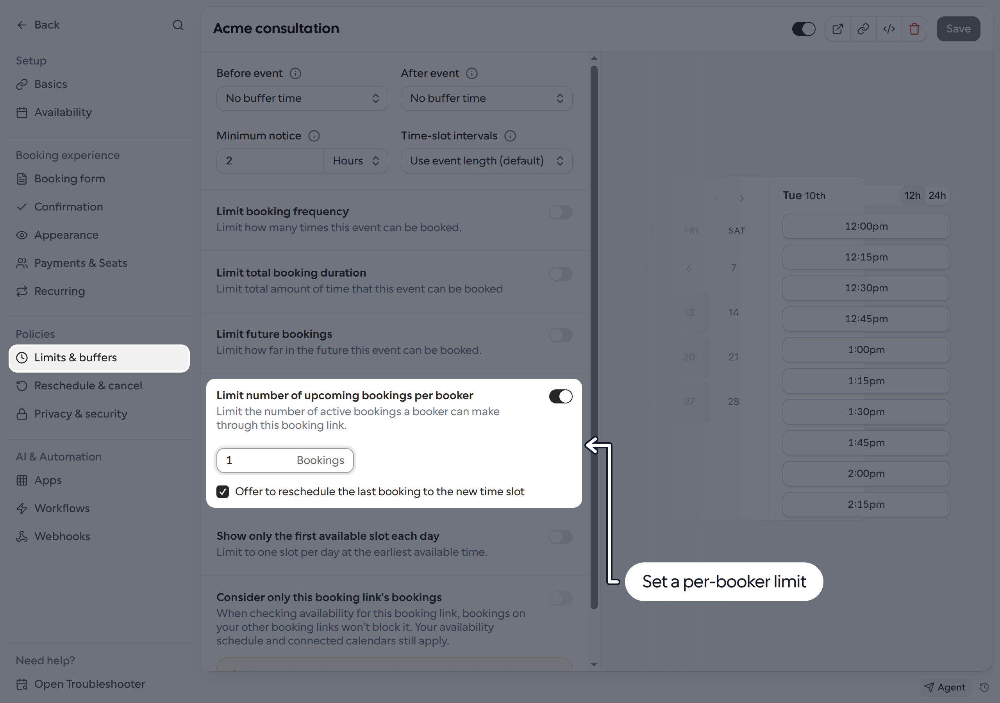

Limit how many active bookings someone can have for the same Link, based on their email address. For example, a limit of **1** prevents another booking until the existing meeting ends or is canceled.

## Set a booking limit

1. Go to **Links** and open the Link you want to update.
2. Select **Limits & buffers**.
3. Turn on **Limit number of upcoming bookings per booker**.
4. Enter the maximum number of bookings allowed, starting at **1**.
5. Optionally select **Offer to reschedule the last booking to the new time slot**.
6. Click **Save**.

<Frame>
  
</Frame>

To remove the limit, turn off the setting and save the Link.

## What counts toward the limit

- The limit applies separately to each Link, not across all of your Links.
- It counts accepted bookings whose end time has not passed, including meetings already in progress. Canceled, rejected, pending and past bookings do not count.
- Matching uses the email address entered by the booker against booking attendees. It is not an account-based limit, and a booking where that address was added as a guest can also count.
- This is not a limit on the host's or team's total bookings. Different bookers have separate limits.

This setting is unavailable for recurring events. If a managed Link or template locks it, ask your administrator to change the setting.

## Offer a reschedule instead

Without the reschedule option, someone who reaches the limit sees an error and cannot create another booking for that Link.

With **Offer to reschedule the last booking to the new time slot** enabled, they are prompted to move an existing booking to the time they selected instead of creating another one. This applies only to active bookings for the same Link and email address. Rescheduling an existing booking does not create an additional booking toward the limit.