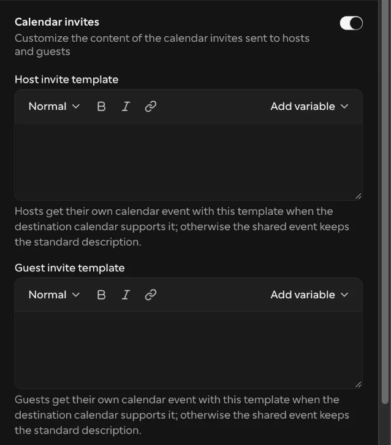
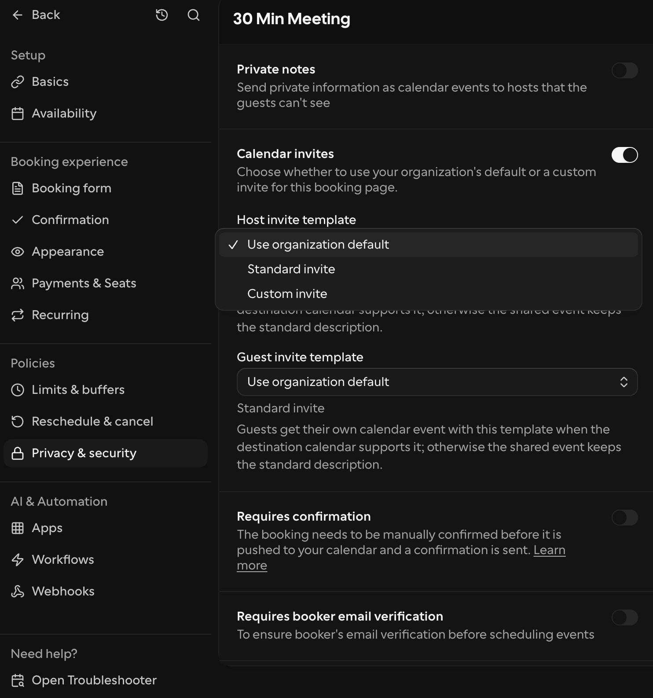
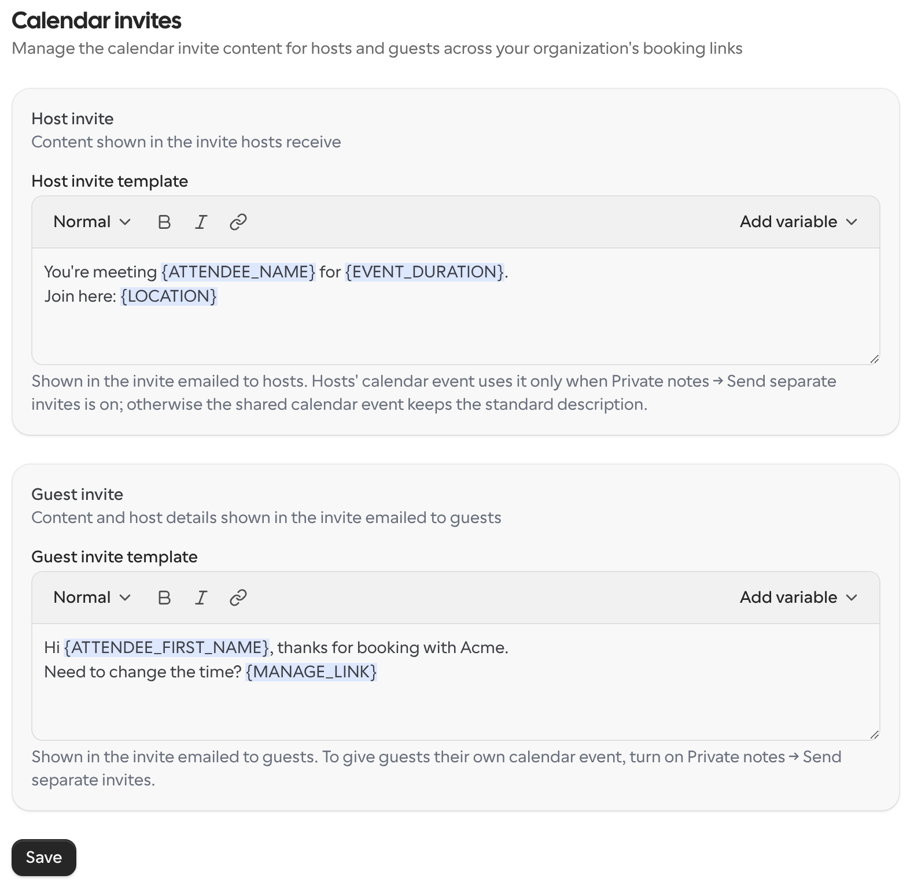

When someone books one of your Links, Cal.com emails a calendar invite to the hosts and guests. By default, the invite description lists the booking details. With custom calendar invites, you can write your own content instead, for example a short agenda, preparation steps, or a link to reschedule.

You can set the content separately for:

- **Hosts**: the invite emailed to the people hosting the booking.
- **Guests**: the invite emailed to the person who booked and anyone they added.

Organizations can also set a default for every Link in the organization, and each Link can follow that default or use its own content.

Custom calendar invites are available on every plan, including Free. Organization defaults are part of the Organizations plan.

---

## Customize the invite for a Link

<Steps>
  <Step title="Open the Link">
    Go to **Links** and open the Link you want to change.
  </Step>
  <Step title="Open Privacy and security">
    Select **Privacy & security** and turn on **Calendar invites**.
  </Step>
  <Step title="Write the host and guest invites">
    Enter your content in **Host invite template** and **Guest invite template**. Use the variable picker to add booking details such as the guest's name or the meeting location.
  </Step>
  <Step title="Save">
    Click **Save**. New bookings for this Link use your content.
  </Step>
</Steps>

<Frame>
  
</Frame>

Turning **Calendar invites** off returns the Link to the standard invite.

### Links in an organization

If you're part of an organization, each audience has its own menu so you can choose, separately for hosts and guests:

- **Use organization default**: use the content your organization admins set. A read-only preview shows what will be sent.
- **Standard invite**: use the standard Cal.com invite description.
- **Custom invite**: write content for this Link only.

<Frame>
  
</Frame>

<Note>
  Links created from a Template follow the Template's calendar invite settings and show **Use parent template**. Change the content on the Template instead.
</Note>

---

## Set organization defaults

Organization owners and admins can set the default content for every Link in the organization.

<Steps>
  <Step title="Open Calendar invites">
    Go to **Settings** → **Organization** → **Calendar invites**.
  </Step>
  <Step title="Write the default invites">
    Fill in **Host invite** and **Guest invite**. Leave a section empty if you don't want an organization default for that audience.
  </Step>
  <Step title="Save">
    Click **Save**. Every Link set to **Use organization default** uses this content for new bookings.
  </Step>
</Steps>

<Frame>
  
</Frame>

---

## Variables

Variables are replaced with the booking's details when the invite is sent. Insert them with the variable picker in the editor.

| Variable | What it shows |
|---|---|
| Link title | The name of the Link |
| Event duration | The length of the booking |
| Attendee | The guest's full name |
| Attendee first name | The guest's first name |
| Organizer name | The host's full name |
| Organizer first name | The host's first name |
| Hosts (`{HOSTS}`) | The names of all hosts on the booking |
| Location | Where the meeting takes place, such as the video link |
| Manage link | A link the guest can use to reschedule or cancel |

On a Link, you can also insert answers to your [booking questions](/event-types/booking-questions). Answers with several values, such as checkboxes, are listed separated by commas.

---

## Things to know

- Invites are sent as plain text. Formatting such as bold text is removed, links are shown as the link text followed by the URL, and line breaks are kept.
- Each template can be up to 5,000 characters.
- Changes apply to new bookings. Invites that were already sent are not updated.
- Booking invites can inherit the reminder you set in Cal.com for your destination calendar. A reminder set on the Link's destination takes precedence over the organizer's default destination reminder.
- Hosts and guests each get their own calendar event with their template when the destination calendar supports it. Otherwise, they share one calendar event that keeps the standard description, and your custom content appears in the invites emailed to each audience.
