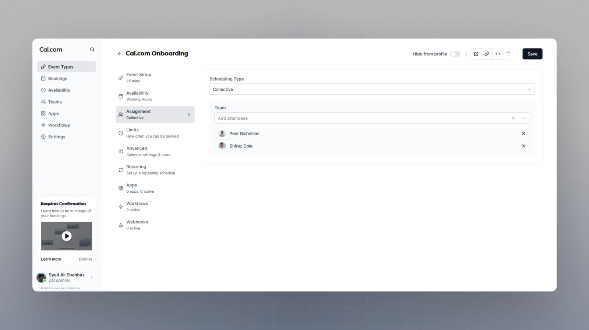
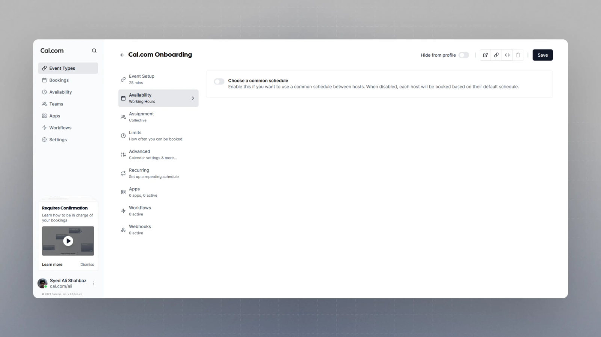

Collective booking links are ideal when the booker needs to book a meeting with several team members at one time. With Cal.com Teams, you can easily create a team booking link and select collective scheduling as the scheduling type. You can then pick exactly which team members should co-host this booking link collectively.

Cal.com then evaluates availability on the basis of each member's availability by default. However, you also have an option to put forward a common schedule for this specific booking link which will be used as the availability and over-ride each member's availability for this booking link.

When you need a group of team members to attend the same meeting, collective events are fantastic. Seeking a convenient time for all of your team members to attend the meeting is a breeze with this method.