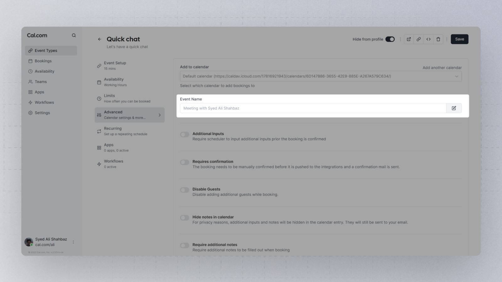

Custom event names allow bookings to take in information from the booking and add it to the title. This feature allows the option to breaks away from the default "Event name" with "Attendee".

You can currently use the following variables here:

| **Name** | **Definition** | **Example** |
| --- | --- | --- |
| Booking link title | The booking link name | Weekly Meeting |
| Organiser | Your full name | John Doe |
| Scheduler | The full name of the scheduler | Jane Doe |
| Location | The location of the event | Acme Cafe |

