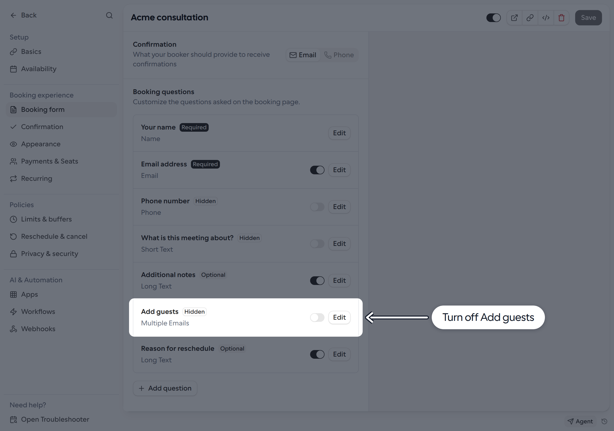

**Add guests** is enabled by default. Turn it off to hide the guest email fields and the **Add guests** button on your Link's booking page.

## Turn off Add guests

1. Go to **Links** and open the Link you want to update.
2. Select **Booking form** and find **Booking questions**.
3. Turn off the toggle beside **Add guests**. The question is marked **Hidden**.
4. Click **Save**.

<Frame>
  
</Frame>

To show the option again, turn the toggle back on and save the Link. If your managed Link or template locks booking questions, ask your administrator to change the setting.

## What this setting controls

This hides the booking-page controls, not every way of adding guests. Guest emails supplied through the `guests` URL parameter or when creating a booking through the API can still be accepted. Do not rely on this toggle as an access restriction.

Bookers may also be able to invite others from their own calendar, depending on their calendar provider and event permissions. This setting does not change those permissions.
