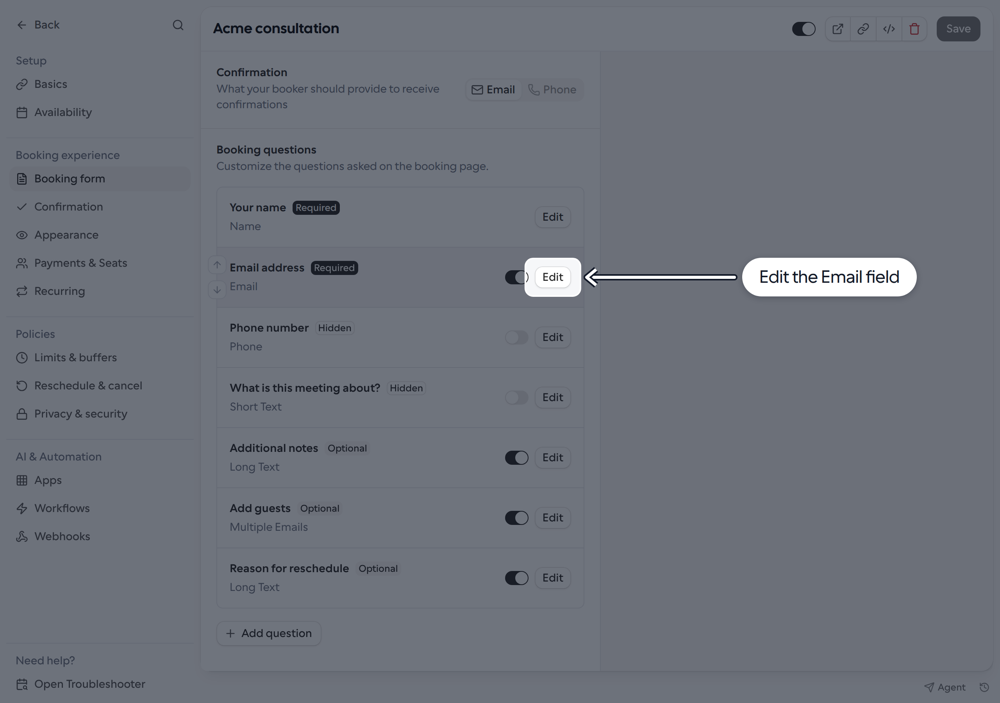
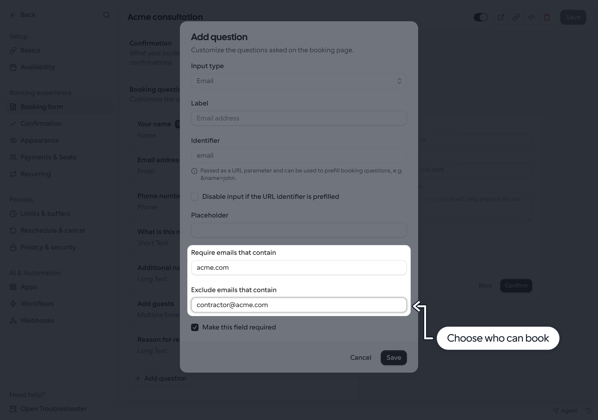
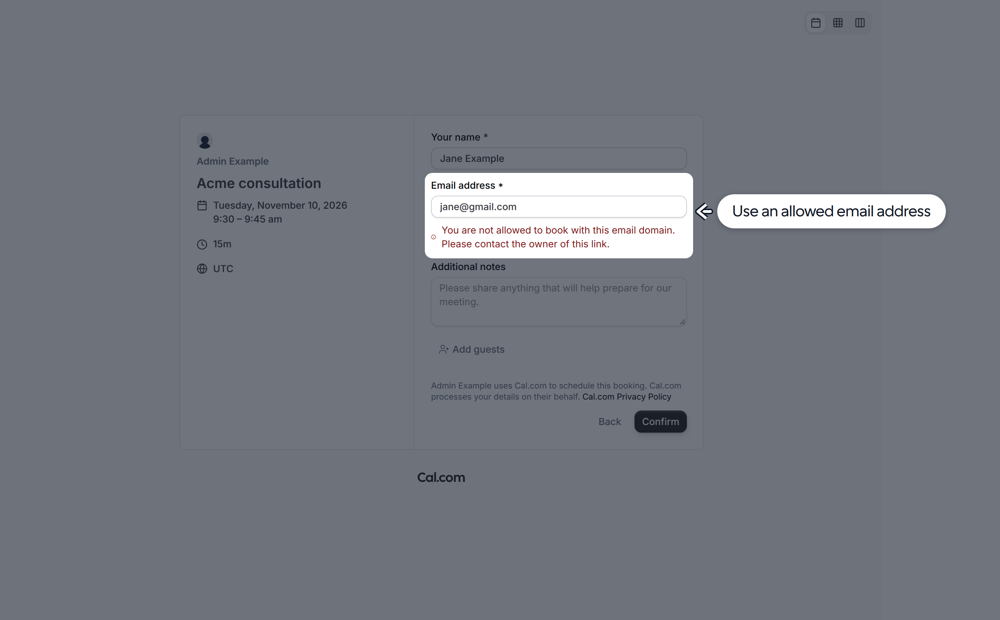

Use the **Email** booking question to allow or block specific email domains or individual addresses for a Link.

## Set up email restrictions

1. Go to **Links** and open the Link you want to update.
2. Select **Booking form**. Under **Booking questions**, find **Email address** (the Email field) and click **Edit**.

<Frame>
  
</Frame>

3. Fill in either or both fields:
   - **Require emails that contain**: only allow addresses matching an entry.
   - **Exclude emails that contain**: block addresses matching an entry.
4. Separate multiple entries with commas, such as `gmail.com, yahoo.com`. Leave a field blank if you do not need that restriction.
5. Click **Save** in the dialog, then **Save** on the Link.

<Frame>
  
</Frame>

## How matching works

Entries match whole domains or whole addresses, not any text the email contains:

- `acme.com` and `@acme.com` both match the exact email domain. They do not match `sub.acme.com` or `notacme.com`.
- A full address, such as `contractor@acme.com`, matches only that address.
- Matching is case-insensitive, and spaces around comma-separated entries are ignored.
- When both fields are filled, an address must match a required entry and must not match any excluded entry.

For example, require `acme.com` and exclude `contractor@acme.com` to allow `jane@acme.com`, but block both `contractor@acme.com` and `jane@gmail.com`.

These rules apply to the question you edit, not to **Add guests** or other email questions. You can configure restrictions separately on other Email-type questions. This checks the address entered, not whether someone is a verified member of an organization.

## What bookers see

Bookers cannot continue with a blocked address. An error appears below the email field:

- If the address does not match a required entry: “You are not allowed to book with this email domain. Please contact the owner of this link.”
- If the address matches an excluded entry: “Please enter a valid work email address”.

<Frame>
  
</Frame>