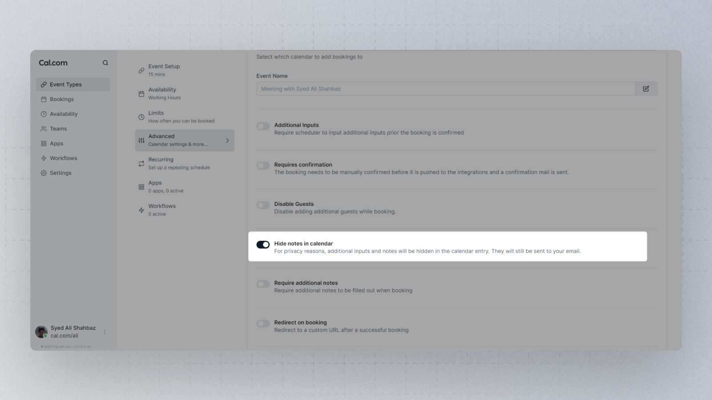

Toggling this option in the booking link settings will hide additional inputs and notes in the calendar entry. They will still be sent in your email confirmation.

Most of the entries in notes and additional inputs contain personal information, and if you have a team or shared calendar, for example, you can protect your attendee's privacy by hiding all this info.