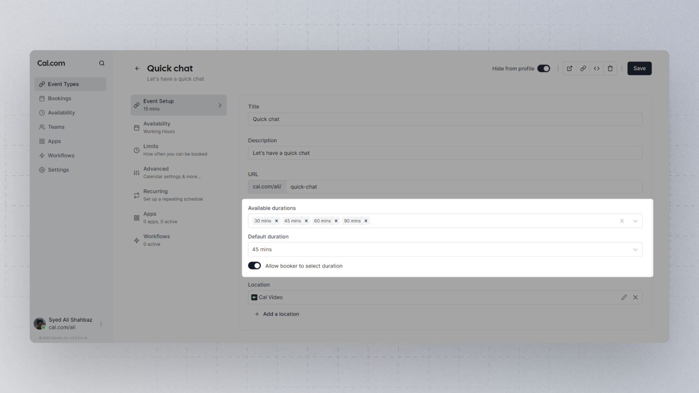

If you want to allow a client to choose between a meeting of 1 hour and one of 30 minutes, you don't have to create two different meetings; one of 60 minutes and one of 30 minutes. Instead, Cal.com offers you the possibility of using the same booking-link and offer meetings with several durations where the booker can pick the preferred duration.

There are multiple options to choose from, and no limit on the number of durations to offer the booker from these options. You also have a default selectable for situations where the booker doesn't necessarily need to select a duration, just that they have an option to choose one.