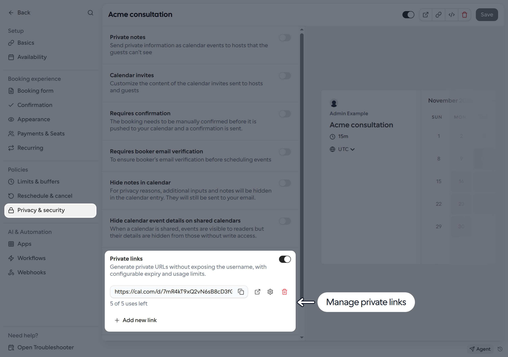
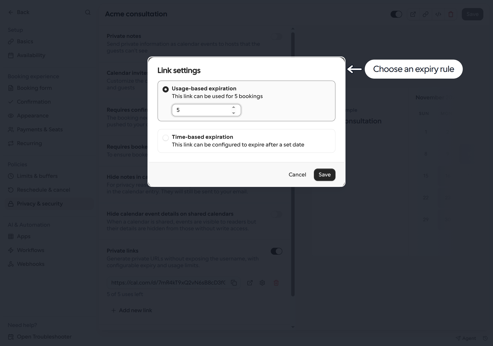

Private links give you additional URLs for the same Link without including your Cal.com username in the URL. Create separate URLs for invite-only sessions, a pilot program or a limited-time offer, each with its own expiration rule.

Anyone with a private URL can use it while it is valid. Share it only with the intended invitees. Creating a private URL does not hide the original Link or disable its standard booking URL.

## Create a private link

1. Go to **Links** and open the Link you want to update.
2. Select **Privacy & security** and find **Private links**.
3. Turn on **Private links** to generate the first URL. It allows **one booking** by default. Use **Add new link** to create more URLs for the same Link.
4. Click the **gear icon** beside a URL to open **Link settings**.

<Frame>
  
</Frame>

5. Choose one expiration rule:
   - **Usage-based expiration**: enter the total number of bookings allowed, starting at **1**. For example, **5** allows five bookings through that private URL, not five page visits.
   - **Time-based expiration**: choose a date. The URL remains valid through the end of the selected date in UTC.
6. Click **Save** in the dialog, then **Save** on the Link to apply the expiration changes.
7. Use the **copy icon** beside the URL and share it with your invitees. The preview icon opens the booking page in a new tab.

<Frame>
  
</Frame>

Creating and deleting private URLs takes effect immediately. You do not need to save the Link first to use a newly generated URL with its default one-booking limit. Save any custom expiration settings before sharing it.

## Expired or deleted links

A private URL stops working when its usage limit is reached or its expiration date passes. Opening an expired or deleted URL shows a not-found page. The settings list marks expired URLs as **Expired** and no longer offers copying, previewing or editing them. You can create a new URL with **Add new link**.

Use the **trash icon** to delete a URL. Deleting an active URL asks for confirmation and immediately stops future bookings through it. Turning off **Private links** removes all of the Link's private URLs, with confirmation if any are still active. These actions cannot be undone.

If a managed Link or template locks this setting, ask your administrator to change it.
