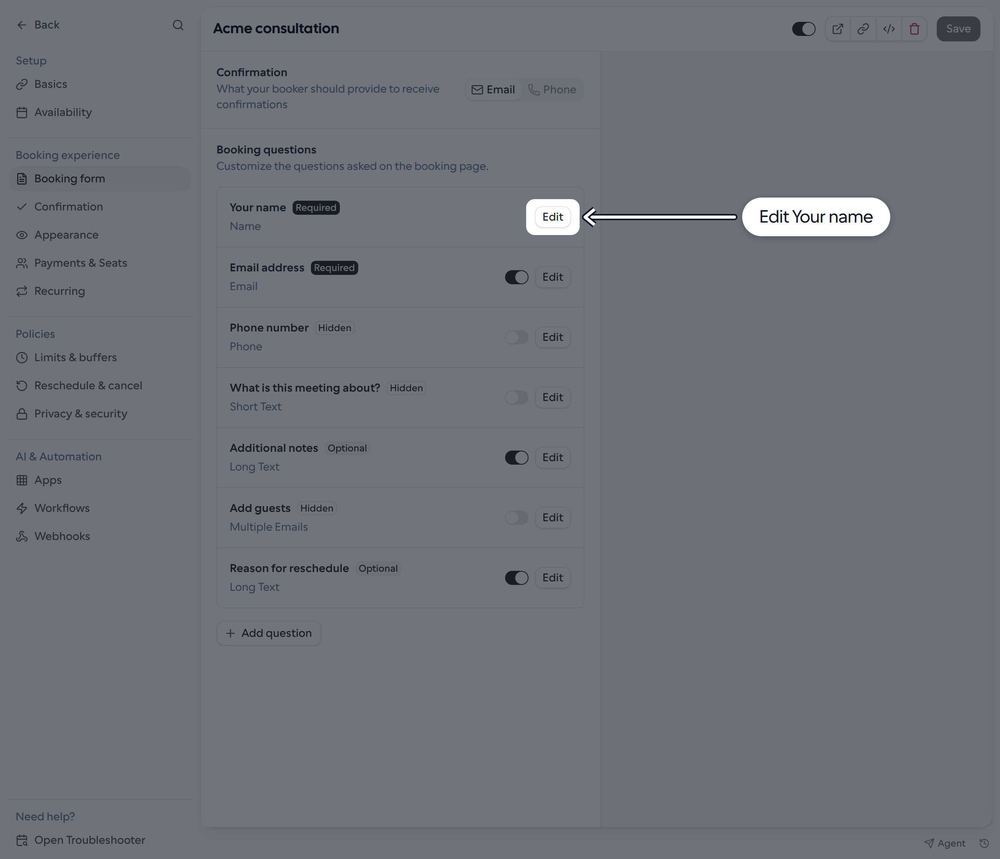
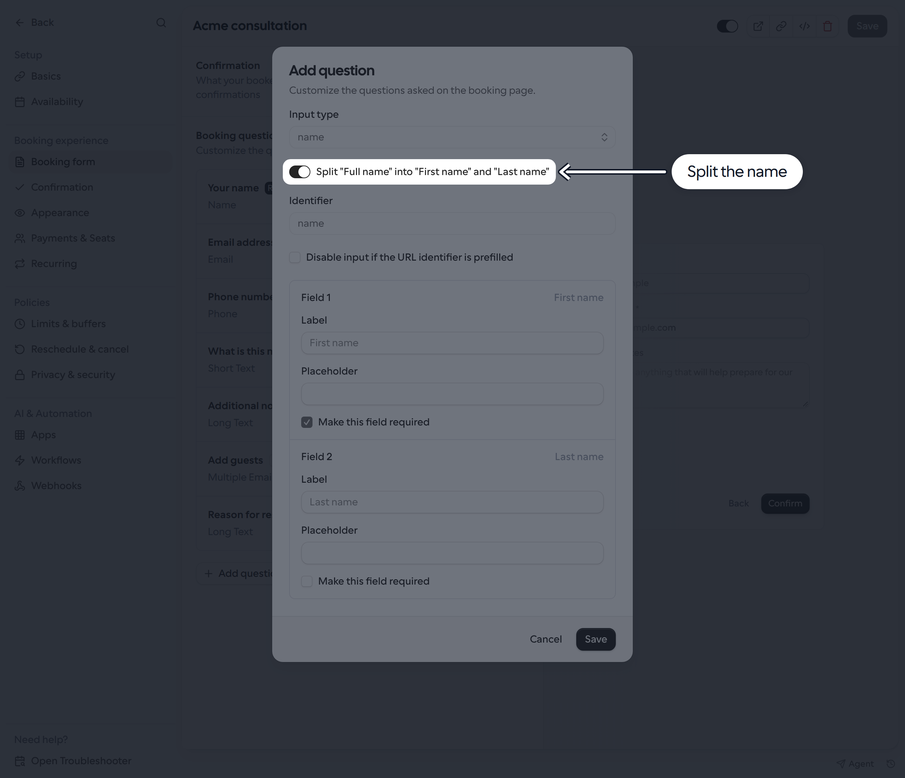
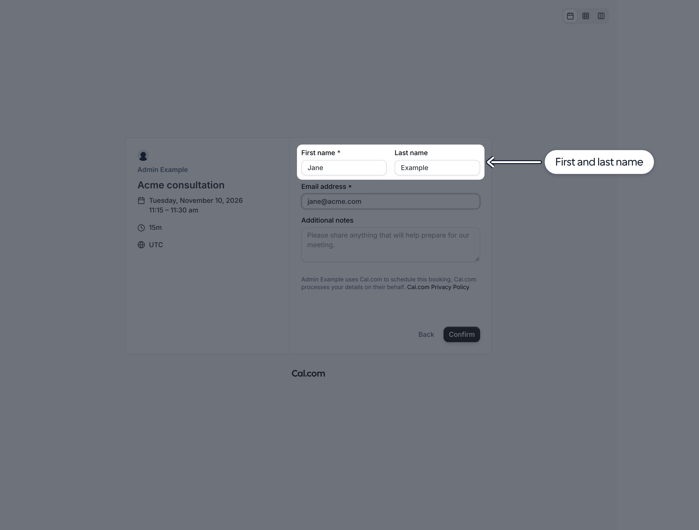

By default, bookers enter their full name in one field. You can split the **Your name** booking question into separate **First name** and **Last name** fields.

## Split the name field

1. Go to **Links** and open the Link you want to update.
2. Select **Booking form**. Under **Booking questions**, find **Your name** and click **Edit**.

<Frame>
  
</Frame>

3. Turn on **Split "Full name" into "First name" and "Last name"**.
4. Optionally customize each field's **Label** and **Placeholder**. First name is always required. Last name is optional by default; select **Make this field required** under **Field 2** to require it.
5. Click **Save** in the dialog, then **Save** on the Link.

<Frame>
  
</Frame>

Bookers now see two fields instead of one. With the default settings, only **First name** has a required asterisk.

<Frame>
  
</Frame>

To return to one full-name field, turn off the split-name toggle and save both the dialog and the Link.

## Booking API requests

For booking endpoints that accept a `responses` object, you can send the split name like this:

```json
{
  "responses": {
    "name": { "firstName": "Jane", "lastName": "Example" },
    "email": "jane@acme.com"
  }
}
```

When last name is optional, you can omit `lastName` or send an empty string. If you make it required, provide a non-empty value. These endpoints also accept a full-name string and split it at the first space, so existing string-based integrations do not have to switch to an object.

**API v2 uses a different request format:** send the full name as a string in `attendee.name`, even when the Link uses split fields. For example, the attendee portion of a request is:

```json
{
  "attendee": {
    "name": "Jane Example",
    "email": "jane@acme.com",
    "timeZone": "UTC"
  }
}
```