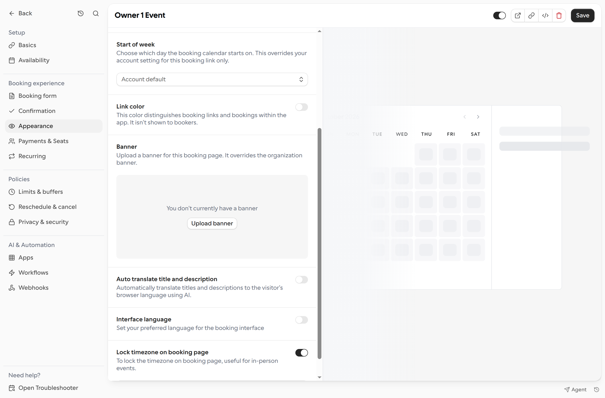

Lock the booking page to a specific timezone when bookers need to see event times in the organizer's timezone instead of their local timezone. This is useful for in-person events.

1. Open **Links** and select a booking link.
2. Choose **Appearance** and turn on **Lock timezone on booking page**.

<Frame>
  
</Frame>