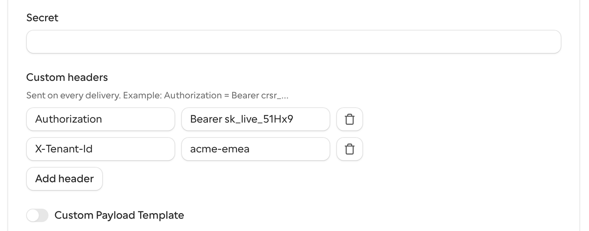

Webhooks offer a great way to automate the flow with other apps when invitees schedule, cancel or reschedule events, or when the meeting ends.

<Frame>
  <iframe width="100%" height="100%" src="https://www.youtube.com/embed/Yy9me5E09LA?si=bhjQfHegY-ImFQYH" title="YouTube video player" frameborder="0" allow="accelerometer; autoplay; clipboard-write; encrypted-media; gyroscope; picture-in-picture; web-share" referrerpolicy="strict-origin-when-cross-origin" allowfullscreen />
</Frame>

The webhook subscription allows you to listen to specific trigger events, such as when a booking has been scheduled, for example. You can always listen to the webhook by providing a custom subscriber URL with your own development work. However, if you wish to trigger automations without any development work, you can use the integration with Zapier which connects Cal.com to your apps.

### Webhook scope levels
Webhooks can be created at multiple levels of scope, each determining which events they apply to:

- **User-level**:
  Triggers for all booking links owned by the user (excluding team-managed types).

- **Booking-link level**:
  Triggers only for a specific booking link. Useful for fine-grained control.

- **Team-level**:
  Applies to team booking links (i.e., Collective and Round Robin) within the specified team.

    <Note>
    In the case of Templates, bookings are made on the child booking links, not the parent team event. Because of this, team-level webhooks will **not** trigger for templates unless one of the following is true:
    
    - You create a webhook directly on the parent booking link (recommended), or
    - You create individual webhooks on the child booking links (owned by users).
    
    💡 **Note:**
    Users can create webhooks that apply to their own booking links, including child events under a template, even if a team-level webhook exists.
    </Note>

- **Organization-level**:
  Applies to all team booking links across all teams within the organization.

### Creating a webhook subscription

To create a new webhook subscription, visit `/settings/developer/webhooks` and proceed to enter the following details:

<Steps>
  <Step title="Subscriber URL">
    This is the listener URL where the payload will be sent when an event trigger is activated.

    The subscriber URL must meet the following requirements:

    - **Cal.com SaaS**: Only HTTPS URLs are accepted. HTTP, private/internal IP addresses (e.g., `10.x.x.x`, `192.168.x.x`, `127.0.0.1`), and `localhost` are blocked.
    - **Self-hosted**: Both HTTP and HTTPS URLs are accepted, and private IP addresses are allowed for internal webhooks.
    - **All environments**: Cloud metadata endpoints (e.g., `169.254.169.254`) and non-HTTP protocols (e.g., `ftp://`, `file://`) are always blocked.

    If your subscriber URL does not meet these requirements, the webhook creation request will be rejected with an error.
  </Step>
  <Step title="Event triggers">
    You can choose which specific triggers to listen to. Currently available triggers include:

    - `Booking Cancelled`
    - `Booking Created`
    - `Booking Rescheduled`
    - `Booking Rejected`
    - `Booking Seat Rejected`
    - `Booking Seat Accepted`
    - `Booking Requested`
    - `Booking Payment Initiated`
    - `Booking Paid`
    - `Meeting Started`
    - `Recording Ready`
    - `Recording Transcription Generated`
    - `Form Submitted`
    - `Form Submitted No Event`
    - `Routing Form Fallback Hit`
    - `Out of Office Created`
    - `Calendar Entry Rejected`
    - `Meeting Ended`
    - `Instant Meeting Created`
    - `Instant Meeting Accepted`
    - `Booking No-show Updated`
    - `Booking Location Updated`
    - `Booking Title Updated`
    - `Booking Reassigned`
    - `Sequence Booking Created` (team, organization and platform OAuth client webhooks only)
    - `After Hosts Didn't Join Cal Video`
    - `After Guests Didn't Join Cal Video`
    - `Wrong Assignment Report`
    - `Delegation Credential Error`
    - `Delegation Credential Secret Rotated`
    - `Delegation Credential Secret Rotation Failed`
    - `Delegation Credential Rotation Required`
    - `Cal Event Registration Requested`
    - `Cal Event Registration Confirmed`
    - `Cal Event Registration Waitlisted`
    - `Cal Event Registration Declined`
    - `Cal Event Registration Cancelled`
  </Step>
  <Step title="Secret">
    You can provide a secret key with this webhook to [verify it](#verifying-the-authenticity-of-the-received-payload) on the subscriber URL when receiving a payload. This helps confirm whether the payload is authentic or has been tampered with. You can leave it blank if you don't wish to secure the webhook with a secret key.

    The secret is write-only: once saved, it can't be revealed again from the webhook settings, which only show that a secret is set. Store a copy somewhere safe before saving. Saving the webhook without editing the secret keeps the stored one. To replace it, click **Edit** next to the secret, enter a new value and save; leaving the field blank removes the secret. Remember to update your receiver with the new secret.
  </Step>
  <Step title="Custom headers">
    You can attach up to 10 static HTTP headers that are sent on every delivery — for example `Authorization` = `Bearer crsr_xxxxxxxxxxxxx`, with the full token as the value as expected by your receiver (e.g. a Cursor-style bearer token). Values are stored encrypted and are always shown as `***` when the webhook is read back. Limits: header names must be valid HTTP token names of at most 256 characters; names starting with `X-Cal-` are reserved for Cal.com's own headers; `host`, `content-length`, `transfer-encoding`, `connection`, `keep-alive`, `upgrade`, `trailer`, `te` and `proxy-authorization` are not allowed; each value can be up to 4 KiB. Stored values are only sent to the subscriber URL they were entered for: when you change the URL, enter the values again or the headers are dropped. Custom headers are independent of the signing secret — `x-cal-signature-256` is still computed over the raw body and both can coexist. Custom headers only appear once the instance has `CALCOM_KEYRING_WEBHOOK_HEADERS_CURRENT` and `CALCOM_KEYRING_WEBHOOK_HEADERS_K1` (a base64url-encoded 32-byte key) set; until then the field is hidden and the API refuses requests that send headers.
  </Step>
  <Step title="Custom Payload">
    You have the option to [customize the payload](#adding-a-custom-payload-template) that you receive when a subscribed event is triggered.
  </Step>
</Steps>

### Expectations with the triggers

| **Event**                          | **Triggers When...**                                                                                          |
| ---------------------------------- | ------------------------------------------------------------------------------------------------------------- |
| Booking Created                   | A new booking is successfully created.                                                                        |
| Booking Cancelled                 | A booking is cancelled by the host, attendee, or via API.                                                     |
| Booking Rejected                  | A booking request is explicitly rejected by the host.                                                         |
| Booking Requested                 | A booking requiring confirmation from the host is submitted.                                                  |
| Booking Paid                      | Payment for a booking is completed.                                                                           |
| Booking Payment Initiated         | A payment attempt is initiated (before confirmation).                                                         |
| Booking No-Show Updated           | A host or attendee is marked as a no-show after the meeting.                                                  |
| Booking Title Updated             | Cal.com syncs a title change the organizer made directly in their connected Google Calendar or Microsoft 365 calendar. |
| Booking Location Updated          | A booking location changes in Cal.com or through the API, or Cal.com syncs a location change from the organizer's connected Google Calendar or Microsoft 365 calendar. |
| Meeting Started                   | At the scheduled start time of the meeting. Uses a [flat payload format](#meeting-started--meeting-ended-flat-format). Automatically cancelled if the booking is cancelled or rescheduled.  |
| Meeting Ended                     | At the scheduled end time of the meeting. Uses a [flat payload format](#meeting-started--meeting-ended-flat-format). Automatically cancelled if the booking is cancelled or rescheduled.    |
| Recording Ready                   | A meeting recording is available and ready to access.                                                         |
| Recording Transcription Generated | A transcription of the meeting recording is successfully generated.                                           |
| Instant Meeting Created           | An instant (ad-hoc) meeting is created.                                                                       |
| Instant Meeting Accepted          | A host accepts an instant meeting and becomes the organizer. Only fires for the first host to accept.         |
| Out of Office Created             | A user adds a new Out of Office entry to their availability.                                                  |
| After Hosts Cal Video No-Show     | The host did not show up to a Cal Video meeting in the first `n` minutes, as set up in the configuration.     |
| After Guests Cal Video No-Show    | The attendee did not show up to a Cal Video meeting in the first `n` minutes, as set up in the configuration. |
| Form Submitted                    | A form is submitted as part of a routing form **with** a scheduled event.                                     |
| Form Submitted (No Event)         | A form is submitted **without** a scheduled event (form-only flow).                                           |
| Calendar Entry Rejected           | An external attendee declines a Cal.com event from their connected Google or Microsoft 365 calendar.          |
| Delegation Credential Rotation Required | The client secret for a Microsoft 365 [Delegation Credential](/enterprise/delegation-credential-microsoft-365) that has opted out of automatic rotation is approaching expiry (~14 days out). Organization-level only. |


### Booking title and location changes

`BOOKING_TITLE_UPDATED` sends the new `title` in the booking payload, but not the previous title. `BOOKING_LOCATION_UPDATED` sends the new `location` and the `previousLocation`. If the organizer changes both in one calendar edit, Cal.com sends two webhooks after it syncs the changes.

When updating a location with API v2 (`PATCH /v2/bookings/{bookingUid}/location`), set `notifyHosts` to `false` to skip host emails. This doesn't affect attendee notifications or webhook delivery.

### Seated booking links

For booking links with [seats enabled](/event-types/offer-seats), the `attendees` array in webhook payloads contains only the attendee associated with the specific seat that triggered the webhook. For example, when a new seat is booked, the webhook includes only that seat's attendee — not all attendees across the entire booking. This applies to all booking-related triggers (`BOOKING_CREATED`, `BOOKING_RESCHEDULED`, etc.).

### Example webhook payloads

Most webhook events use a nested payload format with booking details inside a `payload` object. The `MEETING_STARTED` and `MEETING_ENDED` events use a different flat format where booking fields are at the top level.

#### Booking events (nested format)

Events like `BOOKING_CREATED`, `BOOKING_CANCELLED`, `BOOKING_RESCHEDULED`, and most other triggers use this format:

```json
{
    "triggerEvent": "BOOKING_CREATED",
    "createdAt": "2023-05-24T09:30:00.538Z",
    "payload": {
        "type": "60min",
        "title": "60min between Pro Example and John Doe",
        "description": "",
        "additionalNotes": "",
        "customInputs": {},
        "startTime": "2023-05-25T09:30:00Z",
        "endTime": "2023-05-25T10:30:00Z",
        "organizer": {
            "id": 5,
            "name": "Pro Example",
            "email": "owner@acme.com",
            "username": "owner90",
            "usernameInOrg": "owner",
            "timeZone": "Asia/Kolkata",
            "language": {
                "locale": "en"
            },
            "timeFormat": "h:mma"
        },
        "responses": {
            "name": {
                "label": "your_name",
                "value": "John Doe"
            },
            "email": {
                "label": "email_address",
                "value": "john.doe@example.com"
            },
            "location": {
                "label": "location",
                "value": {
                    "optionValue": "",
                    "value": "inPerson"
                }
            },
            "notes": {
                "label": "additional_notes"
            },
            "guests": {
                "label": "additional_guests"
            },
            "rescheduleReason": {
                "label": "reschedule_reason"
            }
        },
        "userFieldsResponses": {},
        "attendees": [
            {
                "email": "john.doe@example.com",
                "name": "John Doe",
                "timeZone": "Asia/Kolkata",
                "language": {
                    "locale": "en"
                }
            }
        ],
        "location": "Calcom HQ",
        "destinationCalendar": {
            "id": 10,
            "integration": "apple_calendar",
            "externalId": "https://caldav.icloud.com/1234567/calendars/XXXXXXXX-XXXX-XXXX-XXXX-XXXXXXXXXXXX/",
            "userId": 5,
            "eventTypeId": null,
            "credentialId": 1
        },
        "hideCalendarNotes": false,
        "requiresConfirmation": null,
        "eventTypeId": 7,
        "seatsShowAttendees": true,
        "seatsPerTimeSlot": null,
        "uid": "bFJeNb2uX8ANpT3JL5EfXw",
        "appsStatus": [
            {
                "appName": "Apple Calendar",
                "type": "apple_calendar",
                "success": 1,
                "failures": 0,
                "errors": [],
                "warnings": []
            }
        ],
        "eventTitle": "60min",
        "eventDescription": "",
        "price": 0,
        "currency": "usd",
        "length": 60,
        "bookingId": 91,
        "metadata": {},
        "status": "ACCEPTED"
    }
}
```

#### Meeting started / meeting ended (flat format)

`MEETING_STARTED` and `MEETING_ENDED` webhooks use a flat payload format where booking fields are at the top level alongside `triggerEvent`, rather than nested inside a `payload` object. These webhooks are delivered at the scheduled start and end time of the meeting respectively.

```json
{
    "triggerEvent": "MEETING_STARTED",
    "id": 91,
    "uid": "bFJeNb2uX8ANpT3JL5EfXw",
    "title": "60min between Pro Example and John Doe",
    "description": "",
    "startTime": "2023-05-25T09:30:00.000Z",
    "endTime": "2023-05-25T10:30:00.000Z",
    "location": "https://cal.app/video/abc123",
    "status": "ACCEPTED",
    "paid": false,
    "createdAt": "2023-05-24T09:30:00.538Z",
    "updatedAt": "2023-05-24T09:30:00.538Z",
    "userId": 5,
    "eventTypeId": 7,
    "metadata": {},
    "responses": {
        "name": {
            "label": "your_name",
            "value": "John Doe"
        },
        "email": {
            "label": "email_address",
            "value": "john.doe@example.com"
        }
    },
    "user": {
        "email": "owner@acme.com",
        "name": "Pro Example",
        "username": "owner90",
        "timeZone": "Asia/Kolkata",
        "locale": "en"
    },
    "attendees": [
        {
            "id": 201,
            "name": "John Doe",
            "email": "john.doe@example.com",
            "timeZone": "Asia/Kolkata",
            "locale": "en",
            "noShow": false
        }
    ],
    "payment": [],
    "references": [
        {
            "id": 42,
            "type": "daily_video",
            "uid": "abc123",
            "meetingId": "abc123",
            "meetingUrl": "https://cal.app/video/abc123"
        }
    ]
}
```

<Note>
`MEETING_STARTED` and `MEETING_ENDED` webhooks do not support [custom payload templates](#adding-a-custom-payload-template). They always send the full booking data in the flat format shown above.
</Note>

If a booking is cancelled or rescheduled before the meeting time, the scheduled `MEETING_STARTED` and `MEETING_ENDED` webhooks for that booking are automatically cancelled.

#### Instant meeting created

The `INSTANT_MEETING` webhook fires when a booker submits an [Instant Meeting](/enterprise/instant-meetings) request. Its payload carries the booker's form `responses` and the `connectAndJoinUrl` a host opens to accept and join the meeting, so a receiving service can alert the hosts who can take the request.

The fields in `responses` depend on the booking questions configured on the booking link, so your own payload can contain more or fewer fields than the example below. `customInputs` is empty unless the booking link still uses legacy custom inputs.

```json
{
    "triggerEvent": "INSTANT_MEETING",
    "createdAt": "2025-04-17T10:00:00.000Z",
    "payload": {
        "triggerEvent": "INSTANT_MEETING",
        "uid": "aB3kL9mNpQ7rS1tU",
        "responses": {
            "name": "Jane Smith",
            "email": "jane.smith@example.com",
            "notes": "Need help choosing a plan",
            "guests": []
        },
        "connectAndJoinUrl": "https://app.cal.com/connect-and-join?token=EXAMPLE_TOKEN",
        "eventTypeId": 15,
        "eventTypeTitle": "Instant meeting",
        "customInputs": {}
    }
}
```

#### Instant meeting accepted

The `INSTANT_MEETING_ACCEPTED` webhook fires when a host accepts an instant meeting request through the connect-and-join flow. It only triggers for the first host to accept — if another host has already accepted the booking, the webhook is not sent again. This trigger is available for team booking links only.

The payload includes the booking `status` (set to `ACCEPTED`), the accepting host as the `organizer` with their locale and time format preferences, the guest `attendees` list, booking `responses`, and a `metadata` object containing the `videoCallUrl` for the meeting.

```json
{
    "triggerEvent": "INSTANT_MEETING_ACCEPTED",
    "createdAt": "2025-04-17T10:01:00.000Z",
    "payload": {
        "bookingId": 142,
        "bookingUid": "aB3kL9mNpQ7rS1tU",
        "eventTypeId": 15,
        "status": "ACCEPTED",
        "title": "Instant meeting between Team and Jane Smith",
        "startTime": "2025-04-17T10:00:00.000Z",
        "endTime": "2025-04-17T10:30:00.000Z",
        "organizer": {
            "id": 8,
            "name": "Host Example",
            "email": "host@example.com",
            "username": "host-example",
            "timeZone": "America/New_York",
            "language": {
                "locale": "en"
            },
            "timeFormat": "h:mma",
            "utcOffset": -300
        },
        "attendees": [
            {
                "email": "jane.smith@example.com",
                "name": "Jane Smith",
                "timeZone": "Europe/London",
                "language": {
                    "locale": "en"
                },
                "utcOffset": 60
            }
        ],
        "responses": {
            "name": {
                "label": "your_name",
                "value": "Jane Smith"
            },
            "email": {
                "label": "email_address",
                "value": "jane.smith@example.com"
            }
        },
        "location": "integrations:daily",
        "metadata": {
            "videoCallUrl": "https://cal.app/video/aB3kL9mNpQ7rS1tU"
        }
    }
}
```

#### Calendar entry rejected

The `CALENDAR_ENTRY_REJECTED` webhook fires when an external attendee declines a Cal.com event from their connected Google Calendar or Microsoft 365 calendar. Cal.com detects the decline during calendar sync and dispatches the webhook once per attendee per booking — duplicate syncs do not re-fire the trigger, so you can rely on it as an at-most-once signal.

Use this trigger when you want to react to attendee declines that happen outside Cal.com, for example to notify the host, update a CRM, or offer the attendee a reschedule link. The webhook resolves subscribers at the user, booking link, team, and organization levels, so any matching subscription receives the payload.

The payload uses a flat format with `booking`, `calendarEvent`, and `declinedAttendee` objects at the top level:

```json
{
    "triggerEvent": "CALENDAR_ENTRY_REJECTED",
    "createdAt": "2026-06-18T14:22:00.000Z",
    "booking": {
        "uid": "aB3kL9mNpQ7rS1tU",
        "title": "60min between Pro Example and Jane Smith",
        "startTime": "2026-06-20T09:30:00.000Z",
        "endTime": "2026-06-20T10:30:00.000Z"
    },
    "calendarEvent": {
        "id": "abc123xyz",
        "iCalUID": "abc123xyz@google.com",
        "provider": "google_calendar"
    },
    "declinedAttendee": {
        "email": "jane.smith@example.com"
    }
}
```

The `provider` field is `google_calendar` or `office365_calendar` depending on where the decline originated.

### Subscriber URL requirements

Cal.com validates webhook subscriber URLs to protect against server-side request forgery (SSRF). The validation rules depend on whether you are using Cal.com Cloud or a self-hosted instance.

**Cal.com Cloud:**

- The subscriber URL must use HTTPS.
- URLs pointing to private or internal IP addresses (such as `10.x.x.x`, `172.16.x.x`, `192.168.x.x`, or `127.0.0.1`) are blocked.
- Cloud metadata endpoints (such as `169.254.169.254`) are blocked.
- Hostnames that resolve to private IP addresses via DNS are also blocked.

**Self-hosted:**

- Both HTTP and HTTPS URLs are accepted, so you can use internal services as webhook targets.
- Private IP addresses are allowed for internal webhooks.
- Cloud metadata endpoints are still blocked for security, since self-hosted instances may run on cloud infrastructure.

<Warning>
If your subscriber URL does not meet these requirements, the webhook creation or update request will fail with a `400` error indicating the URL is not allowed.
</Warning>

### Cal Event registration webhooks

Open the **Webhooks** tab in the Cal Event editor to subscribe to registrations. API v2 also accepts these triggers in authorized event-type, user, team, organization and platform OAuth client scopes. An event-type subscription must target a Cal Event. Existing booking triggers on a Cal Event subscription remain editable and continue to receive booking events.

| Trigger | Registration status |
| --- | --- |
| `CAL_EVENT_REGISTRATION_REQUESTED` | `PENDING_APPROVAL` |
| `CAL_EVENT_REGISTRATION_CONFIRMED` | `CONFIRMED` |
| `CAL_EVENT_REGISTRATION_WAITLISTED` | `WAITLISTED` |
| `CAL_EVENT_REGISTRATION_DECLINED` | `DECLINED` |
| `CAL_EVENT_REGISTRATION_CANCELLED` | `CANCELLED` or `OFFER_EXPIRED` |

Payment and confirmation holds do not send a webhook on creation. A later confirmation, cancellation or expiry sends the corresponding event. Canceling a whole event preserves the separate occurrence `BOOKING_CANCELLED` webhook and sends registration cancellation events for the registration rows whose status changes.

Both `2021-10-20` and `2026-07-27` deliver the same registration shape:

`calEvent.occurrenceId` is also included when the registration belongs to a specific occurrence.

```json
{
  "triggerEvent": "CAL_EVENT_REGISTRATION_CONFIRMED",
  "createdAt": "2030-01-01T10:00:00.000Z",
  "payload": {
    "eventId": "e96d6859-2563-4658-8c32-20a75c009739",
    "platformOAuthClientId": null,
    "calEvent": {
      "uid": "336e9f2e-10e4-42b0-9b83-4e64c87b3dc4",
      "eventTypeId": 123,
      "title": "Example event",
      "slug": "example-event",
      "startTime": "2030-01-01T12:00:00.000Z",
      "endTime": "2030-01-01T13:00:00.000Z",
      "timeZone": "UTC",
      "organizer": null,
      "teamId": null
    },
    "registration": {
      "uid": "c634ca34-9db9-4dbf-888c-17578d5ab8de",
      "status": "CONFIRMED",
      "previousStatus": "PENDING_APPROVAL",
      "rsvpResponse": "YES",
      "name": "Example guest",
      "email": "guest@example.test",
      "phoneNumber": null,
      "responses": null,
      "createdAt": "2030-01-01T09:00:00.000Z",
      "updatedAt": "2030-01-01T10:00:00.000Z"
    }
  }
}
```

Delivery can retry and arrive more than once or out of order. Deduplicate using `payload.eventId`. The event ID, envelope timestamp, and previous and resulting statuses identify the committed transition. The event details, RSVP response, contact details and answers are read at delivery time. If the registration or event has been deleted, delivery is dropped. Placeholder phone-registration email addresses are represented as `null`.

Audience is based on current ownership, including the event, managed parent, personal owner, owning team or organization, and exact owning platform OAuth client when applicable. Unrelated platform clients do not receive these webhooks. In a custom payload template, use registration variables such as `{{payload.registration.uid}}` and `{{payload.eventId}}`.

Linked chat identities continue to receive automatic registration notices according to their notification preferences. To opt into registration webhook messages for a linked identity, update its existing user webhook through API v2. Add the registration triggers you want to its current trigger list. The receiver checks current Cal Event ownership before sending the message.

Automatic notices and webhook messages are delivered independently. A linked identity can receive two chat messages for the same registration if an automatic notice and an opted-in webhook both fire. This can happen for requested, confirmed or waitlisted registrations. To avoid the overlap while keeping automatic notices, leave the overlapping triggers off that identity’s chat webhook.

### Webhook payload reference

Most webhook payloads are wrapped in the following structure:

```json
{
  "triggerEvent": "TRIGGER_NAME",
  "createdAt": "2024-01-01T00:00:00.000Z",
  "payload": { ... }
}
```

<Note>
  `MEETING_STARTED` and `MEETING_ENDED` are exceptions — they use a flat payload where booking fields are at the top level alongside `triggerEvent`, with no `payload` wrapper. See [meeting started and meeting ended webhooks](#meeting-started-and-meeting-ended-webhooks) for details.
</Note>

<Note>
Webhook payloads are versioned. The version of the payload sent is included in the x-cal-webhook-version HTTP header.
Example: x-cal-webhook-version: 2021-10-20
</Note>

<Note>
  For **seated event types**, the `attendees` array in webhook payloads contains only the attendee associated with the specific seat that triggered the webhook. For example, when a new seat is booked, the webhook includes only that seat's attendee — not all attendees across the entire booking. This applies to all booking-related triggers (`BOOKING_CREATED`, `BOOKING_CANCELLED`, `BOOKING_RESCHEDULED`, etc.).
</Note>

Select a version and trigger event to view the example payload:

<Tabs>
  <Tab title="2021-10-20" id="2021-10-20">
    <AccordionGroup>
      <Accordion title="BOOKING_CREATED">
        ```json
        {
          "triggerEvent": "BOOKING_CREATED",
          "createdAt": "2024-01-01T00:00:00.000Z",
          "payload": {
            "bookerUrl": "https://app.example.com",
            "title": "Strategy Session between Organizer and Guest",
            "startTime": "2024-01-01T10:00:00Z",
            "endTime": "2024-01-01T10:15:00Z",
            "additionalNotes": "",
            "type": "standard-event-type",
            "description": "",
            "eventTypeId": 123,
            "hideCalendarNotes": false,
            "hideCalendarEventDetails": false,
            "hideOrganizerEmail": false,
            "schedulingType": null,
            "seatsPerTimeSlot": null,
            "seatsShowAttendees": true,
            "seatsShowAvailabilityCount": true,
            "customReplyToEmail": null,
            "disableRescheduling": false,
            "disableCancelling": false,
            "organizer": {
              "id": 1,
              "name": "Organizer Name",
              "email": "organizer@example.com",
              "username": "organizer-handle",
              "usernameInOrg": "organizer",
              "timeZone": "UTC",
              "language": {
                "locale": "en"
              },
              "timeFormat": "h:mma",
              "utcOffset": 0
            },
            "attendees": [
              {
                "email": "guest@example.com",
                "name": "Guest User",
                "firstName": "Guest",
                "lastName": "User",
                "timeZone": "UTC",
                "language": {
                  "locale": "en"
                },
                "utcOffset": 0
              },
              {
                "email": "additional-guest@example.com",
                "name": "Additional Guest",
                "firstName": "",
                "lastName": "",
                "timeZone": "UTC",
                "language": {
                  "locale": "en"
                },
                "utcOffset": 0
              }
            ],
            "customInputs": {},
            "responses": {
              "name": {
                "label": "your_name",
                "value": "Guest User",
                "isHidden": false
              },
              "email": {
                "label": "email_address",
                "value": "guest@example.com",
                "isHidden": false
              },
              "attendeePhoneNumber": {
                "label": "phone_number",
                "isHidden": true
              },
              "location": {
                "label": "location",
                "value": {
                  "optionValue": "",
                  "value": "integrations:video-provider"
                },
                "isHidden": false
              },
              "title": {
                "label": "what_is_this_meeting_about",
                "isHidden": true
              },
              "notes": {
                "label": "additional_notes",
                "isHidden": false
              },
              "guests": {
                "label": "additional_guests",
                "value": [
                  "additional-guest@example.com"
                ],
                "isHidden": false
              },
              "rescheduleReason": {
                "label": "reason_for_reschedule",
                "isHidden": false
              }
            },
            "userFieldsResponses": {},
            "location": "integrations:video-provider",
            "destinationCalendar": null,
            "iCalUID": "unique-identifier-string@example.com",
            "iCalSequence": 0,
            "requiresConfirmation": false,
            "oneTimePassword": null,
            "organizationId": 1,
            "hashedLink": null,
            "uid": "unique-booking-id",
            "conferenceData": {
              "createRequest": {
                "requestId": "00000000-0000-0000-0000-000000000000"
              }
            },
            "videoCallData": {
              "type": "video_provider",
              "id": "meeting-room-id",
              "password": "redacted_token",
              "url": "https://video.example.com/meeting-room-id"
            },
            "appsStatus": [
              {
                "appName": "video-app",
                "type": "video_provider",
                "success": 1,
                "failures": 0,
                "errors": []
              }
            ],
            "eventTitle": "Strategy Session",
            "eventDescription": "",
            "price": 0,
            "currency": "usd",
            "length": 15,
            "bookingId": 100,
            "metadata": {
              "videoCallUrl": "https://app.example.com/video/unique-booking-id"
            },
            "status": "ACCEPTED"
          }
        }
        ```
      </Accordion>
      <Accordion title="BOOKING_CANCELLED">
        ```json
        {
          "triggerEvent": "BOOKING_CANCELLED",
          "createdAt": "2024-01-01T15:00:00.000Z",
          "payload": {
            "bookerUrl": "https://app.example.com",
            "title": "Strategy Session: Organizer & Guest",
            "length": 15,
            "type": "standard-event-type",
            "additionalNotes": "Standard meeting notes placeholder",
            "description": "Standard meeting notes placeholder",
            "customInputs": {},
            "eventTypeId": 100,
            "userFieldsResponses": {},
            "responses": {
              "name": {
                "label": "name",
                "value": "Guest User"
              },
              "email": {
                "label": "email",
                "value": "guest@example.com"
              },
              "notes": {
                "label": "notes",
                "value": "Standard meeting notes placeholder"
              },
              "guests": {
                "label": "guests",
                "value": [
                  "additional-guest@example.com"
                ]
              },
              "rescheduleReason": {
                "label": "rescheduleReason",
                "value": "Original slot no longer works."
              }
            },
            "startTime": "2024-01-04T10:00:00+00:00",
            "endTime": "2024-01-04T10:15:00+00:00",
            "organizer": {
              "id": 1,
              "username": "organizer-handle",
              "usernameInOrg": "organizer",
              "email": "organizer@example.com",
              "name": "Organizer Name",
              "timeZone": "UTC",
              "timeFormat": "h:mma",
              "language": {
                "locale": "en"
              },
              "utcOffset": 0
            },
            "attendees": [
              {
                "name": "Guest User",
                "email": "guest@example.com",
                "timeZone": "UTC",
                "phoneNumber": null,
                "language": {
                  "locale": "en"
                },
                "utcOffset": 0
              },
              {
                "name": "Additional Guest",
                "email": "additional-guest@example.com",
                "timeZone": "UTC",
                "phoneNumber": null,
                "language": {
                  "locale": "en"
                },
                "utcOffset": 0
              }
            ],
            "uid": "unique-booking-identifier",
            "bookingId": 200,
            "location": "integrations:video-provider",
            "destinationCalendar": [],
            "cancellationReason": "I am no longer able to attend this session.",
            "seatsPerTimeSlot": null,
            "seatsShowAttendees": false,
            "iCalUID": "unique-identifier@example.com",
            "iCalSequence": 2,
            "hideOrganizerEmail": false,
            "customReplyToEmail": null,
            "organizationId": 5,
            "eventTitle": "Strategy Session",
            "eventDescription": null,
            "requiresConfirmation": true,
            "price": null,
            "currency": "usd",
            "status": "CANCELLED",
            "requestReschedule": false
          }
        }
        ```
      </Accordion>
      <Accordion title="BOOKING_RESCHEDULED">
        ```json
        {
          "triggerEvent": "BOOKING_RESCHEDULED",
          "createdAt": "2024-01-01T10:00:00.000Z",
          "payload": {
            "bookerUrl": "https://app.example.com",
            "title": "Strategy Session: Organizer & Guest",
            "startTime": "2024-01-10T14:30:00Z",
            "endTime": "2024-01-10T14:45:00Z",
            "additionalNotes": "Standard meeting notes placeholder",
            "type": "standard-event-type",
            "description": "Standard meeting notes placeholder",
            "eventTypeId": 100,
            "hideCalendarNotes": false,
            "hideCalendarEventDetails": false,
            "hideOrganizerEmail": false,
            "schedulingType": null,
            "seatsPerTimeSlot": null,
            "seatsShowAttendees": true,
            "seatsShowAvailabilityCount": true,
            "customReplyToEmail": null,
            "disableRescheduling": false,
            "disableCancelling": false,
            "organizer": {
              "id": 1,
              "name": "Organizer Name",
              "email": "organizer@example.com",
              "username": "organizer-handle",
              "usernameInOrg": "organizer",
              "timeZone": "UTC",
              "language": {
                "locale": "en"
              },
              "timeFormat": "h:mma",
              "utcOffset": 0
            },
            "attendees": [
              {
                "email": "guest@example.com",
                "name": "Guest User",
                "firstName": "Guest",
                "lastName": "User",
                "timeZone": "UTC",
                "language": {
                  "locale": "en"
                },
                "utcOffset": 0
              },
              {
                "email": "additional-guest@example.com",
                "name": "Additional Guest",
                "firstName": "",
                "lastName": "",
                "timeZone": "UTC",
                "language": {
                  "locale": "en"
                },
                "utcOffset": 0
              }
            ],
            "customInputs": {},
            "responses": {
              "name": {
                "label": "your_name",
                "value": "Guest User",
                "isHidden": false
              },
              "email": {
                "label": "email_address",
                "value": "guest@example.com",
                "isHidden": false
              },
              "attendeePhoneNumber": {
                "label": "phone_number",
                "isHidden": true
              },
              "location": {
                "label": "location",
                "value": {
                  "value": "integrations:video-provider",
                  "optionValue": ""
                },
                "isHidden": false
              },
              "title": {
                "label": "what_is_this_meeting_about",
                "isHidden": true
              },
              "notes": {
                "label": "additional_notes",
                "value": "Standard meeting notes placeholder",
                "isHidden": false
              },
              "guests": {
                "label": "additional_guests",
                "value": [
                  "additional-guest@example.com"
                ],
                "isHidden": false
              },
              "rescheduleReason": {
                "label": "reason_for_reschedule",
                "isHidden": false
              }
            },
            "userFieldsResponses": {},
            "location": "integrations:video-provider",
            "destinationCalendar": null,
            "iCalSequence": 1,
            "requiresConfirmation": false,
            "oneTimePassword": null,
            "organizationId": 1,
            "hashedLink": null,
            "uid": "new-booking-unique-id",
            "videoCallData": {
              "type": "video_provider",
              "id": "meeting-room-id",
              "password": "redacted_jwt_token",
              "url": "https://video.example.com/meeting-room-id"
            },
            "conferenceData": {
              "createRequest": {
                "requestId": "00000000-0000-0000-0000-000000000000"
              }
            },
            "appsStatus": [
              {
                "appName": "video-app",
                "type": "video_provider",
                "success": 1,
                "failures": 0,
                "errors": []
              }
            ],
            "eventTitle": "Strategy Session",
            "eventDescription": "",
            "price": 0,
            "currency": "usd",
            "length": 15,
            "bookingId": 201,
            "rescheduleId": 200,
            "rescheduleUid": "previous-booking-unique-id",
            "rescheduleStartTime": "2024-01-05T14:30:00Z",
            "rescheduleEndTime": "2024-01-05T14:45:00Z",
            "metadata": {
              "videoCallUrl": "https://app.example.com/video/new-booking-unique-id"
            },
            "status": "ACCEPTED"
          }
        }
        ```
      </Accordion>
      <Accordion title="BOOKING_REQUESTED">
        ```json
        {
          "triggerEvent": "BOOKING_REQUESTED",
          "createdAt": "2024-01-01T12:00:00.000Z",
          "payload": {
            "bookerUrl": "https://app.example.com",
            "title": "Strategy Session: Organizer & Guest",
            "startTime": "2024-01-01T13:00:00Z",
            "endTime": "2024-01-01T13:15:00Z",
            "additionalNotes": "Standard meeting notes placeholder",
            "type": "standard-event-type",
            "description": "Standard meeting notes placeholder",
            "eventTypeId": 100,
            "hideCalendarNotes": false,
            "hideCalendarEventDetails": false,
            "hideOrganizerEmail": false,
            "schedulingType": null,
            "seatsPerTimeSlot": null,
            "seatsShowAttendees": true,
            "seatsShowAvailabilityCount": true,
            "customReplyToEmail": null,
            "disableRescheduling": false,
            "disableCancelling": false,
            "organizer": {
              "id": 1,
              "name": "Organizer Name",
              "email": "organizer@example.com",
              "username": "organizer-handle",
              "usernameInOrg": "organizer",
              "timeZone": "UTC",
              "language": {
                "locale": "en"
              },
              "timeFormat": "h:mma",
              "utcOffset": 0
            },
            "attendees": [
              {
                "email": "guest@example.com",
                "name": "Guest User",
                "firstName": "Guest",
                "lastName": "User",
                "timeZone": "UTC",
                "language": {
                  "locale": "en"
                },
                "utcOffset": 0
              },
              {
                "email": "additional-guest@example.com",
                "name": "Additional Guest",
                "firstName": "",
                "lastName": "",
                "timeZone": "UTC",
                "language": {
                  "locale": "en"
                },
                "utcOffset": 0
              }
            ],
            "customInputs": {},
            "responses": {
              "name": {
                "label": "your_name",
                "value": "Guest User",
                "isHidden": false
              },
              "email": {
                "label": "email_address",
                "value": "guest@example.com",
                "isHidden": false
              },
              "attendeePhoneNumber": {
                "label": "phone_number",
                "isHidden": true
              },
              "location": {
                "label": "location",
                "value": {
                  "value": "integrations:video-provider",
                  "optionValue": ""
                },
                "isHidden": false
              },
              "title": {
                "label": "what_is_this_meeting_about",
                "isHidden": true
              },
              "notes": {
                "label": "additional_notes",
                "value": "Standard meeting notes placeholder",
                "isHidden": false
              },
              "guests": {
                "label": "additional_guests",
                "value": [
                  "additional-guest@example.com"
                ],
                "isHidden": false
              },
              "rescheduleReason": {
                "label": "reason_for_reschedule",
                "isHidden": false
              }
            },
            "userFieldsResponses": {},
            "location": "integrations:video-provider",
            "destinationCalendar": null,
            "iCalUID": "unique-booking-id@example.com",
            "iCalSequence": 0,
            "requiresConfirmation": true,
            "oneTimePassword": "00000000-0000-0000-0000-000000000000",
            "organizationId": 1,
            "hashedLink": null,
            "uid": "unique-booking-id",
            "eventTitle": "Strategy Session",
            "eventDescription": "",
            "price": 0,
            "currency": "usd",
            "length": 15,
            "bookingId": 200,
            "metadata": {},
            "status": "PENDING"
          }
        }
        ```
      </Accordion>
      <Accordion title="BOOKING_REJECTED">
        ```json
        {
          "triggerEvent": "BOOKING_REJECTED",
          "createdAt": "2024-01-01T14:00:00.000Z",
          "payload": {
            "type": "standard-event-type",
            "title": "Strategy Session: Organizer & Guest",
            "description": "Standard meeting notes placeholder",
            "bookerUrl": "https://app.example.com",
            "userFieldsResponses": {},
            "responses": {
              "name": {
                "label": "name",
                "value": "Guest User"
              },
              "email": {
                "label": "email",
                "value": "guest@example.com"
              },
              "notes": {
                "label": "notes",
                "value": "Standard meeting notes placeholder"
              },
              "guests": {
                "label": "guests",
                "value": [
                  "additional-guest@example.com"
                ]
              }
            },
            "customInputs": {},
            "startTime": "2024-01-01T15:00:00.000Z",
            "endTime": "2024-01-01T15:15:00.000Z",
            "organizer": {
              "id": 1,
              "email": "organizer@example.com",
              "name": "Organizer Name",
              "username": "organizer-handle",
              "usernameInOrg": "organizer",
              "timeZone": "UTC",
              "timeFormat": "h:mma",
              "language": {
                "locale": "en"
              },
              "utcOffset": 0
            },
            "attendees": [
              {
                "name": "Guest User",
                "email": "guest@example.com",
                "timeZone": "UTC",
                "phoneNumber": null,
                "language": {
                  "locale": "en"
                },
                "utcOffset": 0
              },
              {
                "name": "Additional Guest",
                "email": "additional-guest@example.com",
                "timeZone": "UTC",
                "phoneNumber": null,
                "language": {
                  "locale": "en"
                },
                "utcOffset": 0
              }
            ],
            "location": "integrations:video-provider",
            "uid": "unique-booking-identifier",
            "destinationCalendar": [],
            "requiresConfirmation": true,
            "hideOrganizerEmail": false,
            "hideCalendarNotes": false,
            "hideCalendarEventDetails": false,
            "eventTypeId": 100,
            "customReplyToEmail": null,
            "organizationId": 5,
            "additionalNotes": "Standard meeting notes placeholder",
            "rejectionReason": "The organizer is no longer available at this time.",
            "eventTitle": "Strategy Session",
            "eventDescription": "",
            "price": 0,
            "currency": "usd",
            "length": 15,
            "bookingId": 200,
            "status": "REJECTED"
          }
        }
        ```
      </Accordion>
      <Accordion title="BOOKING_PAID">
        ```json
        {
          "triggerEvent": "BOOKING_PAID",
          "createdAt": "2024-01-01T12:00:00.000Z",
          "payload": {
            "type": "Consultation Session",
            "title": "Consultation Session: Organizer & Guest",
            "description": "",
            "additionalNotes": "",
            "customInputs": {},
            "startTime": "2024-01-02T10:00:00.000Z",
            "endTime": "2024-01-02T10:30:00.000Z",
            "organizer": {
              "id": 1,
              "name": "Organizer Name",
              "email": "organizer@example.com",
              "username": "organizer-handle",
              "timeZone": "UTC",
              "language": { "locale": "en" },
              "timeFormat": 12
            },
            "attendees": [
              {
                "name": "Guest User",
                "email": "guest@example.com",
                "timeZone": "UTC",
                "language": { "locale": "en" }
              }
            ],
            "location": "integrations:video-provider",
            "destinationCalendar": null,
            "hideCalendarNotes": false,
            "requiresConfirmation": true,
            "eventTypeId": 50,
            "seatsShowAttendees": true,
            "seatsShowAvailabilityCount": true,
            "schedulingType": null,
            "iCalUID": "unique-ical-uid@example.com",
            "iCalSequence": 0,
            "uid": "unique-booking-uid",
            "bookingId": 100,
            "eventTitle": "Consultation Session",
            "eventDescription": "",
            "price": 1000,
            "currency": "USD",
            "length": 30,
            "paymentId": 500,
            "metadata": {
              "identifier": "platform.name",
              "bookingId": 100,
              "eventTypeId": 50,
              "bookerEmail": "guest@example.com",
              "eventTitle": "Consultation Session",
              "externalId": "pi_0000000000000000"
            },
            "status": "ACCEPTED"
          }
        }
        ```
      </Accordion>
      <Accordion title="BOOKING_PAYMENT_INITIATED">
        ```json
        {
          "triggerEvent": "BOOKING_PAYMENT_INITIATED",
          "createdAt": "2024-01-01T12:00:00.000Z",
          "payload": {
            "type": "Consultation Session",
            "title": "Consultation Session: Organizer & Guest",
            "description": "",
            "additionalNotes": "",
            "customInputs": {},
            "startTime": "2024-01-02T10:00:00.000Z",
            "endTime": "2024-01-02T10:30:00.000Z",
            "organizer": {
              "id": 1,
              "name": "Organizer Name",
              "email": "organizer@example.com",
              "username": "organizer-handle",
              "timeZone": "UTC",
              "language": { "locale": "en" },
              "timeFormat": 12
            },
            "attendees": [
              {
                "name": "Guest User",
                "email": "guest@example.com",
                "timeZone": "UTC",
                "language": { "locale": "en" }
              }
            ],
            "location": "integrations:video-provider",
            "destinationCalendar": null,
            "hideCalendarNotes": false,
            "requiresConfirmation": false,
            "eventTypeId": 50,
            "seatsShowAttendees": true,
            "seatsShowAvailabilityCount": true,
            "schedulingType": null,
            "iCalUID": "unique-ical-uid@example.com",
            "iCalSequence": 0,
            "uid": "unique-booking-uid",
            "bookingId": 100,

            "eventTitle": "Consultation Session",
            "eventDescription": "",
            "requiresConfirmation": false,
            "price": 1000,
            "currency": "USD",
            "length": 30,

            "paymentId": 500,

            "status": "ACCEPTED",
            "metadata": {}
          }
        }
        ```
      </Accordion>
      <Accordion title="BOOKING_NO_SHOW_UPDATED">
        `responses` is optional and contains the booking field responses when available.

        ```json
        {
          "triggerEvent": "BOOKING_NO_SHOW_UPDATED",
          "createdAt": "2024-01-01T12:00:00.000Z",
          "payload": {
            "message": "guest@example.com unmarked as no-show",
            "attendees": [
              {
                "email": "guest@example.com",
                "noShow": false
              }
            ],
            "bookingUid": "unique-booking-identifier",
            "bookingId": 100,
            "responses": {}
          }
        }
        ```
      </Accordion>
      <Accordion title="BOOKING_LOCATION_UPDATED">
        Fires when the location of an existing booking is changed. The payload mirrors the standard booking payload, with one addition: `previousLocation` holds the location before the change and existing `location` holds the new location. It also fires when the organizer changes the location of the booking's event directly in their synced Google Calendar or Microsoft 365 calendar, once Cal.com has stored the new location. In that case `previousLocation` is `null` if the booking had no location.
        ```json
        {
          "triggerEvent": "BOOKING_LOCATION_UPDATED",
          "createdAt": "2024-01-01T10:00:00.000Z",
          "payload": {
            "bookerUrl": "https://app.example.com",
            "title": "Strategy Session between Organizer and Guest",
            "startTime": "2024-01-01T10:00:00Z",
            "endTime": "2024-01-01T10:15:00Z",
            "additionalNotes": "",
            "type": "standard-event-type",
            "description": "",
            "eventTypeId": 123,
            "hideCalendarNotes": false,
            "hideCalendarEventDetails": false,
            "hideOrganizerEmail": false,
            "schedulingType": null,
            "seatsPerTimeSlot": null,
            "seatsShowAttendees": true,
            "seatsShowAvailabilityCount": true,
            "customReplyToEmail": null,
            "organizer": {
              "id": 1,
              "name": "Organizer Name",
              "email": "organizer@example.com",
              "username": "organizer-handle",
              "usernameInOrg": "organizer",
              "timeZone": "UTC",
              "language": {
                "locale": "en"
              },
              "timeFormat": "h:mma",
              "utcOffset": 0
            },
            "attendees": [
              {
                "email": "guest@example.com",
                "name": "Guest User",
                "firstName": "Guest",
                "lastName": "User",
                "timeZone": "UTC",
                "language": {
                  "locale": "en"
                },
                "utcOffset": 0
              }
            ],
            "customInputs": {},
            "responses": {
              "name": {
                "label": "your_name",
                "value": "Guest User",
                "isHidden": false
              },
              "email": {
                "label": "email_address",
                "value": "guest@example.com",
                "isHidden": false
              },
              "location": {
                "label": "location",
                "value": {
                  "optionValue": "",
                  "value": "https://app.example.com/video/unique-booking-id"
                },
                "isHidden": false
              }
            },
            "userFieldsResponses": {},
            "location": "https://app.example.com/video/unique-booking-id",
            "previousLocation": "https://meet.google.com/abc-defg-hij",
            "destinationCalendar": null,
            "iCalUID": "unique-identifier-string@example.com",
            "iCalSequence": 1,
            "requiresConfirmation": false,
            "organizationId": 1,
            "uid": "unique-booking-id",
            "eventTitle": "Strategy Session",
            "eventDescription": "",
            "price": 0,
            "currency": "usd",
            "length": 15,
            "bookingId": 100,
            "metadata": {
              "videoCallUrl": "https://app.example.com/video/unique-booking-id"
            },
            "status": "ACCEPTED"
          }
        }
        ```
      </Accordion>
      <Accordion title="BOOKING_TITLE_UPDATED">
        Fires when the organizer renames an existing booking's event in their connected calendar and Cal.com syncs the new title to the booking. The payload mirrors the standard booking payload, with `title` holding the new title; the previous title is not sent. One calendar edit that changes both the title and the location sends one `BOOKING_TITLE_UPDATED` and one `BOOKING_LOCATION_UPDATED`.
        ```json
        {
          "triggerEvent": "BOOKING_TITLE_UPDATED",
          "createdAt": "2024-01-01T10:00:00.000Z",
          "payload": {
            "bookerUrl": "https://app.example.com",
            "title": "Quarterly Planning with Guest",
            "startTime": "2024-01-01T10:00:00Z",
            "endTime": "2024-01-01T10:15:00Z",
            "additionalNotes": "",
            "type": "standard-event-type",
            "description": "",
            "eventTypeId": 123,
            "hideCalendarNotes": false,
            "hideCalendarEventDetails": false,
            "hideOrganizerEmail": false,
            "schedulingType": null,
            "seatsPerTimeSlot": null,
            "seatsShowAttendees": true,
            "seatsShowAvailabilityCount": true,
            "customReplyToEmail": null,
            "organizer": {
              "id": 1,
              "name": "Organizer Name",
              "email": "organizer@example.com",
              "username": "organizer-handle",
              "usernameInOrg": "organizer",
              "timeZone": "UTC",
              "language": {
                "locale": "en"
              },
              "timeFormat": "h:mma",
              "utcOffset": 0
            },
            "attendees": [
              {
                "email": "guest@example.com",
                "name": "Guest User",
                "firstName": "Guest",
                "lastName": "User",
                "timeZone": "UTC",
                "language": {
                  "locale": "en"
                },
                "utcOffset": 0
              }
            ],
            "customInputs": {},
            "responses": {
              "name": {
                "label": "your_name",
                "value": "Guest User",
                "isHidden": false
              },
              "email": {
                "label": "email_address",
                "value": "guest@example.com",
                "isHidden": false
              },
              "location": {
                "label": "location",
                "value": {
                  "optionValue": "",
                  "value": "https://app.example.com/video/unique-booking-id"
                },
                "isHidden": false
              }
            },
            "userFieldsResponses": {},
            "location": "https://app.example.com/video/unique-booking-id",
            "destinationCalendar": null,
            "iCalUID": "unique-identifier-string@example.com",
            "iCalSequence": 1,
            "requiresConfirmation": false,
            "organizationId": 1,
            "uid": "unique-booking-id",
            "eventTitle": "Strategy Session",
            "eventDescription": "",
            "price": 0,
            "currency": "usd",
            "length": 15,
            "bookingId": 100,
            "metadata": {
              "videoCallUrl": "https://app.example.com/video/unique-booking-id"
            },
            "status": "ACCEPTED"
          }
        }
        ```
      </Accordion>
      <Accordion title="BOOKING_SEAT_REJECTED">
        Fires once when a confirmation seat moves to rejected. The payload is the standard booking payload plus `attendeeSeatId`, the seat reference uid. `status` stays the booking's status: this trigger does not mean the session was rejected. A seat that was already rejected emits nothing. `BOOKING_REJECTED` is a different trigger and is not sent for a seat reject.

        ```json
        {
          "triggerEvent": "BOOKING_SEAT_REJECTED",
          "createdAt": "2024-01-01T14:00:00.000Z",
          "payload": {
            "bookerUrl": "https://app.example.com",
            "title": "Strategy Session between Organizer and Guest",
            "startTime": "2024-01-01T15:00:00.000Z",
            "endTime": "2024-01-01T15:15:00.000Z",
            "type": "standard-event-type",
            "uid": "unique-booking-id",
            "bookingId": 200,
            "status": "ACCEPTED",
            "attendeeSeatId": "00000000-0000-4000-8000-000000000001",
            "organizer": {
              "id": 1,
              "email": "organizer@example.com",
              "name": "Organizer Name",
              "timeZone": "UTC",
              "language": { "locale": "en" }
            },
            "attendees": [
              {
                "name": "Guest User",
                "email": "guest@example.com",
                "timeZone": "UTC",
                "language": { "locale": "en" }
              }
            ]
          }
        }
        ```
      </Accordion>
      <Accordion title="BOOKING_REASSIGNED">
        Fires when a round-robin booking's host is reassigned (automatic or manual). The payload mirrors the standard booking payload, with two additions: `addedHostUserIds` lists the user IDs of the host(s) newly assigned to the booking and `removedHostUserIds` lists the user IDs of the host(s) removed. `organizer` reflects the new host. Both are IDs only — resolve them via the Cal.com API if you need host names or emails. Both lists are empty when a booking with separate host and guest invites only swaps its main host and a co-host.
        ```json
        {
          "triggerEvent": "BOOKING_REASSIGNED",
          "createdAt": "2024-01-01T10:00:00.000Z",
          "payload": {
            "bookerUrl": "https://app.example.com",
            "title": "Strategy Session between Organizer and Guest",
            "startTime": "2024-01-01T10:00:00Z",
            "endTime": "2024-01-01T10:15:00Z",
            "type": "standard-event-type",
            "description": "",
            "eventTypeId": 123,
            "organizer": {
              "id": 2,
              "name": "New Host",
              "email": "new-host@example.com",
              "username": "new-host",
              "timeZone": "UTC",
              "language": {
                "locale": "en"
              },
              "timeFormat": "h:mma",
              "utcOffset": 0
            },
            "attendees": [
              {
                "email": "guest@example.com",
                "name": "Guest User",
                "firstName": "Guest",
                "lastName": "User",
                "timeZone": "UTC",
                "language": {
                  "locale": "en"
                },
                "utcOffset": 0
              }
            ],
            "responses": {
              "name": {
                "label": "your_name",
                "value": "Guest User",
                "isHidden": false
              },
              "email": {
                "label": "email_address",
                "value": "guest@example.com",
                "isHidden": false
              }
            },
            "location": "https://app.example.com/video/unique-booking-id",
            "destinationCalendar": null,
            "iCalUID": "unique-identifier-string@example.com",
            "iCalSequence": 1,
            "uid": "unique-booking-id",
            "eventTitle": "Strategy Session",
            "bookingId": 100,
            "status": "ACCEPTED",
            "addedHostUserIds": [2],
            "removedHostUserIds": [1]
          }
        }
        ```
      </Accordion>
      <Accordion title="BOOKING_SEAT_ACCEPTED">
        Fires when a host accepts a seat on a confirmation-required seated booking that is already accepted. The first accept, which creates the booking, still emits `BOOKING_CREATED` once and does not emit this event. The payload is that version's booking payload plus `attendeeSeatId`, the seat's reference uid. Every other field keeps its name and type.
        ```json
        {
          "triggerEvent": "BOOKING_SEAT_ACCEPTED",
          "createdAt": "2024-01-01T10:00:00.000Z",
          "payload": {
            "bookerUrl": "https://app.example.com",
            "title": "Strategy Session between Organizer and Guest",
            "startTime": "2024-01-01T10:00:00Z",
            "endTime": "2024-01-01T10:15:00Z",
            "type": "standard-event-type",
            "description": "",
            "eventTypeId": 123,
            "organizer": {
              "id": 1,
              "name": "Organizer Name",
              "email": "organizer@example.com",
              "username": "organizer",
              "timeZone": "UTC",
              "language": {
                "locale": "en"
              },
              "timeFormat": "h:mma",
              "utcOffset": 0
            },
            "attendees": [
              {
                "email": "guest@example.com",
                "name": "Guest User",
                "firstName": "Guest",
                "lastName": "User",
                "timeZone": "UTC",
                "language": {
                  "locale": "en"
                },
                "utcOffset": 0
              }
            ],
            "responses": {
              "name": {
                "label": "your_name",
                "value": "Guest User",
                "isHidden": false
              },
              "email": {
                "label": "email_address",
                "value": "guest@example.com",
                "isHidden": false
              }
            },
            "location": "https://app.example.com/video/unique-booking-id",
            "destinationCalendar": null,
            "iCalUID": "unique-identifier-string@example.com",
            "iCalSequence": 1,
            "uid": "unique-booking-id",
            "eventTitle": "Strategy Session",
            "bookingId": 100,
            "status": "ACCEPTED",
            "attendeeSeatId": "seat-reference-uid"
          }
        }
        ```
      </Accordion>
      <Accordion title="MEETING_STARTED">
        Unlike other events, `MEETING_STARTED` uses a flat payload structure — booking fields are at the top level, not nested inside a `payload` object. This webhook fires automatically at the booking's scheduled start time. See [meeting started and meeting ended webhooks](#meeting-started-and-meeting-ended-webhooks) for details.

        ```json
        {
          "triggerEvent": "MEETING_STARTED",
          "id": 100,
          "uid": "unique-booking-identifier",
          "idempotencyKey": "00000000-0000-0000-0000-000000000000",
          "userId": 10,
          "userPrimaryEmail": "organizer@example.com",
          "eventTypeId": 50,
          "title": "Strategy Session: Organizer & Guest",
          "description": "",
          "customInputs": {},
          "responses": {
            "name": {
              "label": "your_name",
              "value": "Guest User",
              "isHidden": false
            },
            "email": {
              "label": "email_address",
              "value": "guest@example.com",
              "isHidden": false
            },
            "attendeePhoneNumber": {
              "label": "phone_number",
              "isHidden": true
            },
            "location": {
              "label": "location",
              "value": {
                "optionValue": "",
                "value": "integrations:video-provider"
              },
              "isHidden": false
            },
            "title": {
              "label": "what_is_this_meeting_about",
              "isHidden": true
            },
            "notes": {
              "label": "additional_notes",
              "isHidden": false
            },
            "guests": {
              "label": "additional_guests",
              "value": [
                "additional-guest@example.com"
              ],
              "isHidden": false
            },
            "rescheduleReason": {
              "label": "reason_for_reschedule",
              "isHidden": false
            }
          },
          "startTime": "2024-01-01T10:00:00.000Z",
          "endTime": "2024-01-01T10:15:00.000Z",
          "location": "integrations:video-provider",
          "createdAt": "2024-01-01T09:45:00.000Z",
          "updatedAt": "2024-01-01T09:45:00.000Z",
          "status": "ACCEPTED",
          "paid": false,
          "destinationCalendarId": null,
          "cancellationReason": null,
          "rejectionReason": null,
          "reassignReason": null,
          "reassignById": null,
          "dynamicEventSlugRef": null,
          "dynamicGroupSlugRef": null,
          "rescheduled": null,
          "fromReschedule": null,
          "recurringEventId": null,
          "smsReminderNumber": null,
          "scheduledJobs": [],
          "metadata": {},
          "isRecorded": false,
          "iCalUID": "unique-id@example.com",
          "iCalSequence": 0,
          "rating": null,
          "ratingFeedback": null,
          "noShowHost": false,
          "oneTimePassword": null,
          "cancelledBy": null,
          "rescheduledBy": null,
          "creationSource": "WEBAPP",
          "user": {
            "email": "organizer@example.com",
            "name": "Organizer Name",
            "timeZone": "UTC",
            "username": "organizer-handle"
          },
          "attendees": [
            {
              "id": 101,
              "email": "guest@example.com",
              "name": "Guest User",
              "timeZone": "UTC",
              "phoneNumber": null,
              "locale": "en",
              "bookingId": 100,
              "noShow": false
            },
            {
              "id": 102,
              "email": "additional-guest@example.com",
              "name": "Additional Guest",
              "timeZone": "UTC",
              "phoneNumber": null,
              "locale": "en",
              "bookingId": 100,
              "noShow": false
            }
          ],
          "payment": [],
          "references": [],
          "appsStatus": [
            {
              "appName": "video-app",
              "type": "video_provider",
              "success": 1,
              "failures": 0,
              "errors": []
            }
          ]
        }
        ```
      </Accordion>
      <Accordion title="MEETING_ENDED">
        Unlike other events, `MEETING_ENDED` uses a flat payload structure — booking fields are at the top level, not nested inside a `payload` object. This webhook fires automatically at the booking's scheduled end time. See [meeting started and meeting ended webhooks](#meeting-started-and-meeting-ended-webhooks) for details.

        ```json
        {
          "triggerEvent": "MEETING_ENDED",
          "id": 100,
          "uid": "unique-booking-identifier",
          "idempotencyKey": "00000000-0000-0000-0000-000000000000",
          "userId": 10,
          "userPrimaryEmail": "organizer@example.com",
          "eventTypeId": 50,
          "title": "Strategy Session: Organizer & Guest",
          "description": "",
          "customInputs": {},
          "responses": {
            "name": {
              "label": "your_name",
              "value": "Guest User",
              "isHidden": false
            },
            "email": {
              "label": "email_address",
              "value": "guest@example.com",
              "isHidden": false
            },
            "attendeePhoneNumber": {
              "label": "phone_number",
              "isHidden": true
            },
            "location": {
              "label": "location",
              "value": {
                "optionValue": "",
                "value": "integrations:video-provider"
              },
              "isHidden": false
            },
            "title": {
              "label": "what_is_this_meeting_about",
              "isHidden": true
            },
            "notes": {
              "label": "additional_notes",
              "isHidden": false
            },
            "guests": {
              "label": "additional_guests",
              "value": [
                "additional-guest@example.com"
              ],
              "isHidden": false
            },
            "rescheduleReason": {
              "label": "reason_for_reschedule",
              "isHidden": false
            }
          },
          "startTime": "2024-01-01T10:00:00.000Z",
          "endTime": "2024-01-01T10:15:00.000Z",
          "location": "integrations:video-provider",
          "createdAt": "2024-01-01T09:45:00.000Z",
          "updatedAt": "2024-01-01T10:20:00.000Z",
          "status": "ACCEPTED",
          "paid": false,
          "destinationCalendarId": null,
          "cancellationReason": null,
          "rejectionReason": null,
          "reassignReason": null,
          "reassignById": null,
          "dynamicEventSlugRef": null,
          "dynamicGroupSlugRef": null,
          "rescheduled": null,
          "fromReschedule": null,
          "recurringEventId": null,
          "smsReminderNumber": null,
          "scheduledJobs": [],
          "metadata": {},
          "isRecorded": false,
          "iCalUID": "unique-id@example.com",
          "iCalSequence": 0,
          "rating": null,
          "ratingFeedback": null,
          "noShowHost": false,
          "oneTimePassword": null,
          "cancelledBy": null,
          "rescheduledBy": null,
          "creationSource": "WEBAPP",
          "user": {
            "email": "organizer@example.com",
            "name": "Organizer Name",
            "timeZone": "UTC",
            "username": "organizer-handle"
          },
          "attendees": [
            {
              "id": 101,
              "email": "guest@example.com",
              "name": "Guest User",
              "timeZone": "UTC",
              "phoneNumber": null,
              "locale": "en",
              "bookingId": 100,
              "noShow": false
            },
            {
              "id": 102,
              "email": "additional-guest@example.com",
              "name": "Additional Guest",
              "timeZone": "UTC",
              "phoneNumber": null,
              "locale": "en",
              "bookingId": 100,
              "noShow": false
            }
          ],
          "payment": [],
          "references": [],
          "appsStatus": [
            {
              "appName": "video-app",
              "type": "video_provider",
              "success": 1,
              "failures": 0,
              "errors": []
            }
          ]
        }
        ```
      </Accordion>
      <Accordion title="RECORDING_READY">
        ```json
        {
          "triggerEvent": "RECORDING_READY",
          "createdAt": "2025-12-22T05:50:04.675Z",
          "payload": {
            "type": "meeting between User_A and User_B",
            "title": "meeting between User_A and User_B",
            "startTime": "2025-12-22T05:50:00.000Z",
            "endTime": "2025-12-22T06:00:00.000Z",
            "organizer": {
              "email": "organizer@example.com",
              "name": "Organizer Name",
              "timeZone": "Asia/Dubai",
              "language": {
                "locale": "en"
              },
              "utcOffset": 240
            },
            "attendees": [
              {
                "id": 00000000,
                "name": "Attendee Name",
                "email": "attendee@example.com",
                "timeZone": "Asia/Dubai",
                "language": {
                  "locale": "en"
                },
                "utcOffset": 240
              }
            ],
            "uid": "REDACTED_UID_STRING",
            "customReplyToEmail": null,
            "downloadLink": "https://app.cal.com/api/video/recording?token=REDACTED_TOKEN"
          }
        }
        ```
      </Accordion>
      <Accordion title="RECORDING_TRANSCRIPTION_GENERATED">
        New Cal Video 2.0 recording transcripts provide `json`, `txt`, `srt`, and `vtt` download links. Older stored transcripts provide only their existing `vtt` link. Legacy continues to return Daily's formats and original JSON.

        Cal Video 2.0 JSON uses a subset of Daily's Deepgram structure:

        - `results.channels[0].alternatives[0]` contains `transcript` and `words`.
        - Each word contains `word`, `punctuated_word`, `start`, and `end`. `word` is lowercase recognized text with boundary punctuation removed; `punctuated_word` preserves recognized punctuation and case. Both trim surrounding whitespace. Times are numbers in seconds.
        - Words with a recognized `speaker_N` ID contain numeric `speaker: N`. Missing or unrecognized speaker IDs omit `speaker`; IDs do not identify meeting participants.
        - `results.utterances` contains contiguous speaker runs. Each run contains `start`, `end`, `transcript`, `words` with the same word fields, and `speaker` when known. Runs split on speaker changes. Transcript text preserves the provider's spacing, collapses whitespace, and trims the result.
        - Cal omits `confidence`, `speaker_confidence`, Deepgram `metadata`, `paragraphs`, utterance `id` and `channel`, and all other fields not listed above. It adds no replacement fields or placeholder values. Consumers must treat these omitted fields as optional when processing 2.0 JSON.

        TXT labels a paragraph `Speaker N:` when the speaker changes, SRT puts `[Speaker N]` on its own line above the text, and VTT uses `<v Speaker N>` voice tags. All three share speaker-change and ten-second cue boundaries. Download links expire; use the format field to select the file.

        ```json
        {
          "triggerEvent": "RECORDING_TRANSCRIPTION_GENERATED",
          "createdAt": "2025-12-22T05:52:57.101Z",
          "payload": {
            "type": "meeting between User_A and User_B",
            "title": "meeting between User_A and User_B",
            "startTime": "2025-12-22T05:50:00.000Z",
            "endTime": "2025-12-22T06:00:00.000Z",
            "organizer": {
              "email": "organizer@example.com",
              "name": "Organizer Name",
              "timeZone": "Asia/Dubai",
              "language": {
                "locale": "en"
              },
              "utcOffset": 240
            },
            "attendees": [
              {
                "id": 00000000,
                "name": "Attendee Name",
                "email": "attendee@example.com",
                "timeZone": "Asia/Dubai",
                "language": {
                  "locale": "en"
                },
                "utcOffset": 240
              }
            ],
            "uid": "REDACTED_UID",
            "customReplyToEmail": null,
            "downloadLinks": {
              "transcription": [
                {
                  "format": "json",
                  "link": "https://s3.amazonaws.com/path/to/transcript.json?REDACTED_AWS_SIGNATURE"
                },
                {
                  "format": "srt",
                  "link": "https://s3.amazonaws.com/path/to/transcript.srt?REDACTED_AWS_SIGNATURE"
                },
                {
                  "format": "txt",
                  "link": "https://s3.amazonaws.com/path/to/transcript.txt?REDACTED_AWS_SIGNATURE"
                },
                {
                  "format": "vtt",
                  "link": "https://s3.amazonaws.com/path/to/transcript.vtt?REDACTED_AWS_SIGNATURE"
                }
              ],
              "recording": "https://app.cal.com/api/video/recording?token=REDACTED_TOKEN"
            }
          }
        }
        ```
      </Accordion>
      <Accordion title="INSTANT_MEETING">
        ```json
        {
          "triggerEvent": "INSTANT_MEETING",
          "createdAt": "2024-01-01T12:00:00.000Z",
          "payload": {
            "triggerEvent": "INSTANT_MEETING",
            "uid": "unique-instant-meeting-id",
            "responses": {
              "name": "Guest User",
              "email": "guest@example.com",
              "notes": "Standard meeting notes placeholder",
              "guests": [
                "additional-guest@example.com"
              ]
            },
            "connectAndJoinUrl": "https://app.example.com/connect-and-join?token=REDACTED_ACCESS_TOKEN",
            "eventTypeId": 100,
            "eventTypeTitle": "Instant Meeting",
            "customInputs": {}
          }
        }
        ```
      </Accordion>
      <Accordion title="INSTANT_MEETING_ACCEPTED">
        Fired when a host accepts an instant meeting and becomes the organizer via the connect-and-join flow. This only triggers for the first host to accept — if the booking has already been accepted by another host, the webhook is not sent.

        ```json
        {
          "triggerEvent": "INSTANT_MEETING_ACCEPTED",
          "createdAt": "2024-01-01T12:01:00.000Z",
          "payload": {
            "bookingId": 100,
            "bookingUid": "unique-instant-meeting-id",
            "eventTypeId": 100,
            "status": "ACCEPTED",
            "title": "Instant Meeting between Host and Guest",
            "startTime": "2024-01-01T12:00:00.000Z",
            "endTime": "2024-01-01T12:30:00.000Z",
            "organizer": {
              "id": 1,
              "name": "Host Name",
              "email": "host@example.com",
              "username": "host-handle",
              "timeZone": "UTC",
              "language": {
                "locale": "en"
              },
              "timeFormat": "h:mma",
              "utcOffset": 0
            },
            "attendees": [
              {
                "email": "guest@example.com",
                "name": "Guest User",
                "timeZone": "UTC",
                "language": {
                  "locale": "en"
                },
                "utcOffset": 0
              }
            ],
            "responses": {
              "name": {
                "label": "your_name",
                "value": "Guest User"
              },
              "email": {
                "label": "email_address",
                "value": "guest@example.com"
              }
            },
            "location": "integrations:video-provider",
            "metadata": {
              "videoCallUrl": "https://app.example.com/video/unique-instant-meeting-id"
            }
          }
        }
        ```
      </Accordion>
      <Accordion title="OOO_CREATED">
        `toUser` is the redirect/forwarding user and can be `null` if no redirect is set.

        ```json
        {
          "triggerEvent": "OOO_CREATED",
          "createdAt": "2024-01-01T08:00:00.000Z",
          "payload": {
            "oooEntry": {
              "id": 100,
              "start": "2024-01-05T00:00:00+00:00",
              "end": "2024-01-07T23:59:59+00:00",
              "createdAt": "2024-01-01T08:00:00.000Z",
              "updatedAt": "2024-01-01T08:00:00.000Z",
              "notes": "Holiday Leave",
              "reason": {
                "emoji": "🌴",
                "reason": "ooo_reasons_vacation"
              },
              "reasonId": 5,
              "user": {
                "id": 1,
                "name": "Organizer Name",
                "username": "organizer-handle",
                "email": "organizer@example.com",
                "timeZone": "UTC"
              },
              "toUser": null,
              "uuid": "00000000-0000-0000-0000-000000000000"
            }
          }
        }
        ```
      </Accordion>
      <Accordion title="FORM_SUBMITTED">
        Root-level fields (e.g., `name`, `email`, `department`) are duplicated for backward compatibility. The `value` field in responses is deprecated; use `response` instead. For select/multiselect fields, `response` includes both the label and ID.

        ```json
        {
          "What Language do you prefer": [
            "Placeholder Language"
          ],
          "Where are you from": [
            "Placeholder Location"
          ],
          "triggerEvent": "FORM_SUBMITTED",
          "createdAt": "2024-01-01T12:00:00.000Z",
          "payload": {
            "formId": "00000000-0000-0000-0000-000000000000",
            "formName": "Customer Intake Form",
            "teamId": null,
            "responses": {
              "What Language do you prefer": {
                "value": [
                  "Placeholder Language"
                ],
                "response": [
                  {
                    "label": "Placeholder Language",
                    "id": "00000000-0000-0000-0000-000000000000"
                  }
                ]
              },
              "Where are you from": {
                "value": [
                  "Placeholder Location"
                ],
                "response": [
                  {
                    "label": "Placeholder Location",
                    "id": "00000000-0000-0000-0000-000000000000"
                  }
                ]
              }
            }
          }
        }
        ```
      </Accordion>
      <Accordion title="FORM_SUBMITTED_NO_EVENT">
        Triggered 15 minutes after form submission if no booking was made from the routing form. Unlike `FORM_SUBMITTED`, this payload includes `redirect` and `responseId` and does not duplicate response values at the root of the body.

        ```json
        {
          "triggerEvent": "FORM_SUBMITTED_NO_EVENT",
          "createdAt": "2024-01-01T12:00:00.000Z",
          "payload": {
            "formId": "00000000-0000-0000-0000-000000000000",
            "formName": "Customer Inquiry Form",
            "teamId": null,
            "redirect": {
              "type": "customPageMessage",
              "value": "Thank you for your interest! Our team will review your details."
            },
            "responseId": 100,
            "responses": {
              "What Language do you prefer": {
                "value": [
                  "Placeholder Language"
                ],
                "response": [
                  {
                    "label": "Placeholder Language",
                    "id": "00000000-0000-0000-0000-000000000000"
                  }
                ]
              },
              "Where are you from": {
                "value": [
                  "Placeholder Location"
                ],
                "response": [
                  {
                    "label": "Placeholder Location",
                    "id": "00000000-0000-0000-0000-000000000000"
                  }
                ]
              }
            }
          }
        }
        ```
      </Accordion>
      <Accordion title="ROUTING_FORM_FALLBACK_HIT">
        Fires when a routing form submission uses a fallback action. Both `2021-10-20` and `2026-07-27` deliver the same payload. `fallbackAction.eventTypeId` is also included when the action identifies an event type.

        ```json
        {
          "triggerEvent": "ROUTING_FORM_FALLBACK_HIT",
          "createdAt": "2024-01-01T12:00:00.000Z",
          "payload": {
            "formId": "00000000-0000-0000-0000-000000000000",
            "formName": "Customer Inquiry Form",
            "teamId": null,
            "responseId": 100,
            "fallbackAction": {
              "type": "customPageMessage",
              "value": "Thank you for your interest! Our team will review your details."
            },
            "responses": {},
            "platformOAuthClientId": null
          }
        }
        ```
      </Accordion>
      <Accordion title="CALENDAR_ENTRY_REJECTED">
        Fires when calendar sync detects that an attendee has declined a Cal.com event in their calendar. Both `2021-10-20` and `2026-07-27` deliver the same body, including the nested `triggerEvent`. This direct delivery does not include `platformOAuthClientId` or ICS content fields.

        ```json
        {
          "triggerEvent": "CALENDAR_ENTRY_REJECTED",
          "createdAt": "2024-01-01T12:00:00.000Z",
          "payload": {
            "triggerEvent": "CALENDAR_ENTRY_REJECTED",
            "booking": {
              "uid": "unique-booking-identifier",
              "title": "Strategy Session",
              "startTime": "2024-01-02T10:00:00.000Z",
              "endTime": "2024-01-02T10:30:00.000Z"
            },
            "calendarEvent": {
              "id": "provider-event-id",
              "iCalUID": null,
              "provider": "google_calendar"
            },
            "declinedAttendee": {
              "email": "guest@example.com"
            }
          }
        }
        ```
      </Accordion>
      <Accordion title="AFTER_HOSTS_CAL_VIDEO_NO_SHOW">
        ```json
        {
          "triggerEvent": "AFTER_HOSTS_CAL_VIDEO_NO_SHOW",
          "createdAt": "2024-01-15T10:05:00.000Z",
          "payload": {
            "title": "30 Minute Meeting",
            "bookingId": 123,
            "bookingUid": "abc123-def456-ghi789",
            "startTime": "2024-01-15T10:00:00.000Z",
            "attendees": [
              {
                "id": 123,
                "email": "jane@example.com",
                "name": "Jane Smith",
                "timeZone": "Europe/London",
                "phoneNumber": null,
                "locale": "en",
                "bookingId": 123,
                "noShow": true
              }
            ],
            "endTime": "2024-01-15T10:30:00.000Z",
            "participants": [],
            "hostEmail": "john@example.com",
            "noShowHost": true,
            "eventType": {
              "id": 789,
              "teamId": null,
              "parentId": null,
              "calVideoSettings": null
            },
            "webhook": {
              "id": "webhook-abc123",
              "subscriberUrl": "https://example.com/webhook",
              "appId": null,
              "time": 5,
              "timeUnit": "MINUTE",
              "eventTriggers": [
                "AFTER_HOSTS_CAL_VIDEO_NO_SHOW",
                "AFTER_GUESTS_CAL_VIDEO_NO_SHOW"
              ],
              "payloadTemplate": null
            },
            "message": "Host with email john@example.com didn't join the call or didn't join before 2024-01-15 10:05:00 +00:00"
          }
        }
        ```
      </Accordion>
      <Accordion title="AFTER_GUESTS_CAL_VIDEO_NO_SHOW">
        ```json
        {
          "triggerEvent": "AFTER_GUESTS_CAL_VIDEO_NO_SHOW",
          "createdAt": "2024-01-15T10:05:00.000Z",
          "payload": {
            "title": "30 Minute Meeting",
            "bookingId": 123,
            "bookingUid": "abc123-def456-ghi789",
            "startTime": "2024-01-15T10:00:00.000Z",
            "attendees": [
              {
                "id": 123,
                "email": "jane@example.com",
                "name": "Jane Smith",
                "timeZone": "Europe/London",
                "phoneNumber": null,
                "locale": "en",
                "bookingId": 123,
                "noShow": true
              }
            ],
            "endTime": "2024-01-15T10:30:00.000Z",
            "participants": [],
            "guests": [
              {
                "id": 123,
                "email": "jane@example.com",
                "name": "Jane Smith",
                "timeZone": "Europe/London",
                "phoneNumber": null,
                "locale": "en",
                "bookingId": 123,
                "noShow": true
              }
            ],
            "eventType": {
              "id": 789,
              "teamId": null,
              "parentId": null,
              "calVideoSettings": null
            },
            "webhook": {
              "id": "webhook-abc123",
              "subscriberUrl": "https://example.com/webhook",
              "appId": null,
              "time": 5,
              "timeUnit": "MINUTE",
              "eventTriggers": [
                "AFTER_HOSTS_CAL_VIDEO_NO_SHOW",
                "AFTER_GUESTS_CAL_VIDEO_NO_SHOW"
              ],
              "payloadTemplate": null
            },
            "message": "Guest didn't join the call or didn't join before 2024-01-15 10:05:00 +00:00"
          }
        }
        ```
      </Accordion>
      <Accordion title="DELEGATION_CREDENTIAL_ERROR">
        ```json
        {
          "triggerEvent": "DELEGATION_CREDENTIAL_ERROR",
          "createdAt": "2024-01-01T12:00:00.000Z",
          "payload": {
            "error": {
              "type": "CalendarAppDelegationCredentialError",
              "message": "Invalid grant: account has been disabled or password changed"
            },
            "credential": {
              "id": 100,
              "type": "calendar_provider_type",
              "appId": "calendar-app-identifier",
              "delegationCredentialId": "00000000-0000-0000-0000-000000000000"
            },
            "user": {
              "id": 1,
              "email": "user@example.com",
              "organizationId": 500
            }
          }
        }
        ```
      </Accordion>
      <Accordion title="DELEGATION_CREDENTIAL_SECRET_ROTATED">
        Fired when a pending secret has been verified and promoted to active. It does not fire when a replacement secret is only minted and staged as pending.

        ```json
        {
          "triggerEvent": "DELEGATION_CREDENTIAL_SECRET_ROTATED",
          "createdAt": "2024-01-01T12:00:00.000Z",
          "payload": {
            "delegationCredential": {
              "id": "00000000-0000-0000-0000-000000000000",
              "workspacePlatform": "office365",
              "domain": "example.com",
              "organizationId": 500,
              "secretExpiresAt": "2024-06-30T00:00:00.000Z"
            }
          }
        }
        ```
      </Accordion>
      <Accordion title="DELEGATION_CREDENTIAL_SECRET_ROTATION_FAILED">
        Fired only when an automatic secret mint or promotion has kept failing continuously for 48+ hours and the credential is marked as blocked (`secretRotationBlocked=true`). Transient failures before that 48-hour terminal window are retried automatically and do not fire a webhook. `error.code` is `SECRET_MINT_FAILED` when minting the replacement secret failed, or `SECRET_PROMOTION_FAILED` when a minted pending secret could not be verified with the workspace platform.

        ```json
        {
          "triggerEvent": "DELEGATION_CREDENTIAL_SECRET_ROTATION_FAILED",
          "createdAt": "2024-01-01T12:00:00.000Z",
          "payload": {
            "delegationCredential": {
              "id": "00000000-0000-0000-0000-000000000000",
              "workspacePlatform": "office365",
              "domain": "example.com",
              "organizationId": 500,
              "secretExpiresAt": "2024-01-15T00:00:00.000Z"
            },
            "error": {
              "code": "SECRET_PROMOTION_FAILED",
              "message": "Failed to validate pending secret with workspace platform"
            }
          }
        }
        ```
      </Accordion>
      <Accordion title="DELEGATION_CREDENTIAL_ROTATION_REQUIRED">
        Fired for credentials that have opted out of automatic secret rotation (`optOutAutoSecretRotation=true`) whose active secret is approaching expiry — it is a manual-rotation reminder, not a signal that automatic rotation failed or was blocked. Terminal automatic-rotation failures (including an abandoned pending secret) fire `DELEGATION_CREDENTIAL_SECRET_ROTATION_FAILED` instead. Rotate the secret manually from the delegation credential settings when you receive this event.

        ```json
        {
          "triggerEvent": "DELEGATION_CREDENTIAL_ROTATION_REQUIRED",
          "createdAt": "2024-01-01T12:00:00.000Z",
          "payload": {
            "delegationCredential": {
              "id": "00000000-0000-0000-0000-000000000000",
              "workspacePlatform": "office365",
              "domain": "example.com",
              "organizationId": 500,
              "secretExpiresAt": "2024-01-10T00:00:00.000Z"
            }
          }
        }
        ```
      </Accordion>
      <Accordion title="WRONG_ASSIGNMENT_REPORT">
        This webhook is triggered when a team member reports that a booking from a routing form was assigned to the wrong person. This is useful for tracking routing accuracy and improving CRM data quality.

        <Note>
          This webhook only fires for bookings that came through a routing form and have an assignment reason.
        </Note>

        ```json
        {
          "triggerEvent": "WRONG_ASSIGNMENT_REPORT",
          "createdAt": "2025-01-15T10:30:00.000Z",
          "payload": {
            "booking": {
              "uid": "abc123def456",
              "id": 12345,
              "title": "Sales Call between Team and Lead",
              "startTime": "2025-01-15T14:00:00.000Z",
              "endTime": "2025-01-15T14:30:00.000Z",
              "status": "ACCEPTED",
              "eventType": {
                "id": 100,
                "title": "Sales Call",
                "slug": "sales-call",
                "teamId": 50
              }
            },
            "report": {
              "reportedBy": {
                "id": 1,
                "email": "reporter@example.com",
                "name": "Reporter Name"
              },
              "routingReason": "Routed based on company size: Enterprise",
              "guest": "lead@company.com",
              "host": {
                "email": "assigned-rep@example.com",
                "name": "Assigned Rep"
              },
              "correctAssignee": "correct-rep@example.com",
              "additionalNotes": "This lead should have been routed to the Enterprise team based on their company size."
            }
          }
        }
        ```
      </Accordion>
    </AccordionGroup>
  </Tab>
  <Tab title="2026-07-27" id="2026-07-27">
    <Note>
      Version `2026-07-27` extends `2021-10-20` — every payload shape and field above is
      unchanged. The only difference:       `BOOKING_CREATED`, `BOOKING_RESCHEDULED`,
      `BOOKING_REASSIGNED`, `BOOKING_CANCELLED`, `BOOKING_SEAT_ACCEPTED`, `BOOKING_LOCATION_UPDATED` and `BOOKING_TITLE_UPDATED` (unless the booking is cancelled or rejected), and `BOOKING_PAID` (when the payment accepted the booking) payloads
      additionally carry `attendeeIcsContent` and `organizerIcsContent` — pre-generated `.ics`
      calendar invite strings for a subscriber that sends its own confirmation/cancellation
      emails in place of Cal.com's. Use `attendeeIcsContent` for emails addressed to the attendees
      and `organizerIcsContent` for emails addressed to the organizer. Either field may be absent
      from a payload depending on the booking's calendar and privacy settings — treat both as
      optional. A `BOOKING_REASSIGNED` that moves a booking with separate host and guest invites
      to a new organizer also carries `previousAttendeeIcsContent`: the attendee cancellation for
      the guest invite the new one replaces. Send it to the attendees with `attendeeIcsContent`,
      or they keep both events. Calendars match it to the old event by its UID and organizer; its
      title, location and description show the booking as reassigned.
    </Note>

    <AccordionGroup>
      <Accordion title="BOOKING_CREATED">
        ```json
        {
          "triggerEvent": "BOOKING_CREATED",
          "createdAt": "2024-01-01T00:00:00.000Z",
          "payload": {
            "bookerUrl": "https://app.example.com",
            "title": "Strategy Session between Organizer and Guest",
            "startTime": "2024-01-01T10:00:00Z",
            "endTime": "2024-01-01T10:15:00Z",
            "organizer": {
              "id": 1,
              "name": "Organizer Name",
              "email": "organizer@example.com",
              "timeZone": "UTC"
            },
            "attendees": [
              {
                "email": "guest@example.com",
                "name": "Guest User",
                "timeZone": "UTC"
              }
            ],
            "uid": "unique-booking-id",
            "iCalUID": "unique-identifier-string@example.com",
            "iCalSequence": 0,
            "status": "ACCEPTED",
            "attendeeIcsContent": "BEGIN:VCALENDAR\nVERSION:2.0\nMETHOD:REQUEST\nBEGIN:VEVENT\nUID:unique-identifier-string@example.com\nSEQUENCE:0\nORGANIZER;CN=Organizer Name:mailto:organizer@example.com\nATTENDEE;CN=Guest User;ROLE=REQ-PARTICIPANT;PARTSTAT=ACCEPTED;RSVP=TRUE:mailto:guest@example.com\nEND:VEVENT\nEND:VCALENDAR",
            "organizerIcsContent": "BEGIN:VCALENDAR\nVERSION:2.0\nMETHOD:REQUEST\nBEGIN:VEVENT\nUID:unique-identifier-string@example.com\nSEQUENCE:0\nORGANIZER;CN=Organizer Name:mailto:organizer@example.com\nATTENDEE;CN=Organizer Name;ROLE=CHAIR;PARTSTAT=ACCEPTED;RSVP=FALSE:mailto:organizer@example.com\nEND:VEVENT\nEND:VCALENDAR"
          }
        }
        ```
        <Note>
          Payload fields other than `attendeeIcsContent`/`organizerIcsContent` are truncated
          above for brevity — see the `BOOKING_CREATED` example under the `2021-10-20` tab for
          the full field list, all of which are unchanged here.
        </Note>
      </Accordion>
      <Accordion title="BOOKING_RESCHEDULED">
        ```json
        {
          "triggerEvent": "BOOKING_RESCHEDULED",
          "createdAt": "2024-01-01T10:00:00.000Z",
          "payload": {
            "title": "Strategy Session: Organizer & Guest",
            "startTime": "2024-01-10T14:30:00Z",
            "endTime": "2024-01-10T14:45:00Z",
            "organizer": {
              "id": 1,
              "name": "Organizer Name",
              "email": "organizer@example.com",
              "timeZone": "UTC"
            },
            "attendees": [
              {
                "email": "guest@example.com",
                "name": "Guest User",
                "timeZone": "UTC"
              }
            ],
            "uid": "new-booking-unique-id",
            "iCalUID": "unique-identifier-string@example.com",
            "iCalSequence": 1,
            "rescheduleUid": "previous-booking-unique-id",
            "rescheduleStartTime": "2024-01-05T14:30:00Z",
            "rescheduleEndTime": "2024-01-05T14:45:00Z",
            "status": "ACCEPTED",
            "attendeeIcsContent": "BEGIN:VCALENDAR\nVERSION:2.0\nMETHOD:REQUEST\nBEGIN:VEVENT\nUID:unique-identifier-string@example.com\nSEQUENCE:1\nORGANIZER;CN=Organizer Name:mailto:organizer@example.com\nATTENDEE;CN=Guest User;ROLE=REQ-PARTICIPANT;PARTSTAT=ACCEPTED;RSVP=TRUE:mailto:guest@example.com\nEND:VEVENT\nEND:VCALENDAR",
            "organizerIcsContent": "BEGIN:VCALENDAR\nVERSION:2.0\nMETHOD:REQUEST\nBEGIN:VEVENT\nUID:unique-identifier-string@example.com\nSEQUENCE:1\nORGANIZER;CN=Organizer Name:mailto:organizer@example.com\nATTENDEE;CN=Organizer Name;ROLE=CHAIR;PARTSTAT=ACCEPTED;RSVP=FALSE:mailto:organizer@example.com\nEND:VEVENT\nEND:VCALENDAR"
          }
        }
        ```
        <Note>
          Payload fields other than `attendeeIcsContent`/`organizerIcsContent` are truncated
          above for brevity — see the `BOOKING_RESCHEDULED` example under the `2021-10-20` tab for
          the full field list, all of which are unchanged here.
        </Note>
      </Accordion>
      <Accordion title="BOOKING_REASSIGNED">
        ```json
        {
          "triggerEvent": "BOOKING_REASSIGNED",
          "createdAt": "2024-01-01T10:00:00.000Z",
          "payload": {
            "title": "Strategy Session between New Host and Guest",
            "startTime": "2024-01-01T10:00:00Z",
            "endTime": "2024-01-01T10:15:00Z",
            "organizer": {
              "id": 2,
              "name": "New Host",
              "email": "new-host@example.com",
              "timeZone": "UTC"
            },
            "attendees": [
              {
                "email": "guest@example.com",
                "name": "Guest User",
                "timeZone": "UTC"
              }
            ],
            "uid": "unique-booking-id",
            "iCalUID": "new-guest-invite@example.com",
            "iCalSequence": 0,
            "status": "ACCEPTED",
            "addedHostUserIds": [2],
            "removedHostUserIds": [1],
            "attendeeIcsContent": "BEGIN:VCALENDAR\nVERSION:2.0\nMETHOD:REQUEST\nBEGIN:VEVENT\nUID:new-guest-invite@example.com\nORGANIZER;CN=New Host:mailto:new-host@example.com\nATTENDEE;CN=Guest User;ROLE=REQ-PARTICIPANT;PARTSTAT=ACCEPTED;RSVP=TRUE:mailto:guest@example.com\nEND:VEVENT\nEND:VCALENDAR",
            "previousAttendeeIcsContent": "BEGIN:VCALENDAR\nVERSION:2.0\nMETHOD:CANCEL\nBEGIN:VEVENT\nUID:previous-guest-invite@example.com\nSEQUENCE:3\nSTATUS:CANCELLED\nORGANIZER;CN=Previous Host:mailto:previous-host@example.com\nATTENDEE;CN=Guest User;ROLE=REQ-PARTICIPANT;PARTSTAT=ACCEPTED;RSVP=TRUE:mailto:guest@example.com\nEND:VEVENT\nEND:VCALENDAR"
          }
        }
        ```
        <Note>
          Payload fields other than the ICS fields are truncated above for brevity — see the
          `BOOKING_REASSIGNED` example under the `2021-10-20` tab for the full field list, all of
          which are unchanged here. `previousAttendeeIcsContent` is present only when the
          reassignment changed the organizer of a booking with separate host and guest invites.
        </Note>
      </Accordion>
      <Accordion title="BOOKING_LOCATION_UPDATED">
        ```json
        {
          "triggerEvent": "BOOKING_LOCATION_UPDATED",
          "createdAt": "2024-01-01T10:00:00.000Z",
          "payload": {
            "title": "Strategy Session between Organizer and Guest",
            "startTime": "2024-01-01T10:00:00Z",
            "endTime": "2024-01-01T10:15:00Z",
            "organizer": {
              "id": 1,
              "name": "Organizer Name",
              "email": "organizer@example.com",
              "timeZone": "UTC"
            },
            "attendees": [
              {
                "email": "guest@example.com",
                "name": "Guest User",
                "timeZone": "UTC"
              }
            ],
            "location": "https://meet.example.com/new-room",
            "previousLocation": "https://meet.example.com/old-room",
            "uid": "unique-booking-id",
            "iCalUID": "unique-identifier-string@example.com",
            "iCalSequence": 1,
            "status": "ACCEPTED",
            "attendeeIcsContent": "BEGIN:VCALENDAR\nVERSION:2.0\nMETHOD:REQUEST\nBEGIN:VEVENT\nUID:unique-identifier-string@example.com\nSEQUENCE:1\nLOCATION:https://meet.example.com/new-room\nORGANIZER;CN=Organizer Name:mailto:organizer@example.com\nATTENDEE;CN=Guest User;ROLE=REQ-PARTICIPANT;PARTSTAT=ACCEPTED;RSVP=TRUE:mailto:guest@example.com\nEND:VEVENT\nEND:VCALENDAR",
            "organizerIcsContent": "BEGIN:VCALENDAR\nVERSION:2.0\nMETHOD:REQUEST\nBEGIN:VEVENT\nUID:unique-identifier-string@example.com\nSEQUENCE:1\nLOCATION:https://meet.example.com/new-room\nORGANIZER;CN=Organizer Name:mailto:organizer@example.com\nATTENDEE;CN=Organizer Name;ROLE=CHAIR;PARTSTAT=ACCEPTED;RSVP=FALSE:mailto:organizer@example.com\nEND:VEVENT\nEND:VCALENDAR"
          }
        }
        ```
        <Note>
          Payload fields other than `attendeeIcsContent`/`organizerIcsContent` are truncated
          above for brevity — see the `BOOKING_LOCATION_UPDATED` example under the `2021-10-20`
          tab for the full field list, all of which are unchanged here. The ICS carries the new
          location and the booking's current `SEQUENCE`. A location change made in Cal.com
          increments `SEQUENCE`, and so does an edit the organizer makes in their own calendar to a
          booking that sends separate invites to host and guests, so calendars update the existing
          event. Other edits made in the organizer's calendar leave `SEQUENCE` unchanged.
          Neither ICS field is sent when the booking is cancelled or rejected, and
          `attendeeIcsContent` is omitted for a seated event that hides its attendees, since one
          shared invite would list every seat holder. When a seated event shows its attendees,
          `attendeeIcsContent` lists only accepted seats.
        </Note>
      </Accordion>
      <Accordion title="BOOKING_TITLE_UPDATED">
        ```json
        {
          "triggerEvent": "BOOKING_TITLE_UPDATED",
          "createdAt": "2024-01-01T10:00:00.000Z",
          "payload": {
            "title": "Quarterly Planning with Guest",
            "startTime": "2024-01-01T10:00:00Z",
            "endTime": "2024-01-01T10:15:00Z",
            "organizer": {
              "id": 1,
              "name": "Organizer Name",
              "email": "organizer@example.com",
              "timeZone": "UTC"
            },
            "attendees": [
              {
                "email": "guest@example.com",
                "name": "Guest User",
                "timeZone": "UTC"
              }
            ],
            "location": "https://meet.example.com/room",
            "uid": "unique-booking-id",
            "iCalUID": "unique-identifier-string@example.com",
            "iCalSequence": 1,
            "status": "ACCEPTED",
            "attendeeIcsContent": "BEGIN:VCALENDAR\nVERSION:2.0\nMETHOD:REQUEST\nBEGIN:VEVENT\nUID:unique-identifier-string@example.com\nSEQUENCE:1\nSUMMARY:Quarterly Planning with Guest\nORGANIZER;CN=Organizer Name:mailto:organizer@example.com\nATTENDEE;CN=Guest User;ROLE=REQ-PARTICIPANT;PARTSTAT=ACCEPTED;RSVP=TRUE:mailto:guest@example.com\nEND:VEVENT\nEND:VCALENDAR",
            "organizerIcsContent": "BEGIN:VCALENDAR\nVERSION:2.0\nMETHOD:REQUEST\nBEGIN:VEVENT\nUID:unique-identifier-string@example.com\nSEQUENCE:1\nSUMMARY:Quarterly Planning with Guest\nORGANIZER;CN=Organizer Name:mailto:organizer@example.com\nATTENDEE;CN=Organizer Name;ROLE=CHAIR;PARTSTAT=ACCEPTED;RSVP=FALSE:mailto:organizer@example.com\nEND:VEVENT\nEND:VCALENDAR"
          }
        }
        ```
        <Note>
          Payload fields other than `attendeeIcsContent`/`organizerIcsContent` are truncated
          above for brevity — see the `BOOKING_TITLE_UPDATED` example under the `2021-10-20`
          tab for the full field list, all of which are unchanged here. The ICS carries the new
          title and the booking's current `SEQUENCE`. An edit the organizer makes in their own
          calendar to a booking that sends separate invites to host and guests increments
          `SEQUENCE`, so calendars update the existing event. Other edits made in the organizer's
          calendar leave `SEQUENCE` unchanged. When one calendar edit changes both the title and
          the location, the `BOOKING_TITLE_UPDATED` and `BOOKING_LOCATION_UPDATED` ICS share the
          same `UID` and `SEQUENCE`, so a calendar merges them into one event. The same ICS rules as
          `BOOKING_LOCATION_UPDATED` apply: neither ICS field is sent when the booking is
          cancelled or rejected, `attendeeIcsContent` is omitted for a seated event that hides its
          attendees, and when a seated event shows its attendees, `attendeeIcsContent` lists only
          accepted seats.
          For a booking that uses [Private notes](https://cal.com/docs/features/private-notes) with **Send separate
          invites to host and guests**, `attendeeIcsContent` is the guest invite, with the guest
          event's UID, a `SEQUENCE` one higher than the guest's previous invite and no private
          note, and `organizerIcsContent` is not sent.
        </Note>
      </Accordion>
      <Accordion title="BOOKING_CANCELLED">
        ```json
        {
          "triggerEvent": "BOOKING_CANCELLED",
          "createdAt": "2024-01-01T15:00:00.000Z",
          "payload": {
            "title": "Strategy Session: Organizer & Guest",
            "startTime": "2024-01-04T10:00:00+00:00",
            "endTime": "2024-01-04T10:15:00+00:00",
            "organizer": {
              "id": 1,
              "name": "Organizer Name",
              "email": "organizer@example.com",
              "timeZone": "UTC"
            },
            "attendees": [
              {
                "email": "guest@example.com",
                "name": "Guest User",
                "timeZone": "UTC"
              }
            ],
            "uid": "unique-booking-identifier",
            "bookingId": 200,
            "cancellationReason": "I am no longer able to attend this session.",
            "iCalUID": "unique-identifier@example.com",
            "iCalSequence": 2,
            "status": "CANCELLED",
            "attendeeIcsContent": "BEGIN:VCALENDAR\nVERSION:2.0\nMETHOD:CANCEL\nBEGIN:VEVENT\nUID:unique-identifier@example.com\nSEQUENCE:2\nSTATUS:CANCELLED\nORGANIZER;CN=Organizer Name:mailto:organizer@example.com\nATTENDEE;CN=Guest User;ROLE=REQ-PARTICIPANT;PARTSTAT=ACCEPTED;RSVP=TRUE:mailto:guest@example.com\nEND:VEVENT\nEND:VCALENDAR",
            "organizerIcsContent": "BEGIN:VCALENDAR\nVERSION:2.0\nMETHOD:CANCEL\nBEGIN:VEVENT\nUID:unique-identifier@example.com\nSEQUENCE:2\nSTATUS:CANCELLED\nORGANIZER;CN=Organizer Name:mailto:organizer@example.com\nATTENDEE;CN=Organizer Name;ROLE=CHAIR;PARTSTAT=ACCEPTED;RSVP=FALSE:mailto:organizer@example.com\nEND:VEVENT\nEND:VCALENDAR"
          }
        }
        ```
        <Note>
          Payload fields other than `attendeeIcsContent`/`organizerIcsContent` are truncated
          above for brevity — see the `BOOKING_CANCELLED` example under the `2021-10-20` tab for
          the full field list, all of which are unchanged here.
        </Note>
      </Accordion>
      <Accordion title="BOOKING_PAID">
        ```json
        {
          "triggerEvent": "BOOKING_PAID",
          "createdAt": "2024-01-01T12:00:00.000Z",
          "payload": {
            "type": "Consultation Session",
            "title": "Consultation Session: Organizer & Guest",
            "startTime": "2024-01-02T10:00:00.000Z",
            "endTime": "2024-01-02T10:30:00.000Z",
            "organizer": {
              "id": 1,
              "name": "Organizer Name",
              "email": "organizer@example.com",
              "timeZone": "UTC"
            },
            "attendees": [
              {
                "name": "Guest User",
                "email": "guest@example.com",
                "timeZone": "UTC"
              }
            ],
            "iCalUID": "unique-ical-uid@example.com",
            "iCalSequence": 0,
            "uid": "unique-booking-uid",
            "bookingId": 100,
            "paymentId": 500,
            "metadata": {
              "identifier": "platform.name",
              "bookingId": 100,
              "eventTypeId": 50,
              "bookerEmail": "guest@example.com",
              "eventTitle": "Consultation Session",
              "externalId": "pi_0000000000000000"
            },
            "status": "ACCEPTED",
            "attendeeIcsContent": "BEGIN:VCALENDAR\nVERSION:2.0\nMETHOD:REQUEST\nBEGIN:VEVENT\nUID:unique-ical-uid@example.com\nSEQUENCE:0\nORGANIZER;CN=Organizer Name:mailto:organizer@example.com\nATTENDEE;CN=Guest User;ROLE=REQ-PARTICIPANT;PARTSTAT=ACCEPTED;RSVP=TRUE:mailto:guest@example.com\nEND:VEVENT\nEND:VCALENDAR",
            "organizerIcsContent": "BEGIN:VCALENDAR\nVERSION:2.0\nMETHOD:REQUEST\nBEGIN:VEVENT\nUID:unique-ical-uid@example.com\nSEQUENCE:0\nORGANIZER;CN=Organizer Name:mailto:organizer@example.com\nATTENDEE;CN=Organizer Name;ROLE=CHAIR;PARTSTAT=ACCEPTED;RSVP=FALSE:mailto:organizer@example.com\nEND:VEVENT\nEND:VCALENDAR"
          }
        }
        ```
        <Note>
          Payload fields other than `attendeeIcsContent`/`organizerIcsContent` are truncated
          above for brevity — see the `BOOKING_PAID` example under the `2021-10-20` tab for the
          full field list, all of which are unchanged here. These fields are present only when
          the payment resulted in an `ACCEPTED` booking; rejected or failed payments carry no ICS.
        </Note>
      </Accordion>
    </AccordionGroup>
  </Tab>
</Tabs>

### Booking No-show Updated webhook payload

This webhook is triggered when an attendee is manually marked or unmarked as no-show on the `/bookings/past` page.

`responses` is optional and contains the booking field responses when available.

**Example payload when marking an attendee as no-show:**

```json
{
  "triggerEvent": "BOOKING_NO_SHOW_UPDATED",
  "createdAt": "2025-12-01T12:34:34.774Z",
  "payload": {
    "message": "test@example.com marked as no-show",
    "attendees": [
      {
        "email": "test@example.com",
        "noShow": true
      }
    ],
    "bookingUid": "5vQFqxDFMjdgKGMijqtqRw",
    "bookingId": 31,
    "responses": {}
  }
}
```

**Example payload when unmarking an attendee as no-show:**

```json
{
  "triggerEvent": "BOOKING_NO_SHOW_UPDATED",
  "createdAt": "2025-12-01T12:38:31.663Z",
  "payload": {
    "message": "test@example.com unmarked as no-show",
    "attendees": [
      {
        "email": "test@example.com",
        "noShow": false
      }
    ],
    "bookingUid": "5vQFqxDFMjdgKGMijqtqRw",
    "bookingId": 31,
    "responses": {}
  }
}
```

### Cal Video No-Show Detection webhooks

These webhooks are triggered **automatically** when hosts or guests don't join a Cal Video meeting within the configured time after the booking starts. Unlike `BOOKING_NO_SHOW_UPDATED` which requires manual action, these are detected automatically by checking Cal Video participant data.

<Note>
  These webhooks only work for bookings that use Cal Video as the meeting location.
</Note>

**`Example payload when host didn't join (AFTER_HOSTS_CAL_VIDEO_NO_SHOW):`**

```json
{
  "triggerEvent": "AFTER_HOSTS_CAL_VIDEO_NO_SHOW",
  "createdAt": "2025-12-01T15:23:30.320Z",
  "payload": {
    "title": "30min between Owner 1 and test",
    "bookingId": 32,
    "bookingUid": "qVyXscm1ryg2QoQ4K8uHLW",
    "startTime": "2025-12-02T04:00:00.000Z",
    "attendees": [
      {
        "id": 32,
        "email": "test@example.com",
        "name": "test",
        "timeZone": "Asia/Kolkata",
        "phoneNumber": null,
        "locale": "en",
        "bookingId": 32,
        "noShow": false
      }
    ],
    "endTime": "2025-12-02T04:30:00.000Z",
    "participants": [],
    "hostEmail": "owner1-dunder@example.com",
    "eventType": {
      "id": 50,
      "teamId": null,
      "parentId": null,
      "calVideoSettings": null
    },
    "webhook": {
      "id": "2bdfc20b-aa4a-4863-a499-932cb1d4e69a",
      "subscriberUrl": "https://webhook.site/example",
      "appId": null,
      "time": 5,
      "timeUnit": "MINUTE",
      "eventTriggers": [
        "AFTER_HOSTS_CAL_VIDEO_NO_SHOW",
        "AFTER_GUESTS_CAL_VIDEO_NO_SHOW"
      ],
      "payloadTemplate": null
    },
    "message": "Host with email owner1-dunder@example.com didn't join the call or didn't join before 2025-12-02 04:05:00 +00:00"
  }
}
```

**`Example payload when guest didn't join (AFTER_GUESTS_CAL_VIDEO_NO_SHOW):`**

```json
{
  "triggerEvent": "AFTER_GUESTS_CAL_VIDEO_NO_SHOW",
  "createdAt": "2025-12-01T15:23:30.323Z",
  "payload": {
    "title": "30min between Owner 1 and test",
    "bookingId": 32,
    "bookingUid": "qVyXscm1ryg2QoQ4K8uHLW",
    "startTime": "2025-12-02T04:00:00.000Z",
    "attendees": [
      {
        "id": 32,
        "email": "test@example.com",
        "name": "test",
        "timeZone": "Asia/Kolkata",
        "phoneNumber": null,
        "locale": "en",
        "bookingId": 32,
        "noShow": false
      }
    ],
    "endTime": "2025-12-02T04:30:00.000Z",
    "participants": [],
    "eventType": {
      "id": 50,
      "teamId": null,
      "parentId": null,
      "calVideoSettings": null
    },
    "webhook": {
      "id": "2bdfc20b-aa4a-4863-a499-932cb1d4e69a",
      "subscriberUrl": "https://webhook.site/example",
      "appId": null,
      "time": 5,
      "timeUnit": "MINUTE",
      "eventTriggers": [
        "AFTER_HOSTS_CAL_VIDEO_NO_SHOW",
        "AFTER_GUESTS_CAL_VIDEO_NO_SHOW"
      ],
      "payloadTemplate": null
    },
    "message": "Guest didn't join the call or didn't join before 2025-12-02 04:05:00 +00:00"
  }
}
```

### Sequence booking webhooks

A sequence booking books several event types of one team back to back in one request. Each segment's booking sends its own `BOOKING_CREATED`, or `BOOKING_REQUESTED` when it needs the host's confirmation, carrying `sequenceBooking`. The sequence booking itself sends one `SEQUENCE_BOOKING_CREATED`.

`SEQUENCE_BOOKING_CREATED` goes to the webhooks of the team that owns the sequence, its organization and the platform OAuth client the booking was made under, and to platform-wide webhooks. A user or event-type webhook never receives it, so the web app and API v2 reject the trigger on one.

Both `2021-10-20` and `2026-07-27` deliver the same payload:

```json
{
  "triggerEvent": "SEQUENCE_BOOKING_CREATED",
  "createdAt": "2031-01-01T00:00:00.000Z",
  "payload": {
    "sequence": { "uid": "0190a6b0-0000-7000-8000-000000000001", "title": "Interview loop" },
    "block": {
      "uid": "8b1f2c4e-5d6a-4b7c-9e0f-1a2b3c4d5e6f",
      "startTime": "2031-01-06T15:00:00.000Z",
      "endTime": "2031-01-06T17:00:00.000Z"
    },
    "segments": [
      {
        "position": 0,
        "bookingUid": "segment-0-booking-uid",
        "eventTypeId": 101,
        "title": "Technical interview between Host Zero and Example Guest",
        "status": "accepted",
        "startTime": "2031-01-06T15:00:00.000Z",
        "endTime": "2031-01-06T16:00:00.000Z",
        "hosts": [{ "name": "Host Zero", "email": "host.zero@example.com", "timeZone": "Europe/London" }],
        "responses": {
          "name": { "label": "Your name", "value": "Example Guest" },
          "email": { "label": "Email address", "value": "guest@example.com" }
        },
        "attendeeIcsContent": "BEGIN:VCALENDAR\r\nMETHOD:REQUEST\r\n...\r\nEND:VCALENDAR"
      },
      {
        "position": 1,
        "bookingUid": "segment-1-booking-uid",
        "eventTypeId": 102,
        "title": "Culture interview between Host One and Example Guest",
        "status": "pending",
        "startTime": "2031-01-06T16:00:00.000Z",
        "endTime": "2031-01-06T17:00:00.000Z",
        "hosts": [{ "name": "Host One", "email": "host.one@example.com", "timeZone": "America/New_York" }],
        "responses": { "notes": { "label": "Notes", "value": "Only this segment asks for notes" } }
      }
    ],
    "platformOAuthClientId": null
  }
}
```

- `block.uid` is the sequence booking's uid, the same `uid` each segment's `sequenceBooking` names.
- `segments` lists every segment in booking order, `position` starting at 0, each as its booking stands when the webhook is delivered. `status` is `accepted`, `pending` (waiting for the host's confirmation), `awaiting_host`, `cancelled` or `rejected`.
- `attendeeIcsContent` is present only on an `accepted` segment.
- `responses` holds only that segment's own booking answers.
- `sequence` is `null` when the sequence was deleted after it was booked.

The webhook is sent once per sequence booking, after the segments' own webhooks are queued. When creating a segment's calendar or video meeting fails and will be retried, the webhook waits for the retry that succeeds, so each `accepted` segment's ICS carries its meeting link; if every retry fails, no `SEQUENCE_BOOKING_CREATED` is sent. A `pending` segment that a host confirms later sends no second `SEQUENCE_BOOKING_CREATED`: that segment's own `BOOKING_CREATED` follows, which has no `sequenceBooking`, so match it by its booking `uid` to the `bookingUid` listed here. That `BOOKING_CREATED` carries the segment's ICS only on version `2026-07-27`; `2021-10-20` sends no ICS fields.

### Meeting started and meeting ended webhooks

The `MEETING_STARTED` and `MEETING_ENDED` webhooks are **time-delayed** — they fire automatically at the booking's scheduled start time and end time, respectively. You do not need to take any action to trigger them beyond subscribing to these events.

**Key behaviors:**

- **Automatic scheduling**: When a booking is confirmed, Cal.com schedules the `MEETING_STARTED` webhook to fire at the booking's `startTime` and the `MEETING_ENDED` webhook to fire at the booking's `endTime`.
- **Cancellation handling**: If a booking is cancelled or rescheduled, any pending `MEETING_STARTED` and `MEETING_ENDED` webhooks for that booking are automatically cancelled. When a booking is rescheduled, new webhooks are scheduled for the updated times.
- **Flat payload format**: Unlike other webhook events, these two events use a flat payload structure. The booking data is spread at the top level alongside `triggerEvent`, rather than nested inside a `payload` object. See the [example payloads](#webhook-payload-reference) for the exact structure.
- **No custom payload template support**: Custom payload templates are not applied to `MEETING_STARTED` and `MEETING_ENDED` webhooks. The payload is always sent as raw JSON.

<Note>
  If you are migrating from a system that consumes other webhook events, note that the payload shape for `MEETING_STARTED` and `MEETING_ENDED` differs from events like `BOOKING_CREATED`. Ensure your webhook handler accounts for the flat structure.
</Note>

### Delegation credential secret rotation webhooks

Delegation credentials let an organization act on behalf of its members with a workspace platform. Microsoft 365 (Azure Entra ID) delegation credentials authenticate with a client secret that expires, so Cal.com periodically rotates it and emits webhooks so administrators can track rotation health. Google delegation credentials don't have an expiring secret and are not part of this rotation lifecycle.

Subscribe to these events on an organization-scoped webhook to be notified about the delegation credential rotation lifecycle:

- **`DELEGATION_CREDENTIAL_SECRET_ROTATED`** — a pending secret was verified and promoted, and is now active.
- **`DELEGATION_CREDENTIAL_SECRET_ROTATION_FAILED`** — an automatic mint or promotion attempt has kept failing for 48+ hours and rotation is now blocked for that credential (`error.code` is `SECRET_MINT_FAILED` or `SECRET_PROMOTION_FAILED`). Transient failures before that terminal window are retried automatically and do not fire a webhook.
- **`DELEGATION_CREDENTIAL_ROTATION_REQUIRED`** — a reminder for credentials that opted out of automatic rotation (`optOutAutoSecretRotation=true`) whose active secret is nearing expiry. This event does not indicate that automatic rotation failed or was blocked — see `DELEGATION_CREDENTIAL_SECRET_ROTATION_FAILED` for that. In both cases, an administrator must rotate the secret manually from the delegation credential settings.

<Note>
  `DELEGATION_CREDENTIAL_SECRET_ROTATED` and `DELEGATION_CREDENTIAL_SECRET_ROTATION_FAILED` fire only for delegation credentials with automatic secret rotation enabled. `DELEGATION_CREDENTIAL_ROTATION_REQUIRED` fires only for delegation credentials that have opted out of automatic secret rotation. They are delivered asynchronously with retries on transient network errors and HTTP 408, 429, and 5xx responses.
</Note>

### Verifying the authenticity of the received payload

1. Simply add a new **secret key** to your webhook and save.

2. Wait for the webhook to be triggered (event created, cancelled, rescheduled, or meeting ended)

3. Use the **secret key** to create an `hmac`, and update that with the webhook payload received to create an SHA256.

4. Compare the hash received in the header of the webhook `(X-Cal-Signature-256)` with the one created using the **secret key** and the body of the payload. If they don't match, the received payload was adulterated and cannot be trusted.

### Adding custom headers

If your endpoint expects its own authentication or routing headers, you can add them to the webhook. Cal.com sends them with every delivery, along with the standard Cal.com headers.

1. Open the webhook in **Settings** → **Developer** → **Webhooks**, or create a new one.

2. In **Custom headers**, click **Add header**.

3. Enter the **Header name** and **Header value**. For example, `Authorization` with the value `Bearer your-token`.

4. Add more headers if you need them, then save the webhook.

<Frame>
  
</Frame>

Things to know:

- You can add up to 10 headers per webhook.
- Header values are stored encrypted. After you save, values are masked and can't be read back, so keep a copy of them elsewhere.
- If you change the **Subscriber URL**, saved header values aren't sent to the new URL. Enter them again before you save.
- Header names that start with `X-Cal-` are reserved for Cal.com, and connection headers such as `Host`, `Content-Length`, `Connection` and `Transfer-Encoding` can't be set.
- Each value can be up to 4 KB and can't contain line breaks.
- Custom headers don't replace the secret. If you set a secret, the `X-Cal-Signature-256` header is still sent so you can [verify the payload](#verifying-the-authenticity-of-the-received-payload).

<Note>
  If you don't see **Custom headers** in the webhook form, the feature isn't available on your Cal.com instance yet.
</Note>

### Adding a custom payload template

Customizable webhooks are a great way reduce the development effort and in many cases remove the need for a developer to build an additional integration service.

An example of a custom payload template is provided here:

```json
{
  "content": "A new event has been scheduled",
  "type": "{{type}}",
  "name": "{{title}}",
  "organizer": "{{organizer.name}}",
  "booker": "{{attendees.0.name}}"
}
```

where `{{type}}` represents the booking link slug and `{{title}}` represents the title of the booking link. Note that the variables should be added with a double parenthesis as shown above. Here’s a breakdown of the payload that you would receive via an incoming webhook, with an exhaustive list of all the supported variables provided below:

#### Webhook variable list

| Variable           | Type     | Description                                                                                                                                                                                                                                                                                                                    |
| ------------------ | -------- | ------------------------------------------------------------------------------------------------------------------------------------------------------------------------------------------------------------------------------------------------------------------------------------------------------------------------------ |
| triggerEvent       | String   | The name of the trigger event [BOOKING_CREATED, BOOKING_RESCHEDULED, BOOKING_CANCELLED, MEETING_ENDED, BOOKING_REJECTED, BOOKING_SEAT_REJECTED, BOOKING_SEAT_ACCEPTED, BOOKING_REQUESTED, BOOKING_PAYMENT_INITIATED, BOOKING_PAID, MEETING_STARTED, RECORDING_READY, RECORDING_TRANSCRIPTION_GENERATED, INSTANT_MEETING, INSTANT_MEETING_ACCEPTED, FORM_SUBMITTED, FORM_SUBMITTED_NO_EVENT, ROUTING_FORM_FALLBACK_HIT, OOO_CREATED, BOOKING_NO_SHOW_UPDATED, BOOKING_LOCATION_UPDATED, BOOKING_TITLE_UPDATED, BOOKING_REASSIGNED, CALENDAR_ENTRY_REJECTED, AFTER_HOSTS_CAL_VIDEO_NO_SHOW, AFTER_GUESTS_CAL_VIDEO_NO_SHOW, WRONG_ASSIGNMENT_REPORT, DELEGATION_CREDENTIAL_ERROR, DELEGATION_CREDENTIAL_SECRET_ROTATED, DELEGATION_CREDENTIAL_SECRET_ROTATION_FAILED, DELEGATION_CREDENTIAL_ROTATION_REQUIRED, CAL_EVENT_REGISTRATION_REQUESTED, CAL_EVENT_REGISTRATION_CONFIRMED, CAL_EVENT_REGISTRATION_WAITLISTED, CAL_EVENT_REGISTRATION_DECLINED, CAL_EVENT_REGISTRATION_CANCELLED] |
| createdAt          | Datetime | The time of the webhook                                                                                                                                                                                                                                                                                                        |
| type               | String   | The event type slug                                                                                                                                                                                                                                                                                                            |
| title              | String   | The event type name                                                                                                                                                                                                                                                                                                            |
| startTime          | Datetime | The event's start time                                                                                                                                                                                                                                                                                                         |
| endTime            | Datetime | The event's end time                                                                                                                                                                                                                                                                                                           |
| description        | String   | The event's description as described in the event type settings                                                                                                                                                                                                                                                                |
| location           | String   | Location of the event                                                                                                                                                                                                                                                                                                          |
| organizer          | Person   | The organizer of the event                                                                                                                                                                                                                                                                                                     |
| attendees          | Person[] | The event booker & any guests. For seated event types, this contains only the attendee for the specific seat that triggered the webhook.                                                                                                                                                                                        |
| uid                | String   | The UID of the booking                                                                                                                                                                                                                                                                                                         |
| rescheduleUid      | String   | The UID for rescheduling                                                                                                                                                                                                                                                                                                       |
| cancellationReason | String   | Reason for cancellation                                                                                                                                                                                                                                                                                                        |
| rejectionReason    | String   | Reason for rejection                                                                                                                                                                                                                                                                                                           |
| attendeeSeatId     | String   | Seat reference uid. Present on `BOOKING_SEAT_REJECTED` only.                                                                                                                                                                                                                                                                  |
| sequenceBooking    | Object   | Present on `BOOKING_CREATED` and `BOOKING_REQUESTED` only, when a sequence booking sends them for one of its segments: `uid` (the sequence booking's uid), `position` (the segment's 0-based position) and `segmentCount` (how many segments the sequence booking has). Absent for every other booking, and from the `BOOKING_CREATED` a host's later confirmation of a segment sends: match that one by booking `uid` to a `bookingUid` in [`SEQUENCE_BOOKING_CREATED`](#sequence-booking-webhooks). Not included in Zapier deliveries. |
| team.name          | String   | Name of the team booked                                                                                                                                                                                                                                                                                                        |
| team.members       | String[] | Members of the team booked                                                                                                                                                                                                                                                                                                     |
| metadata           | JSON     | Contains metadata of the booking, including the meeting URL (videoCallUrl) in case of Google Meet and Cal Video                                                                                                                                                                                                                |
| platformOAuthClientId | String \| null | The platform OAuth client that owns the event (`null` for non-platform events). Present on builder-produced payloads for every payload version; omitted from Zapier deliveries, custom payload templates that do not reference the field, the `AFTER_HOSTS_CAL_VIDEO_NO_SHOW` / `AFTER_GUESTS_CAL_VIDEO_NO_SHOW` bodies (delivered verbatim from the fire-time blob, never built), direct `CALENDAR_ENTRY_REJECTED` deliveries and the legacy `FORM_SUBMITTED_NO_EVENT` fallback delivery. |

`platformOAuthClientId` names the platform OAuth client that owns the **event**, which is not the same thing as the `oAuthClientId` field on the API v2 webhook resource — that one names the client that owns the **subscription**. In a custom payload template for the booking triggers the value is a root variable, `{{platformOAuthClientId}}`, not `{{payload.platformOAuthClientId}}`.

#### Organizer Structure

| Variable         | Type   | Description                                                            |
| ---------------- | ------ | ---------------------------------------------------------------------- |
| name             | String | Name of the organizer                                                  |
| email            | Email  | Email of the organizer                                                 |
| username         | String | Global username of the organizer                                       |
| usernameInOrg    | String | Username of the organizer within their organization (if applicable)    |
| timeZone         | String | Timezone of the organizer ("America/New\_York", "Asia/Kolkata", etc.)  |
| language?.locale | String | Locale of the organizer ("en", "fr", etc.)                            |

#### Attendee Structure

| Variable         | Type   | Description                                                              |
| ---------------- | ------ | ------------------------------------------------------------------------ |
| name             | String | Name of the attendee                                                     |
| email            | Email  | Email of the attendee                                                    |
| timeZone         | String | Timezone of the attendee ("America/New\_York", "Asia/Kolkata", etc.)    |
| language?.locale | String | Locale of the attendee ("en", "fr", etc.)                               |